# Awesome Kimi K3.1

English · [简体中文](README.zh-CN.md)

[](https://awesome.re) [](#contents) [](docs/prompts.md) [](https://github.com/sandbase-lab/awesome-kimi-k3-1/actions/workflows/sync.yml) [](https://www.sandbase.ai/model/moonshotai/kimi-k3.1-pro?utm_source=github&utm_medium=readme&utm_campaign=awesome-kimi-k3-1)

[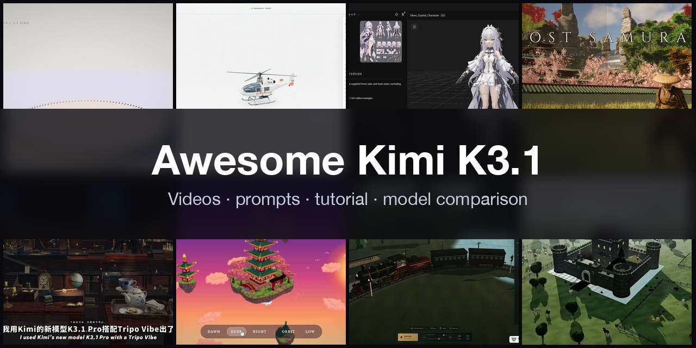](https://www.sandbase.ai/lab/ai-videos/kimi-k3-1?utm_source=github&utm_medium=readme&utm_campaign=awesome-kimi-k3-1&utm_content=banner)

A curated list of **Kimi K3.1 examples**: videos, prompts and demos made with Kimi K3.1 and Kimi K3.1 Pro, Moonshot AI's flagship open-weight multimodal reasoning model — first tested in Arena under the codename Kibitz, released in late October 2026. Interactive Three.js scenes, voxel worlds, browser games, motion graphics and an outsized number of head-to-head comparisons against Claude Opus 5.5 and other frontier models, most of them written as one self-contained HTML page from a prompt, each one credited to its creator and linked to the original post.

**302 videos** from **201 creators** · **60** with the creator's prompt · synced daily from [SandBase Lab](https://www.sandbase.ai/lab/ai-videos/kimi-k3-1?utm_source=github&utm_medium=readme&utm_campaign=awesome-kimi-k3-1&utm_content=stats)

## Start here

| I want to… | Go to |
|---|---|
| Watch the videos | [Browse by category](#contents) below, or [play them full-size on SandBase Lab](https://www.sandbase.ai/lab/ai-videos/kimi-k3-1?utm_source=github&utm_medium=readme&utm_campaign=awesome-kimi-k3-1&utm_content=quickstart) |
| Copy a prompt | [Prompt index](docs/prompts.md): every video that comes with its prompt |
| Write your own prompt | [Prompt guide](docs/prompt-guide.md): 7 patterns and a fill-in template |
| Make a video | [Tutorial](docs/tutorial.md): prompt → HTML → MP4, with the API, the CLI and a recording script |
| Pick a model | [Kimi K3.1 vs. Claude Opus 5.5, GPT-6 Astra and DeepSeek V4.1 Flash](docs/model-comparison.md) |
| Try it now | [Run Kimi K3.1 Pro in the Lab arena](https://www.sandbase.ai/lab/x/llm-arena?models=moonshotai%2Fkimi-k3.1-pro&utm_source=github&utm_medium=readme&utm_campaign=awesome-kimi-k3-1&utm_content=quickstart), next to other models |

<a id="contents"></a>

## Contents

- [Featured](#featured) (8)
- [3D scenes](#3d-scene) (86)
- [Motion graphics](#motion-graphics) (20)
- [Games](#game) (23)
- [Product UI](#ui-demo) (8)
- [Charts & diagrams](#data-viz) (1)
- [Explainers](#explainer) (6)
- [Launch films](#launch-film) (7)
- [Tests & comparisons](#comparison) (151)
- [Recreate a video with Kimi K3.1](#recreate)
- [FAQ](#faq)
- [Suggest a video](#contribute)

Click a preview to play the video. Click a title for the post, the prompt and **Recreate** on SandBase Lab. **@handle** links to the creator's post on X.

<a id="featured"></a>

## Featured

<table>
<tr><td width="33%" valign="top"><a href="https://www.sandbase.ai/lab/media/x/kimi-k3-1/2113611006039761281/video.mp4">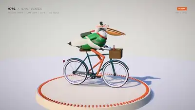</a><br><a href="https://www.sandbase.ai/lab/ai-videos/kimi-k3-1/2113611006039761281?utm_source=github&utm_medium=readme&utm_campaign=awesome-kimi-k3-1&utm_content=card"><b>Pelican riding a bicycle</b></a><br><sub><a href="https://x.com/chetaslua/status/2113611006039761281">@chetaslua</a> · 0:24</sub></td><td width="33%" valign="top"><a href="https://www.sandbase.ai/lab/media/x/kimi-k3-1/2113186973363929470/video.mp4">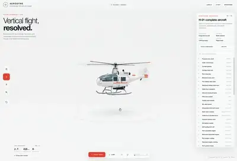</a><br><a href="https://www.sandbase.ai/lab/ai-videos/kimi-k3-1/2113186973363929470?utm_source=github&utm_medium=readme&utm_campaign=awesome-kimi-k3-1&utm_content=card"><b>Detailed 3D helicopter with exploded views</b></a><br><sub><a href="https://x.com/LuminaBench/status/2113186973363929470">@LuminaBench</a> · 1:10</sub></td><td width="33%" valign="top"><a href="https://www.sandbase.ai/lab/media/x/kimi-k3-1/2114028190050254878/video.mp4">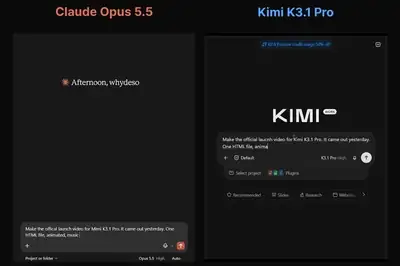</a><br><a href="https://www.sandbase.ai/lab/ai-videos/kimi-k3-1/2114028190050254878?utm_source=github&utm_medium=readme&utm_campaign=awesome-kimi-k3-1&utm_content=card"><b>AI launch video generated by Claude</b></a><br><sub><a href="https://x.com/whydeso/status/2114028190050254878">@whydeso</a> · 0:55</sub></td></tr>
<tr><td width="33%" valign="top"><a href="https://www.sandbase.ai/lab/media/x/kimi-k3-1/2113749533410955458/video.mp4">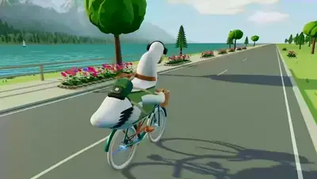</a><br><a href="https://www.sandbase.ai/lab/ai-videos/kimi-k3-1/2113749533410955458?utm_source=github&utm_medium=readme&utm_campaign=awesome-kimi-k3-1&utm_content=card"><b>Pelican riding a bicycle generation test</b></a><br><sub><a href="https://x.com/ChrisGPT/status/2113749533410955458">@ChrisGPT</a> · 0:15</sub></td><td width="33%" valign="top"><a href="https://www.sandbase.ai/lab/media/x/kimi-k3-1/2113919155149943093/video.mp4">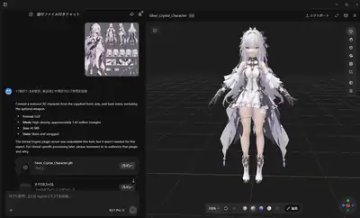</a><br><a href="https://www.sandbase.ai/lab/ai-videos/kimi-k3-1/2113919155149943093?utm_source=github&utm_medium=readme&utm_campaign=awesome-kimi-k3-1&utm_content=card"><b>Anime character 3D model generated from sheet</b></a><br><sub><a href="https://x.com/lucianlamp/status/2113919155149943093">@lucianlamp</a> · 0:22</sub></td><td width="33%" valign="top"><a href="https://www.sandbase.ai/lab/media/x/kimi-k3-1/2113694356939112498/video.mp4">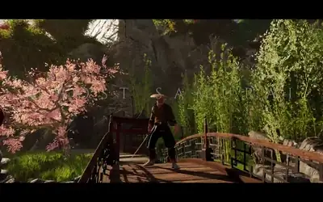</a><br><a href="https://www.sandbase.ai/lab/ai-videos/kimi-k3-1/2113694356939112498?utm_source=github&utm_medium=readme&utm_campaign=awesome-kimi-k3-1&utm_content=card"><b>A Ghost of Tsushima style browser game</b></a><br><sub><a href="https://x.com/thebuggeddev/status/2113694356939112498">@thebuggeddev</a> · 1:23</sub></td></tr>
<tr><td width="33%" valign="top"><a href="https://www.sandbase.ai/lab/media/x/kimi-k3-1/2113683399680700591/video.mp4">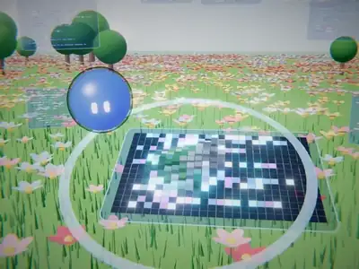</a><br><a href="https://www.sandbase.ai/lab/ai-videos/kimi-k3-1/2113683399680700591?utm_source=github&utm_medium=readme&utm_campaign=awesome-kimi-k3-1&utm_content=card"><b>Launch video generated using Three.js</b></a><br><sub><a href="https://x.com/Bhavani_00007/status/2113683399680700591">@Bhavani_00007</a> · 0:30</sub></td><td width="33%" valign="top"><a href="https://www.sandbase.ai/lab/media/x/kimi-k3-1/2114958387846971570/video.mp4">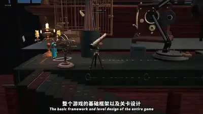</a><br><a href="https://www.sandbase.ai/lab/ai-videos/kimi-k3-1/2114958387846971570?utm_source=github&utm_medium=readme&utm_campaign=awesome-kimi-k3-1&utm_content=card"><b>3D game Tabletop developed with Three.js</b></a><br><sub><a href="https://x.com/xingbugengming/status/2114958387846971570">@xingbugengming</a> · 1:42</sub></td></tr>
</table>

<a id="3d-scene"></a>

## 3D scenes

<table>
<tr><td width="33%" valign="top"><a href="https://www.sandbase.ai/lab/media/x/kimi-k3-1/2113185478178447455/video.mp4">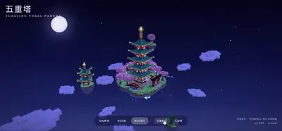</a><br><a href="https://www.sandbase.ai/lab/ai-videos/kimi-k3-1/2113185478178447455?utm_source=github&utm_medium=readme&utm_campaign=awesome-kimi-k3-1&utm_content=card"><b>Voxel pagoda rendered with Kimi K3.1</b></a><br><sub><a href="https://x.com/Mr_Salio/status/2113185478178447455">@Mr_Salio</a> · 0:28</sub></td><td width="33%" valign="top"><a href="https://www.sandbase.ai/lab/media/x/kimi-k3-1/2113186973363929470/video.mp4"></a><br><a href="https://www.sandbase.ai/lab/ai-videos/kimi-k3-1/2113186973363929470?utm_source=github&utm_medium=readme&utm_campaign=awesome-kimi-k3-1&utm_content=card"><b>Detailed 3D helicopter with exploded views</b></a><br><sub><a href="https://x.com/LuminaBench/status/2113186973363929470">@LuminaBench</a> · 1:10</sub></td><td width="33%" valign="top"><a href="https://www.sandbase.ai/lab/media/x/kimi-k3-1/2113218159603859914/video.mp4">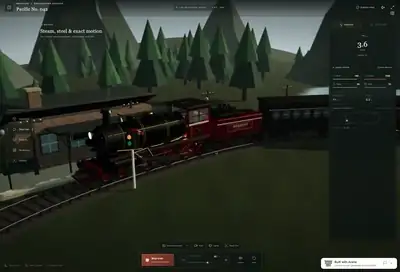</a><br><a href="https://www.sandbase.ai/lab/ai-videos/kimi-k3-1/2113218159603859914?utm_source=github&utm_medium=readme&utm_campaign=awesome-kimi-k3-1&utm_content=card"><b>Interactive 3D train with exploded views</b></a><br><sub><a href="https://x.com/LuminaBench/status/2113218159603859914">@LuminaBench</a> · 0:59</sub></td></tr>
<tr><td width="33%" valign="top"><a href="https://www.sandbase.ai/lab/media/x/kimi-k3-1/2113223010274697726/video.mp4">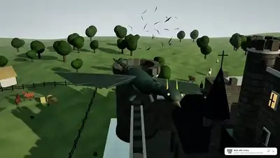</a><br><a href="https://www.sandbase.ai/lab/ai-videos/kimi-k3-1/2113223010274697726?utm_source=github&utm_medium=readme&utm_campaign=awesome-kimi-k3-1&utm_content=card"><b>Medieval castle scene with dragons and moat</b></a><br><sub><a href="https://x.com/karanC_12/status/2113223010274697726">@karanC_12</a> · 0:31</sub></td><td width="33%" valign="top"><a href="https://www.sandbase.ai/lab/media/x/kimi-k3-1/2113253316092448818/video.mp4">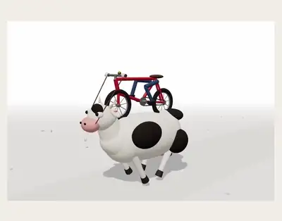</a><br><a href="https://www.sandbase.ai/lab/ai-videos/kimi-k3-1/2113253316092448818?utm_source=github&utm_medium=readme&utm_campaign=awesome-kimi-k3-1&utm_content=card"><b>A cow riding a cycle in Three.js</b></a><br><sub><a href="https://x.com/TimJayas/status/2113253316092448818">@TimJayas</a> · 0:50 · <a href="https://www.sandbase.ai/lab/ai-videos/kimi-k3-1/2113253316092448818?utm_source=github&utm_medium=readme&utm_campaign=awesome-kimi-k3-1&utm_content=card">prompt</a></sub></td><td width="33%" valign="top"><a href="https://www.sandbase.ai/lab/media/x/kimi-k3-1/2113258688756470183/video.mp4">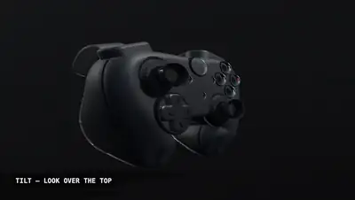</a><br><a href="https://www.sandbase.ai/lab/ai-videos/kimi-k3-1/2113258688756470183?utm_source=github&utm_medium=readme&utm_campaign=awesome-kimi-k3-1&utm_content=card"><b>Procedural 3D Xbox controller in HTML</b></a><br><sub><a href="https://x.com/CodeByNZ/status/2113258688756470183">@CodeByNZ</a> · 0:33</sub></td></tr>
</table>

<details>
<summary><b>Show all 86</b></summary>

<table>
<tr><td width="33%" valign="top"><a href="https://www.sandbase.ai/lab/media/x/kimi-k3-1/2113262900328710564/video.mp4">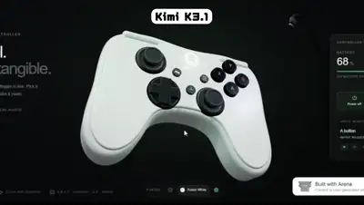</a><br><a href="https://www.sandbase.ai/lab/ai-videos/kimi-k3-1/2113262900328710564?utm_source=github&utm_medium=readme&utm_campaign=awesome-kimi-k3-1&utm_content=card"><b>Interactive 3D Xbox controller</b></a><br><sub><a href="https://x.com/karanC_12/status/2113262900328710564">@karanC_12</a> · 0:22</sub></td><td width="33%" valign="top"><a href="https://www.sandbase.ai/lab/media/x/kimi-k3-1/2113271273568792689/video.mp4">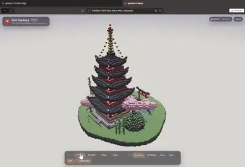</a><br><a href="https://www.sandbase.ai/lab/ai-videos/kimi-k3-1/2113271273568792689?utm_source=github&utm_medium=readme&utm_campaign=awesome-kimi-k3-1&utm_content=card"><b>Voxel pagoda architecture generated by Kimi-K3.1</b></a><br><sub><a href="https://x.com/ashawv5i/status/2113271273568792689">@ashawv5i</a> · 0:22</sub></td><td width="33%" valign="top"><a href="https://www.sandbase.ai/lab/media/x/kimi-k3-1/2113283390548164986/video.mp4">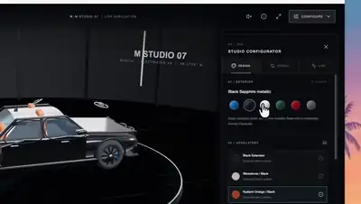</a><br><a href="https://www.sandbase.ai/lab/ai-videos/kimi-k3-1/2113283390548164986?utm_source=github&utm_medium=readme&utm_campaign=awesome-kimi-k3-1&utm_content=card"><b>3D BMW M5 configurator in Three.js</b></a><br><sub><a href="https://x.com/k2sbhai/status/2113283390548164986">@k2sbhai</a> · 0:50 · <a href="https://www.sandbase.ai/lab/ai-videos/kimi-k3-1/2113283390548164986?utm_source=github&utm_medium=readme&utm_campaign=awesome-kimi-k3-1&utm_content=card">prompt</a></sub></td></tr>
<tr><td width="33%" valign="top"><a href="https://www.sandbase.ai/lab/media/x/kimi-k3-1/2113283549319274888/video.mp4">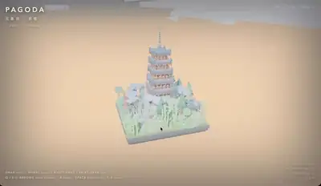</a><br><a href="https://www.sandbase.ai/lab/ai-videos/kimi-k3-1/2113283549319274888?utm_source=github&utm_medium=readme&utm_campaign=awesome-kimi-k3-1&utm_content=card"><b>Voxel pagoda generated by Kimi K3.1</b></a><br><sub><a href="https://x.com/CodeByNZ/status/2113283549319274888">@CodeByNZ</a> · 0:13</sub></td><td width="33%" valign="top"><a href="https://www.sandbase.ai/lab/media/x/kimi-k3-1/2113285555165581763/video.mp4">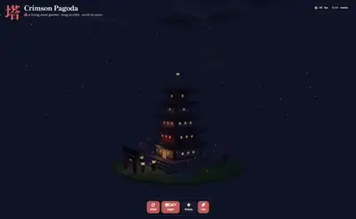</a><br><a href="https://www.sandbase.ai/lab/ai-videos/kimi-k3-1/2113285555165581763?utm_source=github&utm_medium=readme&utm_campaign=awesome-kimi-k3-1&utm_content=card"><b>Voxel pagoda architecture generated by Kimi K3.1</b></a><br><sub><a href="https://x.com/ashawv5i/status/2113285555165581763">@ashawv5i</a> · 0:37</sub></td><td width="33%" valign="top"><a href="https://www.sandbase.ai/lab/media/x/kimi-k3-1/2113287408699728207/video.mp4">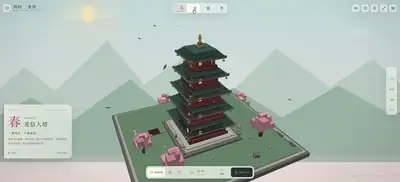</a><br><a href="https://www.sandbase.ai/lab/ai-videos/kimi-k3-1/2113287408699728207?utm_source=github&utm_medium=readme&utm_campaign=awesome-kimi-k3-1&utm_content=card"><b>3D pixel pagoda with four seasons views</b></a><br><sub><a href="https://x.com/leo114119/status/2113287408699728207">@leo114119</a> · 0:34</sub></td></tr>
<tr><td width="33%" valign="top"><a href="https://www.sandbase.ai/lab/media/x/kimi-k3-1/2113291375697682940/video.mp4">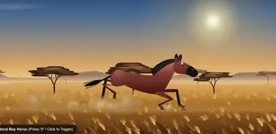</a><br><a href="https://www.sandbase.ai/lab/ai-videos/kimi-k3-1/2113291375697682940?utm_source=github&utm_medium=readme&utm_campaign=awesome-kimi-k3-1&utm_content=card"><b>A galloping horse generated in Three.js</b></a><br><sub><a href="https://x.com/AI_Screening/status/2113291375697682940">@AI_Screening</a> · 0:14</sub></td><td width="33%" valign="top"><a href="https://www.sandbase.ai/lab/media/x/kimi-k3-1/2113297716667371646/video.mp4">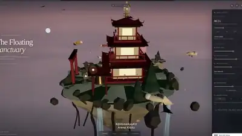</a><br><a href="https://www.sandbase.ai/lab/ai-videos/kimi-k3-1/2113297716667371646?utm_source=github&utm_medium=readme&utm_campaign=awesome-kimi-k3-1&utm_content=card"><b>Interactive floating pagoda island on Kibitz Arena</b></a><br><sub><a href="https://x.com/ItsmeAjayKV/status/2113297716667371646">@ItsmeAjayKV</a> · 0:32 · <a href="https://www.sandbase.ai/lab/ai-videos/kimi-k3-1/2113297716667371646?utm_source=github&utm_medium=readme&utm_campaign=awesome-kimi-k3-1&utm_content=card">prompt</a></sub></td><td width="33%" valign="top"><a href="https://www.sandbase.ai/lab/media/x/kimi-k3-1/2113302979046744220/video.mp4">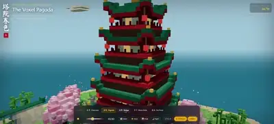</a><br><a href="https://www.sandbase.ai/lab/ai-videos/kimi-k3-1/2113302979046744220?utm_source=github&utm_medium=readme&utm_campaign=awesome-kimi-k3-1&utm_content=card"><b>A 3D voxel pagoda generated with lighting</b></a><br><sub><a href="https://x.com/leo114119/status/2113302979046744220">@leo114119</a> · 0:36</sub></td></tr>
<tr><td width="33%" valign="top"><a href="https://www.sandbase.ai/lab/media/x/kimi-k3-1/2113323680940130668/video.mp4">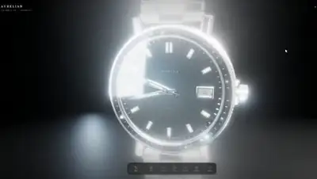</a><br><a href="https://www.sandbase.ai/lab/ai-videos/kimi-k3-1/2113323680940130668?utm_source=github&utm_medium=readme&utm_campaign=awesome-kimi-k3-1&utm_content=card"><b>Realistic 3D models in Three.js</b></a><br><sub><a href="https://x.com/ash_twtz/status/2113323680940130668">@ash_twtz</a> · 0:11</sub></td><td width="33%" valign="top"><a href="https://www.sandbase.ai/lab/media/x/kimi-k3-1/2113341964297064753/video.mp4">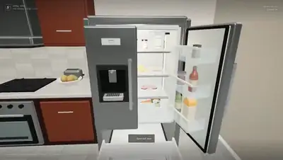</a><br><a href="https://www.sandbase.ai/lab/ai-videos/kimi-k3-1/2113341964297064753?utm_source=github&utm_medium=readme&utm_campaign=awesome-kimi-k3-1&utm_content=card"><b>Interactive 3D dining room with refrigerator</b></a><br><sub><a href="https://x.com/notjazii/status/2113341964297064753">@notjazii</a> · 0:58 · <a href="https://www.sandbase.ai/lab/ai-videos/kimi-k3-1/2113341964297064753?utm_source=github&utm_medium=readme&utm_campaign=awesome-kimi-k3-1&utm_content=card">prompt</a></sub></td><td width="33%" valign="top"><a href="https://www.sandbase.ai/lab/media/x/kimi-k3-1/2113349968295788751/video.mp4">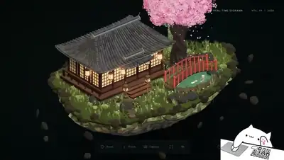</a><br><a href="https://www.sandbase.ai/lab/ai-videos/kimi-k3-1/2113349968295788751?utm_source=github&utm_medium=readme&utm_campaign=awesome-kimi-k3-1&utm_content=card"><b>3D game asset generated in arena</b></a><br><sub><a href="https://x.com/notjazii/status/2113349968295788751">@notjazii</a> · 0:28</sub></td></tr>
<tr><td width="33%" valign="top"><a href="https://www.sandbase.ai/lab/media/x/kimi-k3-1/2113400747631296635/video.mp4">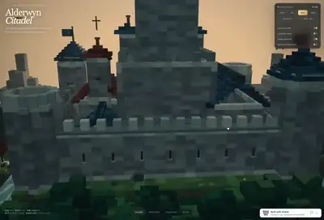</a><br><a href="https://www.sandbase.ai/lab/ai-videos/kimi-k3-1/2113400747631296635?utm_source=github&utm_medium=readme&utm_campaign=awesome-kimi-k3-1&utm_content=card"><b>Medieval voxel castle created with Kimi K3.1</b></a><br><sub><a href="https://x.com/FabianoFirmo/status/2113400747631296635">@FabianoFirmo</a> · 0:42</sub></td><td width="33%" valign="top"><a href="https://www.sandbase.ai/lab/media/x/kimi-k3-1/2113458401309020202/video.mp4">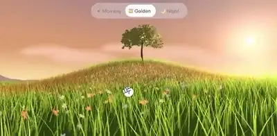</a><br><a href="https://www.sandbase.ai/lab/ai-videos/kimi-k3-1/2113458401309020202?utm_source=github&utm_medium=readme&utm_campaign=awesome-kimi-k3-1&utm_content=card"><b>Three.js reverse engineering demo</b></a><br><sub><a href="https://x.com/ChrisGPT/status/2113458401309020202">@ChrisGPT</a> · 0:14</sub></td><td width="33%" valign="top"><a href="https://www.sandbase.ai/lab/media/x/kimi-k3-1/2113636782311145846/video.mp4">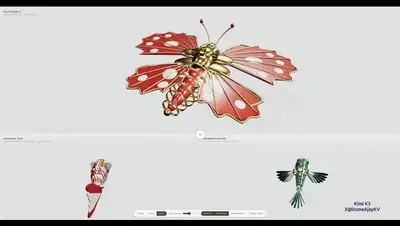</a><br><a href="https://www.sandbase.ai/lab/ai-videos/kimi-k3-1/2113636782311145846?utm_source=github&utm_medium=readme&utm_campaign=awesome-kimi-k3-1&utm_content=card"><b>Building 3D models using Three.js</b></a><br><sub><a href="https://x.com/ItsmeAjayKV/status/2113636782311145846">@ItsmeAjayKV</a> · 1:29</sub></td></tr>
<tr><td width="33%" valign="top"><a href="https://www.sandbase.ai/lab/media/x/kimi-k3-1/2113671138291376391/video.mp4">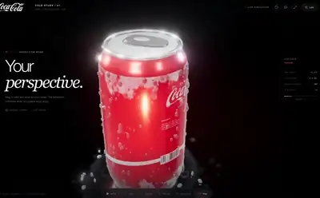</a><br><a href="https://www.sandbase.ai/lab/ai-videos/kimi-k3-1/2113671138291376391?utm_source=github&utm_medium=readme&utm_campaign=awesome-kimi-k3-1&utm_content=card"><b>Coca-Cola render with 3D water droplets</b></a><br><sub><a href="https://x.com/laopai1990/status/2113671138291376391">@laopai1990</a> · 0:27</sub></td><td width="33%" valign="top"><a href="https://www.sandbase.ai/lab/media/x/kimi-k3-1/2113671744011763942/video.mp4">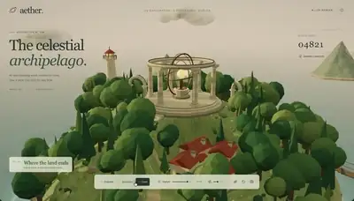</a><br><a href="https://www.sandbase.ai/lab/ai-videos/kimi-k3-1/2113671744011763942?utm_source=github&utm_medium=readme&utm_campaign=awesome-kimi-k3-1&utm_content=card"><b>Procedural 3D scene and cloth simulation test</b></a><br><sub><a href="https://x.com/Kmno4Z62942/status/2113671744011763942">@Kmno4Z62942</a> · 0:37 · <a href="https://www.sandbase.ai/lab/ai-videos/kimi-k3-1/2113671744011763942?utm_source=github&utm_medium=readme&utm_campaign=awesome-kimi-k3-1&utm_content=card">prompt</a></sub></td><td width="33%" valign="top"><a href="https://www.sandbase.ai/lab/media/x/kimi-k3-1/2113677973232681425/video.mp4">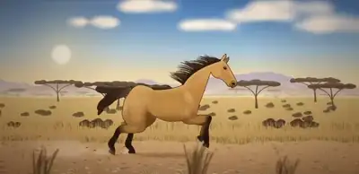</a><br><a href="https://www.sandbase.ai/lab/ai-videos/kimi-k3-1/2113677973232681425?utm_source=github&utm_medium=readme&utm_campaign=awesome-kimi-k3-1&utm_content=card"><b>A galloping horse in Three.js</b></a><br><sub><a href="https://x.com/AI_Screening/status/2113677973232681425">@AI_Screening</a> · 0:16</sub></td></tr>
<tr><td width="33%" valign="top"><a href="https://www.sandbase.ai/lab/media/x/kimi-k3-1/2113684128734625948/video.mp4">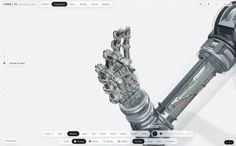</a><br><a href="https://www.sandbase.ai/lab/ai-videos/kimi-k3-1/2113684128734625948?utm_source=github&utm_medium=readme&utm_campaign=awesome-kimi-k3-1&utm_content=card"><b>Interactive 3D robotic hand disassembled into pieces</b></a><br><sub><a href="https://x.com/crystalsssup/status/2113684128734625948">@crystalsssup</a> · 0:09</sub></td><td width="33%" valign="top"><a href="https://www.sandbase.ai/lab/media/x/kimi-k3-1/2113691197189525853/video.mp4">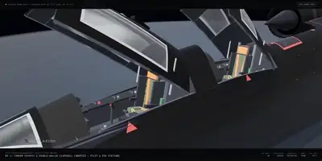</a><br><a href="https://www.sandbase.ai/lab/ai-videos/kimi-k3-1/2113691197189525853?utm_source=github&utm_medium=readme&utm_campaign=awesome-kimi-k3-1&utm_content=card"><b>An SR-71 Blackbird in Three.js</b></a><br><sub><a href="https://x.com/ai_for_success/status/2113691197189525853">@ai_for_success</a> · 1:03</sub></td><td width="33%" valign="top"><a href="https://www.sandbase.ai/lab/media/x/kimi-k3-1/2113695890468962495/video.mp4"></a><br><a href="https://www.sandbase.ai/lab/ai-videos/kimi-k3-1/2113695890468962495?utm_source=github&utm_medium=readme&utm_campaign=awesome-kimi-k3-1&utm_content=card"><b>A palace above the clouds in Unreal Engine</b></a><br><sub><a href="https://x.com/karankendre/status/2113695890468962495">@karankendre</a> · 0:41</sub></td></tr>
<tr><td width="33%" valign="top"><a href="https://www.sandbase.ai/lab/media/x/kimi-k3-1/2113695913617305805/video.mp4">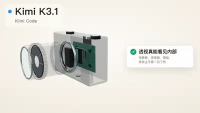</a><br><a href="https://www.sandbase.ai/lab/ai-videos/kimi-k3-1/2113695913617305805?utm_source=github&utm_medium=readme&utm_campaign=awesome-kimi-k3-1&utm_content=card"><b>3D generation benchmark with Kimi K3.1 Pro</b></a><br><sub><a href="https://x.com/bourneliu66/status/2113695913617305805">@bourneliu66</a> · 1:44</sub></td><td width="33%" valign="top"><a href="https://www.sandbase.ai/lab/media/x/kimi-k3-1/2113697560103952826/video.mp4">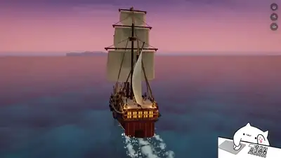</a><br><a href="https://www.sandbase.ai/lab/ai-videos/kimi-k3-1/2113697560103952826?utm_source=github&utm_medium=readme&utm_campaign=awesome-kimi-k3-1&utm_content=card"><b>3D ship modeled in a single shot</b></a><br><sub><a href="https://x.com/notjazii/status/2113697560103952826">@notjazii</a> · 0:24</sub></td><td width="33%" valign="top"><a href="https://www.sandbase.ai/lab/media/x/kimi-k3-1/2113698280991580577/video.mp4">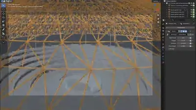</a><br><a href="https://www.sandbase.ai/lab/ai-videos/kimi-k3-1/2113698280991580577?utm_source=github&utm_medium=readme&utm_campaign=awesome-kimi-k3-1&utm_content=card"><b>Singapore Changi Airport 3D model in Blender</b></a><br><sub><a href="https://x.com/crystalsssup/status/2113698280991580577">@crystalsssup</a> · 0:20</sub></td></tr>
<tr><td width="33%" valign="top"><a href="https://www.sandbase.ai/lab/media/x/kimi-k3-1/2113707002249552134/video.mp4">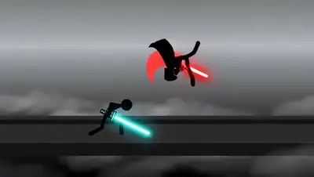</a><br><a href="https://www.sandbase.ai/lab/ai-videos/kimi-k3-1/2113707002249552134?utm_source=github&utm_medium=readme&utm_campaign=awesome-kimi-k3-1&utm_content=card"><b>Stickman Fight Video and 3D Lowpoly Link</b></a><br><sub><a href="https://x.com/DanielZambrini/status/2113707002249552134">@DanielZambrini</a> · 0:15</sub></td><td width="33%" valign="top"><a href="https://www.sandbase.ai/lab/media/x/kimi-k3-1/2113710105871139120/video.mp4">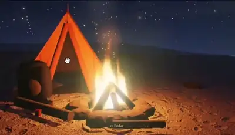</a><br><a href="https://www.sandbase.ai/lab/ai-videos/kimi-k3-1/2113710105871139120?utm_source=github&utm_medium=readme&utm_campaign=awesome-kimi-k3-1&utm_content=card"><b>A 3D Camping Scene with Fire and Shadows</b></a><br><sub><a href="https://x.com/ashawv5i/status/2113710105871139120">@ashawv5i</a> · 0:47</sub></td><td width="33%" valign="top"><a href="https://www.sandbase.ai/lab/media/x/kimi-k3-1/2113715077795008531/video.mp4">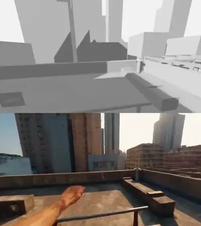</a><br><a href="https://www.sandbase.ai/lab/ai-videos/kimi-k3-1/2113715077795008531?utm_source=github&utm_medium=readme&utm_campaign=awesome-kimi-k3-1&utm_content=card"><b>3D scene generated and rendered in Blender</b></a><br><sub><a href="https://x.com/mattknowsai/status/2113715077795008531">@mattknowsai</a> · 0:22</sub></td></tr>
<tr><td width="33%" valign="top"><a href="https://www.sandbase.ai/lab/media/x/kimi-k3-1/2113721825309945895/video.mp4">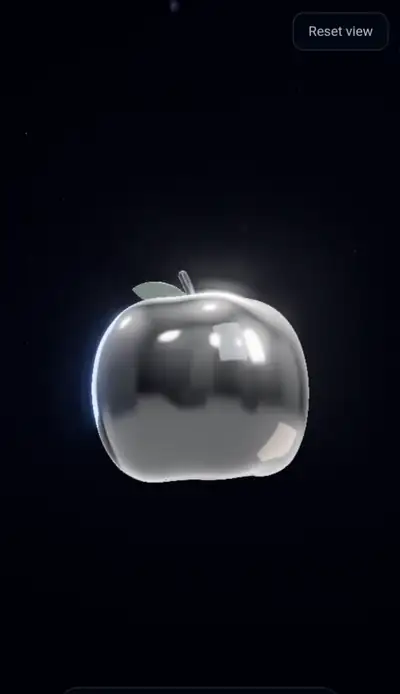</a><br><a href="https://www.sandbase.ai/lab/ai-videos/kimi-k3-1/2113721825309945895?utm_source=github&utm_medium=readme&utm_campaign=awesome-kimi-k3-1&utm_content=card"><b>A 3D glass apple floating in space</b></a><br><sub><a href="https://x.com/Lyelac_/status/2113721825309945895">@Lyelac_</a> · 0:30</sub></td><td width="33%" valign="top"><a href="https://www.sandbase.ai/lab/media/x/kimi-k3-1/2113724051332194589/video.mp4">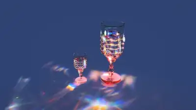</a><br><a href="https://www.sandbase.ai/lab/ai-videos/kimi-k3-1/2113724051332194589?utm_source=github&utm_medium=readme&utm_campaign=awesome-kimi-k3-1&utm_content=card"><b>Three.js 3D scene built with shaders</b></a><br><sub><a href="https://x.com/liambraus/status/2113724051332194589">@liambraus</a> · 0:22</sub></td><td width="33%" valign="top"><a href="https://www.sandbase.ai/lab/media/x/kimi-k3-1/2113725753489756521/video.mp4">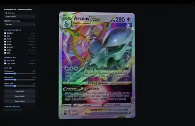</a><br><a href="https://www.sandbase.ai/lab/ai-videos/kimi-k3-1/2113725753489756521?utm_source=github&utm_medium=readme&utm_campaign=awesome-kimi-k3-1&utm_content=card"><b>Holographic Pokémon card shader in Three.js</b></a><br><sub><a href="https://x.com/slash1sol/status/2113725753489756521">@slash1sol</a> · 0:25</sub></td></tr>
<tr><td width="33%" valign="top"><a href="https://www.sandbase.ai/lab/media/x/kimi-k3-1/2113727019771179401/video.mp4">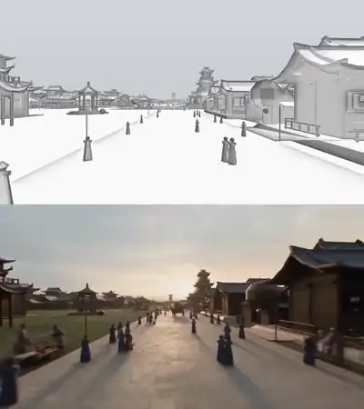</a><br><a href="https://www.sandbase.ai/lab/ai-videos/kimi-k3-1/2113727019771179401?utm_source=github&utm_medium=readme&utm_campaign=awesome-kimi-k3-1&utm_content=card"><b>Clay renders created in Blender</b></a><br><sub><a href="https://x.com/ChrisGPT/status/2113727019771179401">@ChrisGPT</a> · 1:05</sub></td><td width="33%" valign="top"><a href="https://www.sandbase.ai/lab/media/x/kimi-k3-1/2113729972754116779/video.mp4">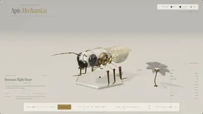</a><br><a href="https://www.sandbase.ai/lab/ai-videos/kimi-k3-1/2113729972754116779?utm_source=github&utm_medium=readme&utm_campaign=awesome-kimi-k3-1&utm_content=card"><b>Mechanical bee created in 3D</b></a><br><sub><a href="https://x.com/thtbee_/status/2113729972754116779">@thtbee_</a> · 0:29</sub></td><td width="33%" valign="top"><a href="https://www.sandbase.ai/lab/media/x/kimi-k3-1/2113746017023602833/video.mp4">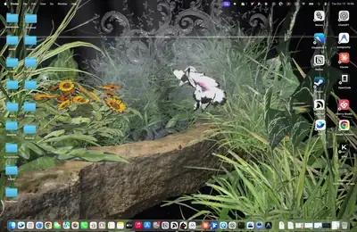</a><br><a href="https://www.sandbase.ai/lab/ai-videos/kimi-k3-1/2113746017023602833?utm_source=github&utm_medium=readme&utm_campaign=awesome-kimi-k3-1&utm_content=card"><b>Houdini scene created by Kimi K3.1</b></a><br><sub><a href="https://x.com/bernirov/status/2113746017023602833">@bernirov</a> · 0:15</sub></td></tr>
<tr><td width="33%" valign="top"><a href="https://www.sandbase.ai/lab/media/x/kimi-k3-1/2113754577258352699/video.mp4">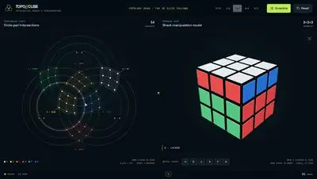</a><br><a href="https://www.sandbase.ai/lab/ai-videos/kimi-k3-1/2113754577258352699?utm_source=github&utm_medium=readme&utm_campaign=awesome-kimi-k3-1&utm_content=card"><b>Interactive Rubik&#x27;s cube with synchronized 3D views</b></a><br><sub><a href="https://x.com/eandualem/status/2113754577258352699">@eandualem</a> · 0:20</sub></td><td width="33%" valign="top"><a href="https://www.sandbase.ai/lab/media/x/kimi-k3-1/2113785039158669347/video.mp4">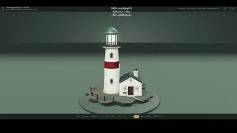</a><br><a href="https://www.sandbase.ai/lab/ai-videos/kimi-k3-1/2113785039158669347?utm_source=github&utm_medium=readme&utm_campaign=awesome-kimi-k3-1&utm_content=card"><b>Procedural 3D lighthouse in Three.js</b></a><br><sub><a href="https://x.com/ItsmeAjayKV/status/2113785039158669347">@ItsmeAjayKV</a> · 1:23</sub></td><td width="33%" valign="top"><a href="https://www.sandbase.ai/lab/media/x/kimi-k3-1/2113808946884657487/video.mp4"></a><br><a href="https://www.sandbase.ai/lab/ai-videos/kimi-k3-1/2113808946884657487?utm_source=github&utm_medium=readme&utm_campaign=awesome-kimi-k3-1&utm_content=card"><b>A 3D robotic hand that pulls apart</b></a><br><sub><a href="https://x.com/RoundtableSpace/status/2113808946884657487">@RoundtableSpace</a> · 0:09</sub></td></tr>
<tr><td width="33%" valign="top"><a href="https://www.sandbase.ai/lab/media/x/kimi-k3-1/2113882041444094366/video.mp4">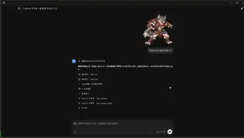</a><br><a href="https://www.sandbase.ai/lab/ai-videos/kimi-k3-1/2113882041444094366?utm_source=github&utm_medium=readme&utm_campaign=awesome-kimi-k3-1&utm_content=card"><b>3D character model generated from an image</b></a><br><sub><a href="https://x.com/lucianlamp/status/2113882041444094366">@lucianlamp</a> · 1:02</sub></td><td width="33%" valign="top"><a href="https://www.sandbase.ai/lab/media/x/kimi-k3-1/2113919155149943093/video.mp4"></a><br><a href="https://www.sandbase.ai/lab/ai-videos/kimi-k3-1/2113919155149943093?utm_source=github&utm_medium=readme&utm_campaign=awesome-kimi-k3-1&utm_content=card"><b>Anime character 3D model generated from sheet</b></a><br><sub><a href="https://x.com/lucianlamp/status/2113919155149943093">@lucianlamp</a> · 0:22</sub></td><td width="33%" valign="top"><a href="https://www.sandbase.ai/lab/media/x/kimi-k3-1/2113920708325622178/video.mp4">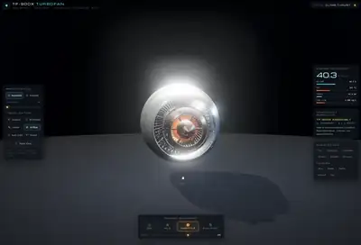</a><br><a href="https://www.sandbase.ai/lab/ai-videos/kimi-k3-1/2113920708325622178?utm_source=github&utm_medium=readme&utm_campaign=awesome-kimi-k3-1&utm_content=card"><b>3D jet engine physics simulation</b></a><br><sub><a href="https://x.com/LuminaBench/status/2113920708325622178">@LuminaBench</a> · 0:55</sub></td></tr>
<tr><td width="33%" valign="top"><a href="https://www.sandbase.ai/lab/media/x/kimi-k3-1/2113933579747209626/video.mp4"></a><br><a href="https://www.sandbase.ai/lab/ai-videos/kimi-k3-1/2113933579747209626?utm_source=github&utm_medium=readme&utm_campaign=awesome-kimi-k3-1&utm_content=card"><b>Single image converted to 360 rotating 3D model</b></a><br><sub><a href="https://x.com/ojigineko_tips/status/2113933579747209626">@ojigineko_tips</a> · 0:08 · <a href="https://www.sandbase.ai/lab/ai-videos/kimi-k3-1/2113933579747209626?utm_source=github&utm_medium=readme&utm_campaign=awesome-kimi-k3-1&utm_content=card">prompt</a></sub></td><td width="33%" valign="top"><a href="https://www.sandbase.ai/lab/media/x/kimi-k3-1/2113983948208451941/video.mp4"></a><br><a href="https://www.sandbase.ai/lab/ai-videos/kimi-k3-1/2113983948208451941?utm_source=github&utm_medium=readme&utm_campaign=awesome-kimi-k3-1&utm_content=card"><b>Interactive exploded view of a robotic hand</b></a><br><sub><a href="https://x.com/Jomolos/status/2113983948208451941">@Jomolos</a> · 0:09</sub></td><td width="33%" valign="top"><a href="https://www.sandbase.ai/lab/media/x/kimi-k3-1/2113991534693773817/video.mp4"></a><br><a href="https://www.sandbase.ai/lab/ai-videos/kimi-k3-1/2113991534693773817?utm_source=github&utm_medium=readme&utm_campaign=awesome-kimi-k3-1&utm_content=card"><b>Blender fidget spinner designed for 3D printing</b></a><br><sub><a href="https://x.com/_MaxBlade/status/2113991534693773817">@_MaxBlade</a> · 0:58</sub></td></tr>
<tr><td width="33%" valign="top"><a href="https://www.sandbase.ai/lab/media/x/kimi-k3-1/2114000732697555300/video.mp4"></a><br><a href="https://www.sandbase.ai/lab/ai-videos/kimi-k3-1/2114000732697555300?utm_source=github&utm_medium=readme&utm_campaign=awesome-kimi-k3-1&utm_content=card"><b>Procedural cyclist animation in Three.js</b></a><br><sub><a href="https://x.com/AI_Screening/status/2114000732697555300">@AI_Screening</a> · 0:13</sub></td><td width="33%" valign="top"><a href="https://www.sandbase.ai/lab/media/x/kimi-k3-1/2114000772145074321/video.mp4"></a><br><a href="https://www.sandbase.ai/lab/ai-videos/kimi-k3-1/2114000772145074321?utm_source=github&utm_medium=readme&utm_campaign=awesome-kimi-k3-1&utm_content=card"><b>Backrooms Level Fun found footage video</b></a><br><sub><a href="https://x.com/K1sqttPHfC41982/status/2114000772145074321">@K1sqttPHfC41982</a> · 3:20</sub></td><td width="33%" valign="top"><a href="https://www.sandbase.ai/lab/media/x/kimi-k3-1/2114003834393723033/video.mp4"></a><br><a href="https://www.sandbase.ai/lab/ai-videos/kimi-k3-1/2114003834393723033?utm_source=github&utm_medium=readme&utm_campaign=awesome-kimi-k3-1&utm_content=card"><b>A 3D scene with water ice and lighting</b></a><br><sub><a href="https://x.com/samiirr_0/status/2114003834393723033">@samiirr_0</a> · 0:11</sub></td></tr>
<tr><td width="33%" valign="top"><a href="https://www.sandbase.ai/lab/media/x/kimi-k3-1/2114014134480372210/video.mp4"></a><br><a href="https://www.sandbase.ai/lab/ai-videos/kimi-k3-1/2114014134480372210?utm_source=github&utm_medium=readme&utm_campaign=awesome-kimi-k3-1&utm_content=card"><b>Procedural 3D model generated with bpy</b></a><br><sub><a href="https://x.com/thebuggeddev/status/2114014134480372210">@thebuggeddev</a> · 0:33</sub></td><td width="33%" valign="top"><a href="https://www.sandbase.ai/lab/media/x/kimi-k3-1/2114021863605322191/video.mp4"></a><br><a href="https://www.sandbase.ai/lab/ai-videos/kimi-k3-1/2114021863605322191?utm_source=github&utm_medium=readme&utm_campaign=awesome-kimi-k3-1&utm_content=card"><b>3D Kintsugi vase reassembling with golden cracks</b></a><br><sub><a href="https://x.com/pankajkumar_dev/status/2114021863605322191">@pankajkumar_dev</a> · 0:59</sub></td><td width="33%" valign="top"><a href="https://www.sandbase.ai/lab/media/x/kimi-k3-1/2114064765731721480/video.mp4"></a><br><a href="https://www.sandbase.ai/lab/ai-videos/kimi-k3-1/2114064765731721480?utm_source=github&utm_medium=readme&utm_campaign=awesome-kimi-k3-1&utm_content=card"><b>F1 car inside a virtual wind tunnel</b></a><br><sub><a href="https://x.com/ka1manov/status/2114064765731721480">@ka1manov</a> · 0:15</sub></td></tr>
<tr><td width="33%" valign="top"><a href="https://www.sandbase.ai/lab/media/x/kimi-k3-1/2114136102399607204/video.mp4"></a><br><a href="https://www.sandbase.ai/lab/ai-videos/kimi-k3-1/2114136102399607204?utm_source=github&utm_medium=readme&utm_campaign=awesome-kimi-k3-1&utm_content=card"><b>A Three.js snow globe with falling snowflakes</b></a><br><sub><a href="https://x.com/wikiwayne/status/2114136102399607204">@wikiwayne</a> · 0:29</sub></td><td width="33%" valign="top"><a href="https://www.sandbase.ai/lab/media/x/kimi-k3-1/2114165913578778832/video.mp4"></a><br><a href="https://www.sandbase.ai/lab/ai-videos/kimi-k3-1/2114165913578778832?utm_source=github&utm_medium=readme&utm_campaign=awesome-kimi-k3-1&utm_content=card"><b>Weapon rigging and swing animation test</b></a><br><sub><a href="https://x.com/atomtanstudio/status/2114165913578778832">@atomtanstudio</a> · 1:01</sub></td><td width="33%" valign="top"><a href="https://www.sandbase.ai/lab/media/x/kimi-k3-1/2114200775060799504/video.mp4"></a><br><a href="https://www.sandbase.ai/lab/ai-videos/kimi-k3-1/2114200775060799504?utm_source=github&utm_medium=readme&utm_campaign=awesome-kimi-k3-1&utm_content=card"><b>Testing 3D scene generation in Kimi K3.1 Pro</b></a><br><sub><a href="https://x.com/FiniYang/status/2114200775060799504">@FiniYang</a> · 0:32</sub></td></tr>
<tr><td width="33%" valign="top"><a href="https://www.sandbase.ai/lab/media/x/kimi-k3-1/2114225941371384239/video.mp4"></a><br><a href="https://www.sandbase.ai/lab/ai-videos/kimi-k3-1/2114225941371384239?utm_source=github&utm_medium=readme&utm_campaign=awesome-kimi-k3-1&utm_content=card"><b>Interactive 3D V8 engine with exploded view</b></a><br><sub><a href="https://x.com/SahilExec/status/2114225941371384239">@SahilExec</a> · 0:40</sub></td><td width="33%" valign="top"><a href="https://www.sandbase.ai/lab/media/x/kimi-k3-1/2114238010527285500/video.mp4"></a><br><a href="https://www.sandbase.ai/lab/ai-videos/kimi-k3-1/2114238010527285500?utm_source=github&utm_medium=readme&utm_campaign=awesome-kimi-k3-1&utm_content=card"><b>3D generation test with Kimi K3.1 Pro</b></a><br><sub><a href="https://x.com/HelloVyom/status/2114238010527285500">@HelloVyom</a> · 0:11</sub></td><td width="33%" valign="top"><a href="https://www.sandbase.ai/lab/media/x/kimi-k3-1/2114295910138322988/video.mp4"></a><br><a href="https://www.sandbase.ai/lab/ai-videos/kimi-k3-1/2114295910138322988?utm_source=github&utm_medium=readme&utm_campaign=awesome-kimi-k3-1&utm_content=card"><b>Voxel Mont Saint Michel created with Hermes Agent</b></a><br><sub><a href="https://x.com/witcheer/status/2114295910138322988">@witcheer</a> · 0:31</sub></td></tr>
<tr><td width="33%" valign="top"><a href="https://www.sandbase.ai/lab/media/x/kimi-k3-1/2114311773637734432/video.mp4"></a><br><a href="https://www.sandbase.ai/lab/ai-videos/kimi-k3-1/2114311773637734432?utm_source=github&utm_medium=readme&utm_campaign=awesome-kimi-k3-1&utm_content=card"><b>Bedroom reconstructed in Three.js from two photos</b></a><br><sub><a href="https://x.com/Kmno4Z62942/status/2114311773637734432">@Kmno4Z62942</a> · 0:40</sub></td><td width="33%" valign="top"><a href="https://www.sandbase.ai/lab/media/x/kimi-k3-1/2114350929319182656/video.mp4"></a><br><a href="https://www.sandbase.ai/lab/ai-videos/kimi-k3-1/2114350929319182656?utm_source=github&utm_medium=readme&utm_campaign=awesome-kimi-k3-1&utm_content=card"><b>3D Rolex Submariner cutaway and dive animation</b></a><br><sub><a href="https://x.com/0xKitsui/status/2114350929319182656">@0xKitsui</a> · 0:34</sub></td><td width="33%" valign="top"><a href="https://www.sandbase.ai/lab/media/x/kimi-k3-1/2114351357561864673/video.mp4"></a><br><a href="https://www.sandbase.ai/lab/ai-videos/kimi-k3-1/2114351357561864673?utm_source=github&utm_medium=readme&utm_campaign=awesome-kimi-k3-1&utm_content=card"><b>Massive medieval voxel world in Qwen 4</b></a><br><sub><a href="https://x.com/marcthecreatorr/status/2114351357561864673">@marcthecreatorr</a> · 0:43</sub></td></tr>
<tr><td width="33%" valign="top"><a href="https://www.sandbase.ai/lab/media/x/kimi-k3-1/2114357069449253198/video.mp4"></a><br><a href="https://www.sandbase.ai/lab/ai-videos/kimi-k3-1/2114357069449253198?utm_source=github&utm_medium=readme&utm_campaign=awesome-kimi-k3-1&utm_content=card"><b>Naruto at Ichiraku Ramen in Three.js</b></a><br><sub><a href="https://x.com/vipinxtwt/status/2114357069449253198">@vipinxtwt</a> · 1:28</sub></td><td width="33%" valign="top"><a href="https://www.sandbase.ai/lab/media/x/kimi-k3-1/2114646562018398492/video.mp4"></a><br><a href="https://www.sandbase.ai/lab/ai-videos/kimi-k3-1/2114646562018398492?utm_source=github&utm_medium=readme&utm_campaign=awesome-kimi-k3-1&utm_content=card"><b>3D visual of a turbo engine</b></a><br><sub><a href="https://x.com/ITangieff/status/2114646562018398492">@ITangieff</a> · 0:27</sub></td><td width="33%" valign="top"><a href="https://www.sandbase.ai/lab/media/x/kimi-k3-1/2114705736903307703/video.mp4"></a><br><a href="https://www.sandbase.ai/lab/ai-videos/kimi-k3-1/2114705736903307703?utm_source=github&utm_medium=readme&utm_campaign=awesome-kimi-k3-1&utm_content=card"><b>Interactive 3D human brain anatomy explorer</b></a><br><sub><a href="https://x.com/sakatayasha/status/2114705736903307703">@sakatayasha</a> · 0:25 · <a href="https://www.sandbase.ai/lab/ai-videos/kimi-k3-1/2114705736903307703?utm_source=github&utm_medium=readme&utm_campaign=awesome-kimi-k3-1&utm_content=card">prompt</a></sub></td></tr>
<tr><td width="33%" valign="top"><a href="https://www.sandbase.ai/lab/media/x/kimi-k3-1/2114718771566784541/video.mp4"></a><br><a href="https://www.sandbase.ai/lab/ai-videos/kimi-k3-1/2114718771566784541?utm_source=github&utm_medium=readme&utm_campaign=awesome-kimi-k3-1&utm_content=card"><b>3D chameleon duel concept comparison</b></a><br><sub><a href="https://x.com/Acoramaa/status/2114718771566784541">@Acoramaa</a> · 0:18</sub></td><td width="33%" valign="top"><a href="https://www.sandbase.ai/lab/media/x/kimi-k3-1/2114750666736644321/video.mp4"></a><br><a href="https://www.sandbase.ai/lab/ai-videos/kimi-k3-1/2114750666736644321?utm_source=github&utm_medium=readme&utm_campaign=awesome-kimi-k3-1&utm_content=card"><b>Pixel volcano eruption in Three.js</b></a><br><sub><a href="https://x.com/xueyu1125/status/2114750666736644321">@xueyu1125</a> · 0:24 · <a href="https://www.sandbase.ai/lab/ai-videos/kimi-k3-1/2114750666736644321?utm_source=github&utm_medium=readme&utm_campaign=awesome-kimi-k3-1&utm_content=card">prompt</a></sub></td><td width="33%" valign="top"><a href="https://www.sandbase.ai/lab/media/x/kimi-k3-1/2114911755147293117/video.mp4"></a><br><a href="https://www.sandbase.ai/lab/ai-videos/kimi-k3-1/2114911755147293117?utm_source=github&utm_medium=readme&utm_campaign=awesome-kimi-k3-1&utm_content=card"><b>3D modeling and animation test of a motorcycle</b></a><br><sub><a href="https://x.com/thebuggeddev/status/2114911755147293117">@thebuggeddev</a> · 0:37</sub></td></tr>
<tr><td width="33%" valign="top"><a href="https://www.sandbase.ai/lab/media/x/kimi-k3-1/2115025044346696034/video.mp4"></a><br><a href="https://www.sandbase.ai/lab/ai-videos/kimi-k3-1/2115025044346696034?utm_source=github&utm_medium=readme&utm_campaign=awesome-kimi-k3-1&utm_content=card"><b>Interactive 3D machine visualising Spring Boot order requests</b></a><br><sub><a href="https://x.com/your_javaguy/status/2115025044346696034">@your_javaguy</a> · 3:55</sub></td><td width="33%" valign="top"><a href="https://www.sandbase.ai/lab/media/x/kimi-k3-1/2115076399895826533/video.mp4"></a><br><a href="https://www.sandbase.ai/lab/ai-videos/kimi-k3-1/2115076399895826533?utm_source=github&utm_medium=readme&utm_campaign=awesome-kimi-k3-1&utm_content=card"><b>Interactive procedural 3D scene walkthrough in Three.js</b></a><br><sub><a href="https://x.com/shitunote/status/2115076399895826533">@shitunote</a> · 1:11 · <a href="https://www.sandbase.ai/lab/ai-videos/kimi-k3-1/2115076399895826533?utm_source=github&utm_medium=readme&utm_campaign=awesome-kimi-k3-1&utm_content=card">prompt</a></sub></td><td width="33%" valign="top"><a href="https://www.sandbase.ai/lab/media/x/kimi-k3-1/2115100357965893649/video.mp4"></a><br><a href="https://www.sandbase.ai/lab/ai-videos/kimi-k3-1/2115100357965893649?utm_source=github&utm_medium=readme&utm_campaign=awesome-kimi-k3-1&utm_content=card"><b>Simulated space journey to Mars</b></a><br><sub><a href="https://x.com/ITangieff/status/2115100357965893649">@ITangieff</a> · 1:00 · <a href="https://www.sandbase.ai/lab/ai-videos/kimi-k3-1/2115100357965893649?utm_source=github&utm_medium=readme&utm_campaign=awesome-kimi-k3-1&utm_content=card">prompt</a></sub></td></tr>
<tr><td width="33%" valign="top"><a href="https://www.sandbase.ai/lab/media/x/kimi-k3-1/2115398558623117349/video.mp4"></a><br><a href="https://www.sandbase.ai/lab/ai-videos/kimi-k3-1/2115398558623117349?utm_source=github&utm_medium=readme&utm_campaign=awesome-kimi-k3-1&utm_content=card"><b>Procedural Three.js scene and explainer of Bianjing market</b></a><br><sub><a href="https://x.com/shitunote/status/2115398558623117349">@shitunote</a> · 1:41 · <a href="https://www.sandbase.ai/lab/ai-videos/kimi-k3-1/2115398558623117349?utm_source=github&utm_medium=readme&utm_campaign=awesome-kimi-k3-1&utm_content=card">prompt</a></sub></td><td width="33%" valign="top"><a href="https://www.sandbase.ai/lab/media/x/kimi-k3-1/2115427682746089475/video.mp4"></a><br><a href="https://www.sandbase.ai/lab/ai-videos/kimi-k3-1/2115427682746089475?utm_source=github&utm_medium=readme&utm_campaign=awesome-kimi-k3-1&utm_content=card"><b>Dancing inside a 3D Halloween room</b></a><br><sub><a href="https://x.com/xc5_/status/2115427682746089475">@xc5_</a> · 1:30</sub></td><td width="33%" valign="top"><a href="https://www.sandbase.ai/lab/media/x/kimi-k3-1/2115727629861130735/video.mp4"></a><br><a href="https://www.sandbase.ai/lab/ai-videos/kimi-k3-1/2115727629861130735?utm_source=github&utm_medium=readme&utm_campaign=awesome-kimi-k3-1&utm_content=card"><b>Paper bending and light on turning pages</b></a><br><sub><a href="https://x.com/abhinavflac/status/2115727629861130735">@abhinavflac</a> · 0:29</sub></td></tr>
<tr><td width="33%" valign="top"><a href="https://www.sandbase.ai/lab/media/x/kimi-k3-1/2115778971442843889/video.mp4"></a><br><a href="https://www.sandbase.ai/lab/ai-videos/kimi-k3-1/2115778971442843889?utm_source=github&utm_medium=readme&utm_campaign=awesome-kimi-k3-1&utm_content=card"><b>Music synchronized 3D character motion animation</b></a><br><sub><a href="https://x.com/aratamadao/status/2115778971442843889">@aratamadao</a> · 0:16</sub></td><td width="33%" valign="top"><a href="https://www.sandbase.ai/lab/media/x/kimi-k3-1/2116061738357625190/video.mp4"></a><br><a href="https://www.sandbase.ai/lab/ai-videos/kimi-k3-1/2116061738357625190?utm_source=github&utm_medium=readme&utm_campaign=awesome-kimi-k3-1&utm_content=card"><b>Editable 3D scene built from single photo</b></a><br><sub><a href="https://x.com/lin_chenguo/status/2116061738357625190">@lin_chenguo</a> · 1:10</sub></td><td width="33%" valign="top"><a href="https://www.sandbase.ai/lab/media/x/kimi-k3-1/2116239385171771613/video.mp4"></a><br><a href="https://www.sandbase.ai/lab/ai-videos/kimi-k3-1/2116239385171771613?utm_source=github&utm_medium=readme&utm_campaign=awesome-kimi-k3-1&utm_content=card"><b>Interactive 3D robot arm running in browser</b></a><br><sub><a href="https://x.com/grokkedd/status/2116239385171771613">@grokkedd</a> · 0:11</sub></td></tr>
<tr><td width="33%" valign="top"><a href="https://www.sandbase.ai/lab/media/x/kimi-k3-1/2116485953225400363/video.mp4"></a><br><a href="https://www.sandbase.ai/lab/ai-videos/kimi-k3-1/2116485953225400363?utm_source=github&utm_medium=readme&utm_campaign=awesome-kimi-k3-1&utm_content=card"><b>Interactive 3D space generated from single image</b></a><br><sub><a href="https://x.com/KimiAI_Studio/status/2116485953225400363">@KimiAI_Studio</a> · 0:35</sub></td><td width="33%" valign="top"><a href="https://www.sandbase.ai/lab/media/x/kimi-k3-1/2117201017083515161/video.mp4"></a><br><a href="https://www.sandbase.ai/lab/ai-videos/kimi-k3-1/2117201017083515161?utm_source=github&utm_medium=readme&utm_campaign=awesome-kimi-k3-1&utm_content=card"><b>Swordsman traversing floating islands to a cloud city</b></a><br><sub><a href="https://x.com/leo114119/status/2117201017083515161">@leo114119</a> · 0:16</sub></td><td width="33%" valign="top"><a href="https://www.sandbase.ai/lab/media/x/kimi-k3-1/2118045781525737580/video.mp4"></a><br><a href="https://www.sandbase.ai/lab/ai-videos/kimi-k3-1/2118045781525737580?utm_source=github&utm_medium=readme&utm_campaign=awesome-kimi-k3-1&utm_content=card"><b>Blender Airport Rainforest Rendered via Python Scripts</b></a><br><sub><a href="https://x.com/wildmindai/status/2118045781525737580">@wildmindai</a> · 1:02</sub></td></tr>
<tr><td width="33%" valign="top"><a href="https://www.sandbase.ai/lab/media/x/kimi-k3-1/2118059786944369107/video.mp4"></a><br><a href="https://www.sandbase.ai/lab/ai-videos/kimi-k3-1/2118059786944369107?utm_source=github&utm_medium=readme&utm_campaign=awesome-kimi-k3-1&utm_content=card"><b>3D worlds generated with Kimi K3.1 Pro</b></a><br><sub><a href="https://x.com/_akhaliq/status/2118059786944369107">@_akhaliq</a> · 0:49</sub></td><td width="33%" valign="top"><a href="https://www.sandbase.ai/lab/media/x/kimi-k3-1/2118077145801195721/video.mp4"></a><br><a href="https://www.sandbase.ai/lab/ai-videos/kimi-k3-1/2118077145801195721?utm_source=github&utm_medium=readme&utm_campaign=awesome-kimi-k3-1&utm_content=card"><b>Exploding mirrorless camera in procedural Three.js</b></a><br><sub><a href="https://x.com/HowDevelop/status/2118077145801195721">@HowDevelop</a> · 0:31</sub></td><td width="33%" valign="top"><a href="https://www.sandbase.ai/lab/media/x/kimi-k3-1/2118098447110955258/video.mp4"></a><br><a href="https://www.sandbase.ai/lab/ai-videos/kimi-k3-1/2118098447110955258?utm_source=github&utm_medium=readme&utm_campaign=awesome-kimi-k3-1&utm_content=card"><b>Alpine Ski Binding Modeled in Three.js and Blender</b></a><br><sub><a href="https://x.com/gareofeasttown/status/2118098447110955258">@gareofeasttown</a> · 0:05</sub></td></tr>
<tr><td width="33%" valign="top"><a href="https://www.sandbase.ai/lab/media/x/kimi-k3-1/2118260184007275001/video.mp4"></a><br><a href="https://www.sandbase.ai/lab/ai-videos/kimi-k3-1/2118260184007275001?utm_source=github&utm_medium=readme&utm_campaign=awesome-kimi-k3-1&utm_content=card"><b>Generating a 3D Character Model from a Single Illustration</b></a><br><sub><a href="https://x.com/KimiAI_Studio/status/2118260184007275001">@KimiAI_Studio</a> · 0:20</sub></td><td width="33%" valign="top"><a href="https://www.sandbase.ai/lab/media/x/kimi-k3-1/2118407100799893901/video.mp4"></a><br><a href="https://www.sandbase.ai/lab/ai-videos/kimi-k3-1/2118407100799893901?utm_source=github&utm_medium=readme&utm_campaign=awesome-kimi-k3-1&utm_content=card"><b>Interactive 3D Cutaway Machine Explorer</b></a><br><sub><a href="https://x.com/nebiustf/status/2118407100799893901">@nebiustf</a> · 0:20</sub></td></tr>
</table>

</details>

<a id="motion-graphics"></a>

## Motion graphics

<table>
<tr><td width="33%" valign="top"><a href="https://www.sandbase.ai/lab/media/x/kimi-k3-1/2113297542372798938/video.mp4"></a><br><a href="https://www.sandbase.ai/lab/ai-videos/kimi-k3-1/2113297542372798938?utm_source=github&utm_medium=readme&utm_campaign=awesome-kimi-k3-1&utm_content=card"><b>Controller riding bicycle riding pelican loop</b></a><br><sub><a href="https://x.com/dummerspast39/status/2113297542372798938">@dummerspast39</a> · 0:12 · <a href="https://www.sandbase.ai/lab/ai-videos/kimi-k3-1/2113297542372798938?utm_source=github&utm_medium=readme&utm_campaign=awesome-kimi-k3-1&utm_content=card">prompt</a></sub></td><td width="33%" valign="top"><a href="https://www.sandbase.ai/lab/media/x/kimi-k3-1/2113299432485843308/video.mp4"></a><br><a href="https://www.sandbase.ai/lab/ai-videos/kimi-k3-1/2113299432485843308?utm_source=github&utm_medium=readme&utm_campaign=awesome-kimi-k3-1&utm_content=card"><b>Pelican riding a bicycle drawn in SVG code</b></a><br><sub><a href="https://x.com/AndyL5cc/status/2113299432485843308">@AndyL5cc</a> · 0:13 · <a href="https://www.sandbase.ai/lab/ai-videos/kimi-k3-1/2113299432485843308?utm_source=github&utm_medium=readme&utm_campaign=awesome-kimi-k3-1&utm_content=card">prompt</a></sub></td><td width="33%" valign="top"><a href="https://www.sandbase.ai/lab/media/x/kimi-k3-1/2113490614402924843/video.mp4"></a><br><a href="https://www.sandbase.ai/lab/ai-videos/kimi-k3-1/2113490614402924843?utm_source=github&utm_medium=readme&utm_campaign=awesome-kimi-k3-1&utm_content=card"><b>Surreal pelican bicycle and lighthouse scene</b></a><br><sub><a href="https://x.com/NFT_Chen/status/2113490614402924843">@NFT_Chen</a> · 0:12</sub></td></tr>
<tr><td width="33%" valign="top"><a href="https://www.sandbase.ai/lab/media/x/kimi-k3-1/2113572702673887407/video.mp4"></a><br><a href="https://www.sandbase.ai/lab/ai-videos/kimi-k3-1/2113572702673887407?utm_source=github&utm_medium=readme&utm_campaign=awesome-kimi-k3-1&utm_content=card"><b>Detailed SVG graphics generated by Kimi K3.1</b></a><br><sub><a href="https://x.com/Mr_Salio/status/2113572702673887407">@Mr_Salio</a> · 0:18</sub></td><td width="33%" valign="top"><a href="https://www.sandbase.ai/lab/media/x/kimi-k3-1/2113611006039761281/video.mp4"></a><br><a href="https://www.sandbase.ai/lab/ai-videos/kimi-k3-1/2113611006039761281?utm_source=github&utm_medium=readme&utm_campaign=awesome-kimi-k3-1&utm_content=card"><b>Pelican riding a bicycle</b></a><br><sub><a href="https://x.com/chetaslua/status/2113611006039761281">@chetaslua</a> · 0:24</sub></td><td width="33%" valign="top"><a href="https://www.sandbase.ai/lab/media/x/kimi-k3-1/2113617458259218508/video.mp4"></a><br><a href="https://www.sandbase.ai/lab/ai-videos/kimi-k3-1/2113617458259218508?utm_source=github&utm_medium=readme&utm_campaign=awesome-kimi-k3-1&utm_content=card"><b>SVG drawing of Satoru Gojo with music</b></a><br><sub><a href="https://x.com/notjazii/status/2113617458259218508">@notjazii</a> · 0:16 · <a href="https://www.sandbase.ai/lab/ai-videos/kimi-k3-1/2113617458259218508?utm_source=github&utm_medium=readme&utm_campaign=awesome-kimi-k3-1&utm_content=card">prompt</a></sub></td></tr>
</table>

<details>
<summary><b>Show all 20</b></summary>

<table>
<tr><td width="33%" valign="top"><a href="https://www.sandbase.ai/lab/media/x/kimi-k3-1/2113689744014209045/video.mp4"></a><br><a href="https://www.sandbase.ai/lab/ai-videos/kimi-k3-1/2113689744014209045?utm_source=github&utm_medium=readme&utm_campaign=awesome-kimi-k3-1&utm_content=card"><b>Fifteen second motion graphics showcase video</b></a><br><sub><a href="https://x.com/renoiseai/status/2113689744014209045">@renoiseai</a> · 0:15 · <a href="https://www.sandbase.ai/lab/ai-videos/kimi-k3-1/2113689744014209045?utm_source=github&utm_medium=readme&utm_campaign=awesome-kimi-k3-1&utm_content=card">prompt</a></sub></td><td width="33%" valign="top"><a href="https://www.sandbase.ai/lab/media/x/kimi-k3-1/2113702615263359305/video.mp4"></a><br><a href="https://www.sandbase.ai/lab/ai-videos/kimi-k3-1/2113702615263359305?utm_source=github&utm_medium=readme&utm_campaign=awesome-kimi-k3-1&utm_content=card"><b>Mozart style animation drawn in Three.js code</b></a><br><sub><a href="https://x.com/marcthecreatorr/status/2113702615263359305">@marcthecreatorr</a> · 0:31</sub></td><td width="33%" valign="top"><a href="https://www.sandbase.ai/lab/media/x/kimi-k3-1/2113710465797009464/video.mp4"></a><br><a href="https://www.sandbase.ai/lab/ai-videos/kimi-k3-1/2113710465797009464?utm_source=github&utm_medium=readme&utm_campaign=awesome-kimi-k3-1&utm_content=card"><b>Netflix brand animation created with Python</b></a><br><sub><a href="https://x.com/zentalksai/status/2113710465797009464">@zentalksai</a> · 0:15</sub></td></tr>
<tr><td width="33%" valign="top"><a href="https://www.sandbase.ai/lab/media/x/kimi-k3-1/2113712443507556696/video.mp4"></a><br><a href="https://www.sandbase.ai/lab/ai-videos/kimi-k3-1/2113712443507556696?utm_source=github&utm_medium=readme&utm_campaign=awesome-kimi-k3-1&utm_content=card"><b>Sequential Morphing Transformation Across Multiple Subjects</b></a><br><sub><a href="https://x.com/0xcalybur/status/2113712443507556696">@0xcalybur</a> · 0:12 · <a href="https://www.sandbase.ai/lab/ai-videos/kimi-k3-1/2113712443507556696?utm_source=github&utm_medium=readme&utm_campaign=awesome-kimi-k3-1&utm_content=card">prompt</a></sub></td><td width="33%" valign="top"><a href="https://www.sandbase.ai/lab/media/x/kimi-k3-1/2113749533410955458/video.mp4"></a><br><a href="https://www.sandbase.ai/lab/ai-videos/kimi-k3-1/2113749533410955458?utm_source=github&utm_medium=readme&utm_campaign=awesome-kimi-k3-1&utm_content=card"><b>Pelican riding a bicycle generation test</b></a><br><sub><a href="https://x.com/ChrisGPT/status/2113749533410955458">@ChrisGPT</a> · 0:15</sub></td><td width="33%" valign="top"><a href="https://www.sandbase.ai/lab/media/x/kimi-k3-1/2113930055806230636/video.mp4"></a><br><a href="https://www.sandbase.ai/lab/ai-videos/kimi-k3-1/2113930055806230636?utm_source=github&utm_medium=readme&utm_campaign=awesome-kimi-k3-1&utm_content=card"><b>Compilation of animations made with Kimi K3.1</b></a><br><sub><a href="https://x.com/yihui_indie/status/2113930055806230636">@yihui_indie</a> · 1:17 · <a href="https://www.sandbase.ai/lab/ai-videos/kimi-k3-1/2113930055806230636?utm_source=github&utm_medium=readme&utm_campaign=awesome-kimi-k3-1&utm_content=card">prompt</a></sub></td></tr>
<tr><td width="33%" valign="top"><a href="https://www.sandbase.ai/lab/media/x/kimi-k3-1/2113991469858226259/video.mp4"></a><br><a href="https://www.sandbase.ai/lab/ai-videos/kimi-k3-1/2113991469858226259?utm_source=github&utm_medium=readme&utm_campaign=awesome-kimi-k3-1&utm_content=card"><b>Six generation outputs from one prompt</b></a><br><sub><a href="https://x.com/VulKan42069/status/2113991469858226259">@VulKan42069</a> · 1:22</sub></td><td width="33%" valign="top"><a href="https://www.sandbase.ai/lab/media/x/kimi-k3-1/2114000799156277357/video.mp4"></a><br><a href="https://www.sandbase.ai/lab/ai-videos/kimi-k3-1/2114000799156277357?utm_source=github&utm_medium=readme&utm_campaign=awesome-kimi-k3-1&utm_content=card"><b>Exploded isometric SVG direct-drive tube turntable</b></a><br><sub><a href="https://x.com/Adidotdev/status/2114000799156277357">@Adidotdev</a> · 0:10</sub></td><td width="33%" valign="top"><a href="https://www.sandbase.ai/lab/media/x/kimi-k3-1/2114020631507550557/video.mp4"></a><br><a href="https://www.sandbase.ai/lab/ai-videos/kimi-k3-1/2114020631507550557?utm_source=github&utm_medium=readme&utm_campaign=awesome-kimi-k3-1&utm_content=card"><b>Motion design created with Claude Opus 5.5</b></a><br><sub><a href="https://x.com/flxrnc/status/2114020631507550557">@flxrnc</a> · 0:21</sub></td></tr>
<tr><td width="33%" valign="top"><a href="https://www.sandbase.ai/lab/media/x/kimi-k3-1/2114387549921685606/video.mp4"></a><br><a href="https://www.sandbase.ai/lab/ai-videos/kimi-k3-1/2114387549921685606?utm_source=github&utm_medium=readme&utm_campaign=awesome-kimi-k3-1&utm_content=card"><b>Marketing video created for AI teen workshop</b></a><br><sub><a href="https://x.com/CodeWithTamara/status/2114387549921685606">@CodeWithTamara</a> · 0:12</sub></td><td width="33%" valign="top"><a href="https://www.sandbase.ai/lab/media/x/kimi-k3-1/2114578134574207195/video.mp4"></a><br><a href="https://www.sandbase.ai/lab/ai-videos/kimi-k3-1/2114578134574207195?utm_source=github&utm_medium=readme&utm_campaign=awesome-kimi-k3-1&utm_content=card"><b>Remotion video created with Kimi K3.1 Pro</b></a><br><sub><a href="https://x.com/direkturcrypto/status/2114578134574207195">@direkturcrypto</a> · 0:15</sub></td><td width="33%" valign="top"><a href="https://www.sandbase.ai/lab/media/x/kimi-k3-1/2116045123746517474/video.mp4"></a><br><a href="https://www.sandbase.ai/lab/ai-videos/kimi-k3-1/2116045123746517474?utm_source=github&utm_medium=readme&utm_campaign=awesome-kimi-k3-1&utm_content=card"><b>Motion video comparing Muse and Hermes</b></a><br><sub><a href="https://x.com/direkturcrypto/status/2116045123746517474">@direkturcrypto</a> · 1:17</sub></td></tr>
<tr><td width="33%" valign="top"><a href="https://www.sandbase.ai/lab/media/x/kimi-k3-1/2116429103645806643/video.mp4"></a><br><a href="https://www.sandbase.ai/lab/ai-videos/kimi-k3-1/2116429103645806643?utm_source=github&utm_medium=readme&utm_campaign=awesome-kimi-k3-1&utm_content=card"><b>Creating a 2D animation film with Remotion</b></a><br><sub><a href="https://x.com/direkturcrypto/status/2116429103645806643">@direkturcrypto</a> · 3:00</sub></td><td width="33%" valign="top"><a href="https://www.sandbase.ai/lab/media/x/kimi-k3-1/2117883443669307569/video.mp4"></a><br><a href="https://www.sandbase.ai/lab/ai-videos/kimi-k3-1/2117883443669307569?utm_source=github&utm_medium=readme&utm_campaign=awesome-kimi-k3-1&utm_content=card"><b>The slap meme parodying AI model competition</b></a><br><sub><a href="https://x.com/rdominguezibar/status/2117883443669307569">@rdominguezibar</a> · 0:39</sub></td></tr>
</table>

</details>

<a id="game"></a>

## Games

<table>
<tr><td width="33%" valign="top"><a href="https://www.sandbase.ai/lab/media/x/kimi-k3-1/2113274970881044853/video.mp4"></a><br><a href="https://www.sandbase.ai/lab/ai-videos/kimi-k3-1/2113274970881044853?utm_source=github&utm_medium=readme&utm_campaign=awesome-kimi-k3-1&utm_content=card"><b>Playable 3D airplane game generated by Kimi</b></a><br><sub><a href="https://x.com/Mr_Salio/status/2113274970881044853">@Mr_Salio</a> · 0:49</sub></td><td width="33%" valign="top"><a href="https://www.sandbase.ai/lab/media/x/kimi-k3-1/2113306271629640019/video.mp4"></a><br><a href="https://www.sandbase.ai/lab/ai-videos/kimi-k3-1/2113306271629640019?utm_source=github&utm_medium=readme&utm_campaign=awesome-kimi-k3-1&utm_content=card"><b>A 2D to 3D racing game in Three.js</b></a><br><sub><a href="https://x.com/leo114119/status/2113306271629640019">@leo114119</a> · 0:55</sub></td><td width="33%" valign="top"><a href="https://www.sandbase.ai/lab/media/x/kimi-k3-1/2113342706303004771/video.mp4"></a><br><a href="https://www.sandbase.ai/lab/ai-videos/kimi-k3-1/2113342706303004771?utm_source=github&utm_medium=readme&utm_campaign=awesome-kimi-k3-1&utm_content=card"><b>Playable 3D airplane game generated by AI</b></a><br><sub><a href="https://x.com/ashawv5i/status/2113342706303004771">@ashawv5i</a> · 0:49</sub></td></tr>
<tr><td width="33%" valign="top"><a href="https://www.sandbase.ai/lab/media/x/kimi-k3-1/2113694356939112498/video.mp4"></a><br><a href="https://www.sandbase.ai/lab/ai-videos/kimi-k3-1/2113694356939112498?utm_source=github&utm_medium=readme&utm_campaign=awesome-kimi-k3-1&utm_content=card"><b>A Ghost of Tsushima style browser game</b></a><br><sub><a href="https://x.com/thebuggeddev/status/2113694356939112498">@thebuggeddev</a> · 1:23</sub></td><td width="33%" valign="top"><a href="https://www.sandbase.ai/lab/media/x/kimi-k3-1/2113698617353527664/video.mp4"></a><br><a href="https://www.sandbase.ai/lab/ai-videos/kimi-k3-1/2113698617353527664?utm_source=github&utm_medium=readme&utm_campaign=awesome-kimi-k3-1&utm_content=card"><b>Modern Frogger arcade game in HTML</b></a><br><sub><a href="https://x.com/ivanfioravanti/status/2113698617353527664">@ivanfioravanti</a> · 0:38 · <a href="https://www.sandbase.ai/lab/ai-videos/kimi-k3-1/2113698617353527664?utm_source=github&utm_medium=readme&utm_campaign=awesome-kimi-k3-1&utm_content=card">prompt</a></sub></td><td width="33%" valign="top"><a href="https://www.sandbase.ai/lab/media/x/kimi-k3-1/2113701194187059221/video.mp4"></a><br><a href="https://www.sandbase.ai/lab/ai-videos/kimi-k3-1/2113701194187059221?utm_source=github&utm_medium=readme&utm_campaign=awesome-kimi-k3-1&utm_content=card"><b>Spider-Man swinging through Manhattan in 3D</b></a><br><sub><a href="https://x.com/bubbubbdex/status/2113701194187059221">@bubbubbdex</a> · 0:37</sub></td></tr>
</table>

<details>
<summary><b>Show all 23</b></summary>

<table>
<tr><td width="33%" valign="top"><a href="https://www.sandbase.ai/lab/media/x/kimi-k3-1/2113710554225504495/video.mp4"></a><br><a href="https://www.sandbase.ai/lab/ai-videos/kimi-k3-1/2113710554225504495?utm_source=github&utm_medium=readme&utm_campaign=awesome-kimi-k3-1&utm_content=card"><b>An open world game built in Unreal</b></a><br><sub><a href="https://x.com/nattcornelis/status/2113710554225504495">@nattcornelis</a> · 0:13</sub></td><td width="33%" valign="top"><a href="https://www.sandbase.ai/lab/media/x/kimi-k3-1/2113716426708291882/video.mp4"></a><br><a href="https://www.sandbase.ai/lab/ai-videos/kimi-k3-1/2113716426708291882?utm_source=github&utm_medium=readme&utm_campaign=awesome-kimi-k3-1&utm_content=card"><b>Playable online multiplayer game in browser</b></a><br><sub><a href="https://x.com/noisyb0y1/status/2113716426708291882">@noisyb0y1</a> · 0:04</sub></td><td width="33%" valign="top"><a href="https://www.sandbase.ai/lab/media/x/kimi-k3-1/2113740437609398680/video.mp4"></a><br><a href="https://www.sandbase.ai/lab/ai-videos/kimi-k3-1/2113740437609398680?utm_source=github&utm_medium=readme&utm_campaign=awesome-kimi-k3-1&utm_content=card"><b>Rooftop parkour game with sunset skyline</b></a><br><sub><a href="https://x.com/ka1r0seve/status/2113740437609398680">@ka1r0seve</a> · 0:13</sub></td></tr>
<tr><td width="33%" valign="top"><a href="https://www.sandbase.ai/lab/media/x/kimi-k3-1/2113755557182267586/video.mp4"></a><br><a href="https://www.sandbase.ai/lab/ai-videos/kimi-k3-1/2113755557182267586?utm_source=github&utm_medium=readme&utm_campaign=awesome-kimi-k3-1&utm_content=card"><b>A third-person sci-fi arena shooter game</b></a><br><sub><a href="https://x.com/ItsmeAjayKV/status/2113755557182267586">@ItsmeAjayKV</a> · 3:31</sub></td><td width="33%" valign="top"><a href="https://www.sandbase.ai/lab/media/x/kimi-k3-1/2113770240769442012/video.mp4"></a><br><a href="https://www.sandbase.ai/lab/ai-videos/kimi-k3-1/2113770240769442012?utm_source=github&utm_medium=readme&utm_campaign=awesome-kimi-k3-1&utm_content=card"><b>Interactive 3D mountain bike descent scene</b></a><br><sub><a href="https://x.com/ArtificialAnlys/status/2113770240769442012">@ArtificialAnlys</a> · 0:22</sub></td><td width="33%" valign="top"><a href="https://www.sandbase.ai/lab/media/x/kimi-k3-1/2114237695526679033/video.mp4"></a><br><a href="https://www.sandbase.ai/lab/ai-videos/kimi-k3-1/2114237695526679033?utm_source=github&utm_medium=readme&utm_campaign=awesome-kimi-k3-1&utm_content=card"><b>Full 3D chess game in Three.js</b></a><br><sub><a href="https://x.com/TechyAizen/status/2114237695526679033">@TechyAizen</a> · 0:22</sub></td></tr>
<tr><td width="33%" valign="top"><a href="https://www.sandbase.ai/lab/media/x/kimi-k3-1/2114561416695009580/video.mp4"></a><br><a href="https://www.sandbase.ai/lab/ai-videos/kimi-k3-1/2114561416695009580?utm_source=github&utm_medium=readme&utm_campaign=awesome-kimi-k3-1&utm_content=card"><b>3D xianxia RPG gameplay demo with sword combat</b></a><br><sub><a href="https://x.com/FiniYang/status/2114561416695009580">@FiniYang</a> · 0:18</sub></td><td width="33%" valign="top"><a href="https://www.sandbase.ai/lab/media/x/kimi-k3-1/2114628327638188408/video.mp4"></a><br><a href="https://www.sandbase.ai/lab/ai-videos/kimi-k3-1/2114628327638188408?utm_source=github&utm_medium=readme&utm_campaign=awesome-kimi-k3-1&utm_content=card"><b>Three.js mini exploration game on a desk</b></a><br><sub><a href="https://x.com/xingbugengming/status/2114628327638188408">@xingbugengming</a> · 0:41</sub></td><td width="33%" valign="top"><a href="https://www.sandbase.ai/lab/media/x/kimi-k3-1/2114958387846971570/video.mp4"></a><br><a href="https://www.sandbase.ai/lab/ai-videos/kimi-k3-1/2114958387846971570?utm_source=github&utm_medium=readme&utm_campaign=awesome-kimi-k3-1&utm_content=card"><b>3D game Tabletop developed with Three.js</b></a><br><sub><a href="https://x.com/xingbugengming/status/2114958387846971570">@xingbugengming</a> · 1:42</sub></td></tr>
<tr><td width="33%" valign="top"><a href="https://www.sandbase.ai/lab/media/x/kimi-k3-1/2115083605743644785/video.mp4"></a><br><a href="https://www.sandbase.ai/lab/ai-videos/kimi-k3-1/2115083605743644785?utm_source=github&utm_medium=readme&utm_campaign=awesome-kimi-k3-1&utm_content=card"><b>Steampunk side-scrolling shooter with 3D character</b></a><br><sub><a href="https://x.com/kis/status/2115083605743644785">@kis</a> · 0:48</sub></td><td width="33%" valign="top"><a href="https://www.sandbase.ai/lab/media/x/kimi-k3-1/2115100479835529522/video.mp4"></a><br><a href="https://www.sandbase.ai/lab/ai-videos/kimi-k3-1/2115100479835529522?utm_source=github&utm_medium=readme&utm_campaign=awesome-kimi-k3-1&utm_content=card"><b>Hand-drawn style 3D game Paper Sea Mail</b></a><br><sub><a href="https://x.com/NFT_Chen/status/2115100479835529522">@NFT_Chen</a> · 1:50</sub></td><td width="33%" valign="top"><a href="https://www.sandbase.ai/lab/media/x/kimi-k3-1/2115107408246890499/video.mp4"></a><br><a href="https://www.sandbase.ai/lab/ai-videos/kimi-k3-1/2115107408246890499?utm_source=github&utm_medium=readme&utm_campaign=awesome-kimi-k3-1&utm_content=card"><b>Interactive 3D hand-drawn game Paper Sea Voyage</b></a><br><sub><a href="https://x.com/xiax0603/status/2115107408246890499">@xiax0603</a> · 1:50</sub></td></tr>
<tr><td width="33%" valign="top"><a href="https://www.sandbase.ai/lab/media/x/kimi-k3-1/2115430328538181787/video.mp4"></a><br><a href="https://www.sandbase.ai/lab/ai-videos/kimi-k3-1/2115430328538181787?utm_source=github&utm_medium=readme&utm_campaign=awesome-kimi-k3-1&utm_content=card"><b>Slalom ski run game with varying moods</b></a><br><sub><a href="https://x.com/davidliyangbing/status/2115430328538181787">@davidliyangbing</a> · 1:00</sub></td><td width="33%" valign="top"><a href="https://www.sandbase.ai/lab/media/x/kimi-k3-1/2115805865731039572/video.mp4"></a><br><a href="https://www.sandbase.ai/lab/ai-videos/kimi-k3-1/2115805865731039572?utm_source=github&utm_medium=readme&utm_campaign=awesome-kimi-k3-1&utm_content=card"><b>Voxel-style wuxia combat game demo</b></a><br><sub><a href="https://x.com/CanopyWave_CW/status/2115805865731039572">@CanopyWave_CW</a> · 0:33</sub></td><td width="33%" valign="top"><a href="https://www.sandbase.ai/lab/media/x/kimi-k3-1/2116558404487446869/video.mp4"></a><br><a href="https://www.sandbase.ai/lab/ai-videos/kimi-k3-1/2116558404487446869?utm_source=github&utm_medium=readme&utm_campaign=awesome-kimi-k3-1&utm_content=card"><b>Interactive pixel art volleyball 3D scene</b></a><br><sub><a href="https://x.com/EvoLinkAi/status/2116558404487446869">@EvoLinkAi</a> · 0:30 · <a href="https://www.sandbase.ai/lab/ai-videos/kimi-k3-1/2116558404487446869?utm_source=github&utm_medium=readme&utm_campaign=awesome-kimi-k3-1&utm_content=card">prompt</a></sub></td></tr>
<tr><td width="33%" valign="top"><a href="https://www.sandbase.ai/lab/media/x/kimi-k3-1/2117449451706970216/video.mp4"></a><br><a href="https://www.sandbase.ai/lab/ai-videos/kimi-k3-1/2117449451706970216?utm_source=github&utm_medium=readme&utm_campaign=awesome-kimi-k3-1&utm_content=card"><b>Playable sci-fi FPS game generated from design document</b></a><br><sub><a href="https://x.com/coding_xiaoguo/status/2117449451706970216">@coding_xiaoguo</a> · 0:35</sub></td><td width="33%" valign="top"><a href="https://www.sandbase.ai/lab/media/x/kimi-k3-1/2117990074663268413/video.mp4"></a><br><a href="https://www.sandbase.ai/lab/ai-videos/kimi-k3-1/2117990074663268413?utm_source=github&utm_medium=readme&utm_campaign=awesome-kimi-k3-1&utm_content=card"><b>First-Person 3D Cafe Game in Three.js</b></a><br><sub><a href="https://x.com/KimiAI_Studio/status/2117990074663268413">@KimiAI_Studio</a> · 1:13</sub></td></tr>
</table>

</details>

<a id="ui-demo"></a>

## Product UI

<table>
<tr><td width="33%" valign="top"><a href="https://www.sandbase.ai/lab/media/x/kimi-k3-1/2113552063636578445/video.mp4"></a><br><a href="https://www.sandbase.ai/lab/ai-videos/kimi-k3-1/2113552063636578445?utm_source=github&utm_medium=readme&utm_campaign=awesome-kimi-k3-1&utm_content=card"><b>A demo website generated in one shot</b></a><br><sub><a href="https://x.com/chetaslua/status/2113552063636578445">@chetaslua</a> · 0:30</sub></td><td width="33%" valign="top"><a href="https://www.sandbase.ai/lab/media/x/kimi-k3-1/2113694080014356760/video.mp4"></a><br><a href="https://www.sandbase.ai/lab/ai-videos/kimi-k3-1/2113694080014356760?utm_source=github&utm_medium=readme&utm_campaign=awesome-kimi-k3-1&utm_content=card"><b>Interactive folding phone webpage built with Blender</b></a><br><sub><a href="https://x.com/chetaslua/status/2113694080014356760">@chetaslua</a> · 0:46</sub></td><td width="33%" valign="top"><a href="https://www.sandbase.ai/lab/media/x/kimi-k3-1/2113698732537704574/video.mp4"></a><br><a href="https://www.sandbase.ai/lab/ai-videos/kimi-k3-1/2113698732537704574?utm_source=github&utm_medium=readme&utm_campaign=awesome-kimi-k3-1&utm_content=card"><b>Computer use demonstration with Kimi K3.1 Pro</b></a><br><sub><a href="https://x.com/chetaslua/status/2113698732537704574">@chetaslua</a> · 0:34</sub></td></tr>
<tr><td width="33%" valign="top"><a href="https://www.sandbase.ai/lab/media/x/kimi-k3-1/2113850263576449125/video.mp4"></a><br><a href="https://www.sandbase.ai/lab/ai-videos/kimi-k3-1/2113850263576449125?utm_source=github&utm_medium=readme&utm_campaign=awesome-kimi-k3-1&utm_content=card"><b>Interactive 3D globe dashboard in Three.js</b></a><br><sub><a href="https://x.com/hqmank/status/2113850263576449125">@hqmank</a> · 0:39</sub></td><td width="33%" valign="top"><a href="https://www.sandbase.ai/lab/media/x/kimi-k3-1/2114670012086513901/video.mp4"></a><br><a href="https://www.sandbase.ai/lab/ai-videos/kimi-k3-1/2114670012086513901?utm_source=github&utm_medium=readme&utm_campaign=awesome-kimi-k3-1&utm_content=card"><b>Interactive 3D assembly guide from PDF manual</b></a><br><sub><a href="https://x.com/hqmank/status/2114670012086513901">@hqmank</a> · 0:34</sub></td><td width="33%" valign="top"><a href="https://www.sandbase.ai/lab/media/x/kimi-k3-1/2118054521800982963/video.mp4"></a><br><a href="https://www.sandbase.ai/lab/ai-videos/kimi-k3-1/2118054521800982963?utm_source=github&utm_medium=readme&utm_campaign=awesome-kimi-k3-1&utm_content=card"><b>Interactive 3D cutaway models for learning machine anatomy</b></a><br><sub><a href="https://x.com/Astrodevil_/status/2118054521800982963">@Astrodevil_</a> · 1:30</sub></td></tr>
</table>

<details>
<summary><b>Show all 8</b></summary>

<table>
<tr><td width="33%" valign="top"><a href="https://www.sandbase.ai/lab/media/x/kimi-k3-1/2118059586448134519/video.mp4"></a><br><a href="https://www.sandbase.ai/lab/ai-videos/kimi-k3-1/2118059586448134519?utm_source=github&utm_medium=readme&utm_campaign=awesome-kimi-k3-1&utm_content=card"><b>Interactive 3D machine learning app with study sheets</b></a><br><sub><a href="https://x.com/Astrodevil_/status/2118059586448134519">@Astrodevil_</a> · 1:00</sub></td><td width="33%" valign="top"><a href="https://www.sandbase.ai/lab/media/x/kimi-k3-1/2118064983464640611/video.mp4"></a><br><a href="https://www.sandbase.ai/lab/ai-videos/kimi-k3-1/2118064983464640611?utm_source=github&utm_medium=readme&utm_campaign=awesome-kimi-k3-1&utm_content=card"><b>Turning a napkin sketch into a 3D model</b></a><br><sub><a href="https://x.com/Arindam_1729/status/2118064983464640611">@Arindam_1729</a> · 1:02</sub></td></tr>
</table>

</details>

<a id="data-viz"></a>

## Charts & diagrams

<table>
<tr><td width="33%" valign="top"><a href="https://www.sandbase.ai/lab/media/x/kimi-k3-1/2118033077121524129/video.mp4"></a><br><a href="https://www.sandbase.ai/lab/ai-videos/kimi-k3-1/2118033077121524129?utm_source=github&utm_medium=readme&utm_campaign=awesome-kimi-k3-1&utm_content=card"><b>Frontier model benchmark results in Agent Arena</b></a><br><sub><a href="https://x.com/arena/status/2118033077121524129">@arena</a> · 0:14</sub></td></tr>
</table>

<a id="explainer"></a>

## Explainers

<table>
<tr><td width="33%" valign="top"><a href="https://www.sandbase.ai/lab/media/x/kimi-k3-1/2113990648646750546/video.mp4"></a><br><a href="https://www.sandbase.ai/lab/ai-videos/kimi-k3-1/2113990648646750546?utm_source=github&utm_medium=readme&utm_campaign=awesome-kimi-k3-1&utm_content=card"><b>Interactive 3D drone disassembly model</b></a><br><sub><a href="https://x.com/elvar_official/status/2113990648646750546">@elvar_official</a> · 0:35 · <a href="https://www.sandbase.ai/lab/ai-videos/kimi-k3-1/2113990648646750546?utm_source=github&utm_medium=readme&utm_campaign=awesome-kimi-k3-1&utm_content=card">prompt</a></sub></td><td width="33%" valign="top"><a href="https://www.sandbase.ai/lab/media/x/kimi-k3-1/2115036428673626218/video.mp4"></a><br><a href="https://www.sandbase.ai/lab/ai-videos/kimi-k3-1/2115036428673626218?utm_source=github&utm_medium=readme&utm_campaign=awesome-kimi-k3-1&utm_content=card"><b>Explainer on the pelican on a bicycle test</b></a><br><sub><a href="https://x.com/OpenDesignHQ/status/2115036428673626218">@OpenDesignHQ</a> · 0:34</sub></td><td width="33%" valign="top"><a href="https://www.sandbase.ai/lab/media/x/kimi-k3-1/2115082090190684247/video.mp4"></a><br><a href="https://www.sandbase.ai/lab/ai-videos/kimi-k3-1/2115082090190684247?utm_source=github&utm_medium=readme&utm_campaign=awesome-kimi-k3-1&utm_content=card"><b>Explaining how an LLM model works</b></a><br><sub><a href="https://x.com/iamfakhrealam/status/2115082090190684247">@iamfakhrealam</a> · 1:00 · <a href="https://www.sandbase.ai/lab/ai-videos/kimi-k3-1/2115082090190684247?utm_source=github&utm_medium=readme&utm_campaign=awesome-kimi-k3-1&utm_content=card">prompt</a></sub></td></tr>
<tr><td width="33%" valign="top"><a href="https://www.sandbase.ai/lab/media/x/kimi-k3-1/2115391381237858707/video.mp4"></a><br><a href="https://www.sandbase.ai/lab/ai-videos/kimi-k3-1/2115391381237858707?utm_source=github&utm_medium=readme&utm_campaign=awesome-kimi-k3-1&utm_content=card"><b>Visual explainer with animated comparisons and visuals</b></a><br><sub><a href="https://x.com/OpenDesignHQ/status/2115391381237858707">@OpenDesignHQ</a> · 0:34</sub></td><td width="33%" valign="top"><a href="https://www.sandbase.ai/lab/media/x/kimi-k3-1/2115468854751346856/video.mp4"></a><br><a href="https://www.sandbase.ai/lab/ai-videos/kimi-k3-1/2115468854751346856?utm_source=github&utm_medium=readme&utm_campaign=awesome-kimi-k3-1&utm_content=card"><b>STEM educational video generated with Kimi K3.1 Pro</b></a><br><sub><a href="https://x.com/Schneizellll/status/2115468854751346856">@Schneizellll</a> · 0:36</sub></td><td width="33%" valign="top"><a href="https://www.sandbase.ai/lab/media/x/kimi-k3-1/2118363335561552141/video.mp4"></a><br><a href="https://www.sandbase.ai/lab/ai-videos/kimi-k3-1/2118363335561552141?utm_source=github&utm_medium=readme&utm_campaign=awesome-kimi-k3-1&utm_content=card"><b>Turning an ArXiv Paper into an Interactive Explainer</b></a><br><sub><a href="https://x.com/Arindam_1729/status/2118363335561552141">@Arindam_1729</a> · 1:22</sub></td></tr>
</table>

<a id="launch-film"></a>

## Launch films

<table>
<tr><td width="33%" valign="top"><a href="https://www.sandbase.ai/lab/media/x/kimi-k3-1/2113580809609498873/video.mp4"></a><br><a href="https://www.sandbase.ai/lab/ai-videos/kimi-k3-1/2113580809609498873?utm_source=github&utm_medium=readme&utm_campaign=awesome-kimi-k3-1&utm_content=card"><b>Recreating Kimi K3.1 launch video in code</b></a><br><sub><a href="https://x.com/fanofaliens/status/2113580809609498873">@fanofaliens</a> · 0:24</sub></td><td width="33%" valign="top"><a href="https://www.sandbase.ai/lab/media/x/kimi-k3-1/2113683399680700591/video.mp4"></a><br><a href="https://www.sandbase.ai/lab/ai-videos/kimi-k3-1/2113683399680700591?utm_source=github&utm_medium=readme&utm_campaign=awesome-kimi-k3-1&utm_content=card"><b>Launch video generated using Three.js</b></a><br><sub><a href="https://x.com/Bhavani_00007/status/2113683399680700591">@Bhavani_00007</a> · 0:30</sub></td><td width="33%" valign="top"><a href="https://www.sandbase.ai/lab/media/x/kimi-k3-1/2113693742163218695/video.mp4"></a><br><a href="https://www.sandbase.ai/lab/ai-videos/kimi-k3-1/2113693742163218695?utm_source=github&utm_medium=readme&utm_campaign=awesome-kimi-k3-1&utm_content=card"><b>A promo video generated from one prompt</b></a><br><sub><a href="https://x.com/renoiseai/status/2113693742163218695">@renoiseai</a> · 0:30</sub></td></tr>
<tr><td width="33%" valign="top"><a href="https://www.sandbase.ai/lab/media/x/kimi-k3-1/2113717837168566696/video.mp4"></a><br><a href="https://www.sandbase.ai/lab/ai-videos/kimi-k3-1/2113717837168566696?utm_source=github&utm_medium=readme&utm_campaign=awesome-kimi-k3-1&utm_content=card"><b>Launch video for Antseed in Three.js</b></a><br><sub><a href="https://x.com/AntSeed/status/2113717837168566696">@AntSeed</a> · 0:40</sub></td><td width="33%" valign="top"><a href="https://www.sandbase.ai/lab/media/x/kimi-k3-1/2113751620014002629/video.mp4"></a><br><a href="https://www.sandbase.ai/lab/ai-videos/kimi-k3-1/2113751620014002629?utm_source=github&utm_medium=readme&utm_campaign=awesome-kimi-k3-1&utm_content=card"><b>Dynamic AI launch film with Three.js</b></a><br><sub><a href="https://x.com/superalesha/status/2113751620014002629">@superalesha</a> · 0:45</sub></td><td width="33%" valign="top"><a href="https://www.sandbase.ai/lab/media/x/kimi-k3-1/2114028190050254878/video.mp4"></a><br><a href="https://www.sandbase.ai/lab/ai-videos/kimi-k3-1/2114028190050254878?utm_source=github&utm_medium=readme&utm_campaign=awesome-kimi-k3-1&utm_content=card"><b>AI launch video generated by Claude</b></a><br><sub><a href="https://x.com/whydeso/status/2114028190050254878">@whydeso</a> · 0:55</sub></td></tr>
</table>

<details>
<summary><b>Show all 7</b></summary>

<table>
<tr><td width="33%" valign="top"><a href="https://www.sandbase.ai/lab/media/x/kimi-k3-1/2114543806464823449/video.mp4"></a><br><a href="https://www.sandbase.ai/lab/ai-videos/kimi-k3-1/2114543806464823449?utm_source=github&utm_medium=readme&utm_campaign=awesome-kimi-k3-1&utm_content=card"><b>AI launch video created using Claude workflow</b></a><br><sub><a href="https://x.com/RealMarvelX/status/2114543806464823449">@RealMarvelX</a> · 0:55</sub></td></tr>
</table>

</details>

<a id="comparison"></a>

## Tests & comparisons

<table>
<tr><td width="33%" valign="top"><a href="https://www.sandbase.ai/lab/media/x/kimi-k3-1/2113136432936083808/video.mp4"></a><br><a href="https://www.sandbase.ai/lab/ai-videos/kimi-k3-1/2113136432936083808?utm_source=github&utm_medium=readme&utm_campaign=awesome-kimi-k3-1&utm_content=card"><b>Kibitz versus Fable 5.1 3D Arena test</b></a><br><sub><a href="https://x.com/SPAC89/status/2113136432936083808">@SPAC89</a> · 0:29</sub></td><td width="33%" valign="top"><a href="https://www.sandbase.ai/lab/media/x/kimi-k3-1/2113217029675085963/video.mp4"></a><br><a href="https://www.sandbase.ai/lab/ai-videos/kimi-k3-1/2113217029675085963?utm_source=github&utm_medium=readme&utm_campaign=awesome-kimi-k3-1&utm_content=card"><b>Comparison of a 3D helicopter model</b></a><br><sub><a href="https://x.com/LuminaBench/status/2113217029675085963">@LuminaBench</a> · 0:56</sub></td><td width="33%" valign="top"><a href="https://www.sandbase.ai/lab/media/x/kimi-k3-1/2113218148837257546/video.mp4"></a><br><a href="https://www.sandbase.ai/lab/ai-videos/kimi-k3-1/2113218148837257546?utm_source=github&utm_medium=readme&utm_campaign=awesome-kimi-k3-1&utm_content=card"><b>Pelican riding a bicycle model comparison</b></a><br><sub><a href="https://x.com/abhinavflac/status/2113218148837257546">@abhinavflac</a> · 0:08 · <a href="https://www.sandbase.ai/lab/ai-videos/kimi-k3-1/2113218148837257546?utm_source=github&utm_medium=readme&utm_campaign=awesome-kimi-k3-1&utm_content=card">prompt</a></sub></td></tr>
<tr><td width="33%" valign="top"><a href="https://www.sandbase.ai/lab/media/x/kimi-k3-1/2113229529208525057/video.mp4"></a><br><a href="https://www.sandbase.ai/lab/ai-videos/kimi-k3-1/2113229529208525057?utm_source=github&utm_medium=readme&utm_campaign=awesome-kimi-k3-1&utm_content=card"><b>Kimi K3.1 versus Opus 5.5 prompt comparison</b></a><br><sub><a href="https://x.com/Mr_Salio/status/2113229529208525057">@Mr_Salio</a> · 0:49</sub></td><td width="33%" valign="top"><a href="https://www.sandbase.ai/lab/media/x/kimi-k3-1/2113237033737216492/video.mp4"></a><br><a href="https://www.sandbase.ai/lab/ai-videos/kimi-k3-1/2113237033737216492?utm_source=github&utm_medium=readme&utm_campaign=awesome-kimi-k3-1&utm_content=card"><b>Side-by-side web design prompt comparison</b></a><br><sub><a href="https://x.com/Adidotdev/status/2113237033737216492">@Adidotdev</a> · 1:07</sub></td><td width="33%" valign="top"><a href="https://www.sandbase.ai/lab/media/x/kimi-k3-1/2113276208716866019/video.mp4"></a><br><a href="https://www.sandbase.ai/lab/ai-videos/kimi-k3-1/2113276208716866019?utm_source=github&utm_medium=readme&utm_campaign=awesome-kimi-k3-1&utm_content=card"><b>3D reconstruction of Konark Sun Temple wheel</b></a><br><sub><a href="https://x.com/srikanthvaluri/status/2113276208716866019">@srikanthvaluri</a> · 0:19</sub></td></tr>
</table>

<details>
<summary><b>Show all 151</b></summary>

<table>
<tr><td width="33%" valign="top"><a href="https://www.sandbase.ai/lab/media/x/kimi-k3-1/2113277551980482975/video.mp4"></a><br><a href="https://www.sandbase.ai/lab/ai-videos/kimi-k3-1/2113277551980482975?utm_source=github&utm_medium=readme&utm_campaign=awesome-kimi-k3-1&utm_content=card"><b>Three.js cow riding a bicycle comparison</b></a><br><sub><a href="https://x.com/TimJayas/status/2113277551980482975">@TimJayas</a> · 0:50 · <a href="https://www.sandbase.ai/lab/ai-videos/kimi-k3-1/2113277551980482975?utm_source=github&utm_medium=readme&utm_campaign=awesome-kimi-k3-1&utm_content=card">prompt</a></sub></td><td width="33%" valign="top"><a href="https://www.sandbase.ai/lab/media/x/kimi-k3-1/2113285539998872040/video.mp4"></a><br><a href="https://www.sandbase.ai/lab/ai-videos/kimi-k3-1/2113285539998872040?utm_source=github&utm_medium=readme&utm_campaign=awesome-kimi-k3-1&utm_content=card"><b>Voxel cherry blossom valley comparison</b></a><br><sub><a href="https://x.com/abhinavflac/status/2113285539998872040">@abhinavflac</a> · 0:38 · <a href="https://www.sandbase.ai/lab/ai-videos/kimi-k3-1/2113285539998872040?utm_source=github&utm_medium=readme&utm_campaign=awesome-kimi-k3-1&utm_content=card">prompt</a></sub></td><td width="33%" valign="top"><a href="https://www.sandbase.ai/lab/media/x/kimi-k3-1/2113296124576764239/video.mp4"></a><br><a href="https://www.sandbase.ai/lab/ai-videos/kimi-k3-1/2113296124576764239?utm_source=github&utm_medium=readme&utm_campaign=awesome-kimi-k3-1&utm_content=card"><b>Backrooms horror game comparison</b></a><br><sub><a href="https://x.com/kepochnik/status/2113296124576764239">@kepochnik</a> · 2:55</sub></td></tr>
<tr><td width="33%" valign="top"><a href="https://www.sandbase.ai/lab/media/x/kimi-k3-1/2113408447777522140/video.mp4"></a><br><a href="https://www.sandbase.ai/lab/ai-videos/kimi-k3-1/2113408447777522140?utm_source=github&utm_medium=readme&utm_campaign=awesome-kimi-k3-1&utm_content=card"><b>Gemini 4 Carbon versus Kimi K3.1 3D test</b></a><br><sub><a href="https://x.com/SPAC89/status/2113408447777522140">@SPAC89</a> · 0:15</sub></td><td width="33%" valign="top"><a href="https://www.sandbase.ai/lab/media/x/kimi-k3-1/2113581118339662139/video.mp4"></a><br><a href="https://www.sandbase.ai/lab/ai-videos/kimi-k3-1/2113581118339662139?utm_source=github&utm_medium=readme&utm_campaign=awesome-kimi-k3-1&utm_content=card"><b>Floating castle above clouds model comparison</b></a><br><sub><a href="https://x.com/sakatayasha/status/2113581118339662139">@sakatayasha</a> · 0:29 · <a href="https://www.sandbase.ai/lab/ai-videos/kimi-k3-1/2113581118339662139?utm_source=github&utm_medium=readme&utm_campaign=awesome-kimi-k3-1&utm_content=card">prompt</a></sub></td><td width="33%" valign="top"><a href="https://www.sandbase.ai/lab/media/x/kimi-k3-1/2113586533836173561/video.mp4"></a><br><a href="https://www.sandbase.ai/lab/ai-videos/kimi-k3-1/2113586533836173561?utm_source=github&utm_medium=readme&utm_campaign=awesome-kimi-k3-1&utm_content=card"><b>Kimi K3.1 vs Kimi K3 3D output</b></a><br><sub><a href="https://x.com/Haleeeemahh/status/2113586533836173561">@Haleeeemahh</a> · 0:12</sub></td></tr>
<tr><td width="33%" valign="top"><a href="https://www.sandbase.ai/lab/media/x/kimi-k3-1/2113619577578070324/video.mp4"></a><br><a href="https://www.sandbase.ai/lab/ai-videos/kimi-k3-1/2113619577578070324?utm_source=github&utm_medium=readme&utm_campaign=awesome-kimi-k3-1&utm_content=card"><b>Pelican stacked on bikes model comparison</b></a><br><sub><a href="https://x.com/Pexoai_offical/status/2113619577578070324">@Pexoai_offical</a> · 0:10</sub></td><td width="33%" valign="top"><a href="https://www.sandbase.ai/lab/media/x/kimi-k3-1/2113621605624500590/video.mp4"></a><br><a href="https://www.sandbase.ai/lab/ai-videos/kimi-k3-1/2113621605624500590?utm_source=github&utm_medium=readme&utm_campaign=awesome-kimi-k3-1&utm_content=card"><b>Prompt execution output comparison across models</b></a><br><sub><a href="https://x.com/vikktorrrre/status/2113621605624500590">@vikktorrrre</a> · 0:32</sub></td><td width="33%" valign="top"><a href="https://www.sandbase.ai/lab/media/x/kimi-k3-1/2113623079330980114/video.mp4"></a><br><a href="https://www.sandbase.ai/lab/ai-videos/kimi-k3-1/2113623079330980114?utm_source=github&utm_medium=readme&utm_campaign=awesome-kimi-k3-1&utm_content=card"><b>Beach scene SVG comparison of pelican</b></a><br><sub><a href="https://x.com/0ai_zoyberg/status/2113623079330980114">@0ai_zoyberg</a> · 0:13</sub></td></tr>
<tr><td width="33%" valign="top"><a href="https://www.sandbase.ai/lab/media/x/kimi-k3-1/2113657922404466862/video.mp4"></a><br><a href="https://www.sandbase.ai/lab/ai-videos/kimi-k3-1/2113657922404466862?utm_source=github&utm_medium=readme&utm_campaign=awesome-kimi-k3-1&utm_content=card"><b>Living Voxel Koi Valley model comparison</b></a><br><sub><a href="https://x.com/abhinavflac/status/2113657922404466862">@abhinavflac</a> · 0:41 · <a href="https://www.sandbase.ai/lab/ai-videos/kimi-k3-1/2113657922404466862?utm_source=github&utm_medium=readme&utm_campaign=awesome-kimi-k3-1&utm_content=card">prompt</a></sub></td><td width="33%" valign="top"><a href="https://www.sandbase.ai/lab/media/x/kimi-k3-1/2113683116820746556/video.mp4"></a><br><a href="https://www.sandbase.ai/lab/ai-videos/kimi-k3-1/2113683116820746556?utm_source=github&utm_medium=readme&utm_campaign=awesome-kimi-k3-1&utm_content=card"><b>Comparing 3D Roman ruins scene generation</b></a><br><sub><a href="https://x.com/NinaLumeh_ia/status/2113683116820746556">@NinaLumeh_ia</a> · 0:05</sub></td><td width="33%" valign="top"><a href="https://www.sandbase.ai/lab/media/x/kimi-k3-1/2113687234448875770/video.mp4"></a><br><a href="https://www.sandbase.ai/lab/ai-videos/kimi-k3-1/2113687234448875770?utm_source=github&utm_medium=readme&utm_campaign=awesome-kimi-k3-1&utm_content=card"><b>Voxel pagoda island comparison between AI models</b></a><br><sub><a href="https://x.com/adxtyahq/status/2113687234448875770">@adxtyahq</a> · 0:30</sub></td></tr>
<tr><td width="33%" valign="top"><a href="https://www.sandbase.ai/lab/media/x/kimi-k3-1/2113688082474221830/video.mp4"></a><br><a href="https://www.sandbase.ai/lab/ai-videos/kimi-k3-1/2113688082474221830?utm_source=github&utm_medium=readme&utm_campaign=awesome-kimi-k3-1&utm_content=card"><b>Three.js generation comparison across frontier models</b></a><br><sub><a href="https://x.com/AI_Screening/status/2113688082474221830">@AI_Screening</a> · 0:14</sub></td><td width="33%" valign="top"><a href="https://www.sandbase.ai/lab/media/x/kimi-k3-1/2113694807587512558/video.mp4"></a><br><a href="https://www.sandbase.ai/lab/ai-videos/kimi-k3-1/2113694807587512558?utm_source=github&utm_medium=readme&utm_campaign=awesome-kimi-k3-1&utm_content=card"><b>Castle scene and Backrooms game comparison</b></a><br><sub><a href="https://x.com/0ai_zoyberg/status/2113694807587512558">@0ai_zoyberg</a> · 0:46</sub></td><td width="33%" valign="top"><a href="https://www.sandbase.ai/lab/media/x/kimi-k3-1/2113699800847929483/video.mp4"></a><br><a href="https://www.sandbase.ai/lab/ai-videos/kimi-k3-1/2113699800847929483?utm_source=github&utm_medium=readme&utm_campaign=awesome-kimi-k3-1&utm_content=card"><b>Rocket scene benchmark between AI models</b></a><br><sub><a href="https://x.com/Bhavani_00007/status/2113699800847929483">@Bhavani_00007</a> · 0:25</sub></td></tr>
<tr><td width="33%" valign="top"><a href="https://www.sandbase.ai/lab/media/x/kimi-k3-1/2113699831248220177/video.mp4"></a><br><a href="https://www.sandbase.ai/lab/ai-videos/kimi-k3-1/2113699831248220177?utm_source=github&utm_medium=readme&utm_campaign=awesome-kimi-k3-1&utm_content=card"><b>Animated 3D tabletop railway comparison</b></a><br><sub><a href="https://x.com/Amank1412/status/2113699831248220177">@Amank1412</a> · 0:30</sub></td><td width="33%" valign="top"><a href="https://www.sandbase.ai/lab/media/x/kimi-k3-1/2113700709506113948/video.mp4"></a><br><a href="https://www.sandbase.ai/lab/ai-videos/kimi-k3-1/2113700709506113948?utm_source=github&utm_medium=readme&utm_campaign=awesome-kimi-k3-1&utm_content=card"><b>SpongeBob task benchmark between multi-agent teams</b></a><br><sub><a href="https://x.com/atomic_chat_hq/status/2113700709506113948">@atomic_chat_hq</a> · 0:40</sub></td><td width="33%" valign="top"><a href="https://www.sandbase.ai/lab/media/x/kimi-k3-1/2113702744800571769/video.mp4"></a><br><a href="https://www.sandbase.ai/lab/ai-videos/kimi-k3-1/2113702744800571769?utm_source=github&utm_medium=readme&utm_campaign=awesome-kimi-k3-1&utm_content=card"><b>A code generated Avatar scene in HTML</b></a><br><sub><a href="https://x.com/atomicagent_io/status/2113702744800571769">@atomicagent_io</a> · 0:28</sub></td></tr>
<tr><td width="33%" valign="top"><a href="https://www.sandbase.ai/lab/media/x/kimi-k3-1/2113705327615184952/video.mp4"></a><br><a href="https://www.sandbase.ai/lab/ai-videos/kimi-k3-1/2113705327615184952?utm_source=github&utm_medium=readme&utm_campaign=awesome-kimi-k3-1&utm_content=card"><b>3D generation comparison among multiple AI models</b></a><br><sub><a href="https://x.com/Super_Nius/status/2113705327615184952">@Super_Nius</a> · 0:12</sub></td><td width="33%" valign="top"><a href="https://www.sandbase.ai/lab/media/x/kimi-k3-1/2113707413006143727/video.mp4"></a><br><a href="https://www.sandbase.ai/lab/ai-videos/kimi-k3-1/2113707413006143727?utm_source=github&utm_medium=readme&utm_campaign=awesome-kimi-k3-1&utm_content=card"><b>Rocket League 3D modeling benchmark test</b></a><br><sub><a href="https://x.com/LLMJunky/status/2113707413006143727">@LLMJunky</a> · 1:58</sub></td><td width="33%" valign="top"><a href="https://www.sandbase.ai/lab/media/x/kimi-k3-1/2113708170132459697/video.mp4"></a><br><a href="https://www.sandbase.ai/lab/ai-videos/kimi-k3-1/2113708170132459697?utm_source=github&utm_medium=readme&utm_campaign=awesome-kimi-k3-1&utm_content=card"><b>Space scenes comparison between AI models</b></a><br><sub><a href="https://x.com/hug0_plat/status/2113708170132459697">@hug0_plat</a> · 0:28</sub></td></tr>
<tr><td width="33%" valign="top"><a href="https://www.sandbase.ai/lab/media/x/kimi-k3-1/2113708763719012400/video.mp4"></a><br><a href="https://www.sandbase.ai/lab/ai-videos/kimi-k3-1/2113708763719012400?utm_source=github&utm_medium=readme&utm_campaign=awesome-kimi-k3-1&utm_content=card"><b>Rocket launch 3D scene cost comparison</b></a><br><sub><a href="https://x.com/marcusyul/status/2113708763719012400">@marcusyul</a> · 0:20</sub></td><td width="33%" valign="top"><a href="https://www.sandbase.ai/lab/media/x/kimi-k3-1/2113710005509877842/video.mp4"></a><br><a href="https://www.sandbase.ai/lab/ai-videos/kimi-k3-1/2113710005509877842?utm_source=github&utm_medium=readme&utm_campaign=awesome-kimi-k3-1&utm_content=card"><b>Kimi K3.1 Pro vs Fable 5.1 Reasoning Comparison</b></a><br><sub><a href="https://x.com/AiHubMix/status/2113710005509877842">@AiHubMix</a> · 0:37</sub></td><td width="33%" valign="top"><a href="https://www.sandbase.ai/lab/media/x/kimi-k3-1/2113711071668142142/video.mp4"></a><br><a href="https://www.sandbase.ai/lab/ai-videos/kimi-k3-1/2113711071668142142?utm_source=github&utm_medium=readme&utm_campaign=awesome-kimi-k3-1&utm_content=card"><b>Opus 5.5 and Kimi K3.1 Pro Canvas Challenge</b></a><br><sub><a href="https://x.com/adolandev/status/2113711071668142142">@adolandev</a> · 1:02 · <a href="https://www.sandbase.ai/lab/ai-videos/kimi-k3-1/2113711071668142142?utm_source=github&utm_medium=readme&utm_campaign=awesome-kimi-k3-1&utm_content=card">prompt</a></sub></td></tr>
<tr><td width="33%" valign="top"><a href="https://www.sandbase.ai/lab/media/x/kimi-k3-1/2113716424887661034/video.mp4"></a><br><a href="https://www.sandbase.ai/lab/ai-videos/kimi-k3-1/2113716424887661034?utm_source=github&utm_medium=readme&utm_campaign=awesome-kimi-k3-1&utm_content=card"><b>Roadster 3D animation model comparison</b></a><br><sub><a href="https://x.com/k1rallik/status/2113716424887661034">@k1rallik</a> · 0:16 · <a href="https://www.sandbase.ai/lab/ai-videos/kimi-k3-1/2113716424887661034?utm_source=github&utm_medium=readme&utm_campaign=awesome-kimi-k3-1&utm_content=card">prompt</a></sub></td><td width="33%" valign="top"><a href="https://www.sandbase.ai/lab/media/x/kimi-k3-1/2113716730057150479/video.mp4"></a><br><a href="https://www.sandbase.ai/lab/ai-videos/kimi-k3-1/2113716730057150479?utm_source=github&utm_medium=readme&utm_campaign=awesome-kimi-k3-1&utm_content=card"><b>Interactive voxel ship in a bottle</b></a><br><sub><a href="https://x.com/vib3coded/status/2113716730057150479">@vib3coded</a> · 0:18</sub></td><td width="33%" valign="top"><a href="https://www.sandbase.ai/lab/media/x/kimi-k3-1/2113717949811032357/video.mp4"></a><br><a href="https://www.sandbase.ai/lab/ai-videos/kimi-k3-1/2113717949811032357?utm_source=github&utm_medium=readme&utm_campaign=awesome-kimi-k3-1&utm_content=card"><b>Central park autumn scene comparison in Three.js</b></a><br><sub><a href="https://x.com/yuhasbeentaken/status/2113717949811032357">@yuhasbeentaken</a> · 0:30 · <a href="https://www.sandbase.ai/lab/ai-videos/kimi-k3-1/2113717949811032357?utm_source=github&utm_medium=readme&utm_campaign=awesome-kimi-k3-1&utm_content=card">prompt</a></sub></td></tr>
<tr><td width="33%" valign="top"><a href="https://www.sandbase.ai/lab/media/x/kimi-k3-1/2113722581610033330/video.mp4"></a><br><a href="https://www.sandbase.ai/lab/ai-videos/kimi-k3-1/2113722581610033330?utm_source=github&utm_medium=readme&utm_campaign=awesome-kimi-k3-1&utm_content=card"><b>Browser-based Minecraft game comparison</b></a><br><sub><a href="https://x.com/starmexxx/status/2113722581610033330">@starmexxx</a> · 0:46 · <a href="https://www.sandbase.ai/lab/ai-videos/kimi-k3-1/2113722581610033330?utm_source=github&utm_medium=readme&utm_campaign=awesome-kimi-k3-1&utm_content=card">prompt</a></sub></td><td width="33%" valign="top"><a href="https://www.sandbase.ai/lab/media/x/kimi-k3-1/2113726374359834722/video.mp4"></a><br><a href="https://www.sandbase.ai/lab/ai-videos/kimi-k3-1/2113726374359834722?utm_source=github&utm_medium=readme&utm_campaign=awesome-kimi-k3-1&utm_content=card"><b>ELISA science animation comparison between Opus and Kimi</b></a><br><sub><a href="https://x.com/animiotics/status/2113726374359834722">@animiotics</a> · 0:40</sub></td><td width="33%" valign="top"><a href="https://www.sandbase.ai/lab/media/x/kimi-k3-1/2113727385904280034/video.mp4"></a><br><a href="https://www.sandbase.ai/lab/ai-videos/kimi-k3-1/2113727385904280034?utm_source=github&utm_medium=readme&utm_campaign=awesome-kimi-k3-1&utm_content=card"><b>3D bike showroom comparison across models</b></a><br><sub><a href="https://x.com/reMugi3/status/2113727385904280034">@reMugi3</a> · 0:13 · <a href="https://www.sandbase.ai/lab/ai-videos/kimi-k3-1/2113727385904280034?utm_source=github&utm_medium=readme&utm_campaign=awesome-kimi-k3-1&utm_content=card">prompt</a></sub></td></tr>
<tr><td width="33%" valign="top"><a href="https://www.sandbase.ai/lab/media/x/kimi-k3-1/2113727486580449755/video.mp4"></a><br><a href="https://www.sandbase.ai/lab/ai-videos/kimi-k3-1/2113727486580449755?utm_source=github&utm_medium=readme&utm_campaign=awesome-kimi-k3-1&utm_content=card"><b>Breaching whale scene model cost comparison</b></a><br><sub><a href="https://x.com/Bhavani_00007/status/2113727486580449755">@Bhavani_00007</a> · 0:20</sub></td><td width="33%" valign="top"><a href="https://www.sandbase.ai/lab/media/x/kimi-k3-1/2113736911978418315/video.mp4"></a><br><a href="https://www.sandbase.ai/lab/ai-videos/kimi-k3-1/2113736911978418315?utm_source=github&utm_medium=readme&utm_campaign=awesome-kimi-k3-1&utm_content=card"><b>Dragon flight sequence in Three.js</b></a><br><sub><a href="https://x.com/kartikktwt/status/2113736911978418315">@kartikktwt</a> · 0:28 · <a href="https://www.sandbase.ai/lab/ai-videos/kimi-k3-1/2113736911978418315?utm_source=github&utm_medium=readme&utm_campaign=awesome-kimi-k3-1&utm_content=card">prompt</a></sub></td><td width="33%" valign="top"><a href="https://www.sandbase.ai/lab/media/x/kimi-k3-1/2113737965704990914/video.mp4"></a><br><a href="https://www.sandbase.ai/lab/ai-videos/kimi-k3-1/2113737965704990914?utm_source=github&utm_medium=readme&utm_campaign=awesome-kimi-k3-1&utm_content=card"><b>Kimi K3.1 Pro comparison with frontier models</b></a><br><sub><a href="https://x.com/heliocosta/status/2113737965704990914">@heliocosta</a> · 0:15</sub></td></tr>
<tr><td width="33%" valign="top"><a href="https://www.sandbase.ai/lab/media/x/kimi-k3-1/2113750412507406751/video.mp4"></a><br><a href="https://www.sandbase.ai/lab/ai-videos/kimi-k3-1/2113750412507406751?utm_source=github&utm_medium=readme&utm_campaign=awesome-kimi-k3-1&utm_content=card"><b>Kimi versus Opus output quality comparison</b></a><br><sub><a href="https://x.com/_MaxBlade/status/2113750412507406751">@_MaxBlade</a> · 0:42</sub></td><td width="33%" valign="top"><a href="https://www.sandbase.ai/lab/media/x/kimi-k3-1/2113758485758328945/video.mp4"></a><br><a href="https://www.sandbase.ai/lab/ai-videos/kimi-k3-1/2113758485758328945?utm_source=github&utm_medium=readme&utm_campaign=awesome-kimi-k3-1&utm_content=card"><b>Arc de Triomphe at sunset in Three.js</b></a><br><sub><a href="https://x.com/thehypedotnews/status/2113758485758328945">@thehypedotnews</a> · 0:35 · <a href="https://www.sandbase.ai/lab/ai-videos/kimi-k3-1/2113758485758328945?utm_source=github&utm_medium=readme&utm_campaign=awesome-kimi-k3-1&utm_content=card">prompt</a></sub></td><td width="33%" valign="top"><a href="https://www.sandbase.ai/lab/media/x/kimi-k3-1/2113759398187417835/video.mp4"></a><br><a href="https://www.sandbase.ai/lab/ai-videos/kimi-k3-1/2113759398187417835?utm_source=github&utm_medium=readme&utm_campaign=awesome-kimi-k3-1&utm_content=card"><b>Ski resort 3D scene comparison between models</b></a><br><sub><a href="https://x.com/N1njaCodex/status/2113759398187417835">@N1njaCodex</a> · 0:17</sub></td></tr>
<tr><td width="33%" valign="top"><a href="https://www.sandbase.ai/lab/media/x/kimi-k3-1/2113775873786794218/video.mp4"></a><br><a href="https://www.sandbase.ai/lab/ai-videos/kimi-k3-1/2113775873786794218?utm_source=github&utm_medium=readme&utm_campaign=awesome-kimi-k3-1&utm_content=card"><b>Interactive 3D stained-glass butterfly model comparison</b></a><br><sub><a href="https://x.com/ivanainai/status/2113775873786794218">@ivanainai</a> · 1:07</sub></td><td width="33%" valign="top"><a href="https://www.sandbase.ai/lab/media/x/kimi-k3-1/2113784835659722860/video.mp4"></a><br><a href="https://www.sandbase.ai/lab/ai-videos/kimi-k3-1/2113784835659722860?utm_source=github&utm_medium=readme&utm_campaign=awesome-kimi-k3-1&utm_content=card"><b>Cinematic scene generated from JSON prompt</b></a><br><sub><a href="https://x.com/eng_khairallah1/status/2113784835659722860">@eng_khairallah1</a> · 0:15</sub></td><td width="33%" valign="top"><a href="https://www.sandbase.ai/lab/media/x/kimi-k3-1/2113846772770779388/video.mp4"></a><br><a href="https://www.sandbase.ai/lab/ai-videos/kimi-k3-1/2113846772770779388?utm_source=github&utm_medium=readme&utm_campaign=awesome-kimi-k3-1&utm_content=card"><b>3D pinball machine comparison between Kimi and Astra</b></a><br><sub><a href="https://x.com/leppppp1/status/2113846772770779388">@leppppp1</a> · 0:33</sub></td></tr>
<tr><td width="33%" valign="top"><a href="https://www.sandbase.ai/lab/media/x/kimi-k3-1/2113849897438834851/video.mp4"></a><br><a href="https://www.sandbase.ai/lab/ai-videos/kimi-k3-1/2113849897438834851?utm_source=github&utm_medium=readme&utm_campaign=awesome-kimi-k3-1&utm_content=card"><b>Pixel airport 3D scene model comparison</b></a><br><sub><a href="https://x.com/vib3coded/status/2113849897438834851">@vib3coded</a> · 0:18</sub></td><td width="33%" valign="top"><a href="https://www.sandbase.ai/lab/media/x/kimi-k3-1/2113861932251758723/video.mp4"></a><br><a href="https://www.sandbase.ai/lab/ai-videos/kimi-k3-1/2113861932251758723?utm_source=github&utm_medium=readme&utm_campaign=awesome-kimi-k3-1&utm_content=card"><b>Ghost ship comparison between two models</b></a><br><sub><a href="https://x.com/N1njaCodex/status/2113861932251758723">@N1njaCodex</a> · 0:15</sub></td><td width="33%" valign="top"><a href="https://www.sandbase.ai/lab/media/x/kimi-k3-1/2113869535338000625/video.mp4"></a><br><a href="https://www.sandbase.ai/lab/ai-videos/kimi-k3-1/2113869535338000625?utm_source=github&utm_medium=readme&utm_campaign=awesome-kimi-k3-1&utm_content=card"><b>A Rube Goldberg machine comparison in HTML</b></a><br><sub><a href="https://x.com/adolandev/status/2113869535338000625">@adolandev</a> · 1:15 · <a href="https://www.sandbase.ai/lab/ai-videos/kimi-k3-1/2113869535338000625?utm_source=github&utm_medium=readme&utm_campaign=awesome-kimi-k3-1&utm_content=card">prompt</a></sub></td></tr>
<tr><td width="33%" valign="top"><a href="https://www.sandbase.ai/lab/media/x/kimi-k3-1/2113875636016042418/video.mp4"></a><br><a href="https://www.sandbase.ai/lab/ai-videos/kimi-k3-1/2113875636016042418?utm_source=github&utm_medium=readme&utm_campaign=awesome-kimi-k3-1&utm_content=card"><b>DeepSeek Flash versus Kimi K3.1 comparison</b></a><br><sub><a href="https://x.com/loktar00/status/2113875636016042418">@loktar00</a> · 0:50</sub></td><td width="33%" valign="top"><a href="https://www.sandbase.ai/lab/media/x/kimi-k3-1/2113889721185444329/video.mp4"></a><br><a href="https://www.sandbase.ai/lab/ai-videos/kimi-k3-1/2113889721185444329?utm_source=github&utm_medium=readme&utm_campaign=awesome-kimi-k3-1&utm_content=card"><b>Interactive 3D snowy fjord environment in browser</b></a><br><sub><a href="https://x.com/thebuggeddev/status/2113889721185444329">@thebuggeddev</a> · 0:19</sub></td><td width="33%" valign="top"><a href="https://www.sandbase.ai/lab/media/x/kimi-k3-1/2113895768998531583/video.mp4"></a><br><a href="https://www.sandbase.ai/lab/ai-videos/kimi-k3-1/2113895768998531583?utm_source=github&utm_medium=readme&utm_campaign=awesome-kimi-k3-1&utm_content=card"><b>Pelican riding a bicycle in 3D comparison</b></a><br><sub><a href="https://x.com/jurlycat/status/2113895768998531583">@jurlycat</a> · 0:16 · <a href="https://www.sandbase.ai/lab/ai-videos/kimi-k3-1/2113895768998531583?utm_source=github&utm_medium=readme&utm_campaign=awesome-kimi-k3-1&utm_content=card">prompt</a></sub></td></tr>
<tr><td width="33%" valign="top"><a href="https://www.sandbase.ai/lab/media/x/kimi-k3-1/2113897852107681981/video.mp4"></a><br><a href="https://www.sandbase.ai/lab/ai-videos/kimi-k3-1/2113897852107681981?utm_source=github&utm_medium=readme&utm_campaign=awesome-kimi-k3-1&utm_content=card"><b>Avatar-style dragon flight in Three.js</b></a><br><sub><a href="https://x.com/KimiDYOR/status/2113897852107681981">@KimiDYOR</a> · 0:28</sub></td><td width="33%" valign="top"><a href="https://www.sandbase.ai/lab/media/x/kimi-k3-1/2113918746939076683/video.mp4"></a><br><a href="https://www.sandbase.ai/lab/ai-videos/kimi-k3-1/2113918746939076683?utm_source=github&utm_medium=readme&utm_campaign=awesome-kimi-k3-1&utm_content=card"><b>Rocket launch 3D scene comparison</b></a><br><sub><a href="https://x.com/0xKiyoro/status/2113918746939076683">@0xKiyoro</a> · 0:15</sub></td><td width="33%" valign="top"><a href="https://www.sandbase.ai/lab/media/x/kimi-k3-1/2113924752679321607/video.mp4"></a><br><a href="https://www.sandbase.ai/lab/ai-videos/kimi-k3-1/2113924752679321607?utm_source=github&utm_medium=readme&utm_campaign=awesome-kimi-k3-1&utm_content=card"><b>Kimi K3.1 Pro versus Opus 5.5 benchmark comparison</b></a><br><sub><a href="https://x.com/camperaigg/status/2113924752679321607">@camperaigg</a> · 0:24</sub></td></tr>
<tr><td width="33%" valign="top"><a href="https://www.sandbase.ai/lab/media/x/kimi-k3-1/2113932268271960096/video.mp4"></a><br><a href="https://www.sandbase.ai/lab/ai-videos/kimi-k3-1/2113932268271960096?utm_source=github&utm_medium=readme&utm_campaign=awesome-kimi-k3-1&utm_content=card"><b>Rooftop glass pool at sunset code comparison</b></a><br><sub><a href="https://x.com/daveeyyy_/status/2113932268271960096">@daveeyyy_</a> · 0:34</sub></td><td width="33%" valign="top"><a href="https://www.sandbase.ai/lab/media/x/kimi-k3-1/2113941454963806558/video.mp4"></a><br><a href="https://www.sandbase.ai/lab/ai-videos/kimi-k3-1/2113941454963806558?utm_source=github&utm_medium=readme&utm_campaign=awesome-kimi-k3-1&utm_content=card"><b>CAD bracket modeling speed comparison across models</b></a><br><sub><a href="https://x.com/leopardracer/status/2113941454963806558">@leopardracer</a> · 0:33</sub></td><td width="33%" valign="top"><a href="https://www.sandbase.ai/lab/media/x/kimi-k3-1/2113944297620017458/video.mp4"></a><br><a href="https://www.sandbase.ai/lab/ai-videos/kimi-k3-1/2113944297620017458?utm_source=github&utm_medium=readme&utm_campaign=awesome-kimi-k3-1&utm_content=card"><b>Interactive pixel airport simulation comparison</b></a><br><sub><a href="https://x.com/alannnfx/status/2113944297620017458">@alannnfx</a> · 0:18</sub></td></tr>
<tr><td width="33%" valign="top"><a href="https://www.sandbase.ai/lab/media/x/kimi-k3-1/2113974830215098859/video.mp4"></a><br><a href="https://www.sandbase.ai/lab/ai-videos/kimi-k3-1/2113974830215098859?utm_source=github&utm_medium=readme&utm_campaign=awesome-kimi-k3-1&utm_content=card"><b>Simulating the sinking Titanic in Kimi vs Opus</b></a><br><sub><a href="https://x.com/noclipepe/status/2113974830215098859">@noclipepe</a> · 0:29 · <a href="https://www.sandbase.ai/lab/ai-videos/kimi-k3-1/2113974830215098859?utm_source=github&utm_medium=readme&utm_campaign=awesome-kimi-k3-1&utm_content=card">prompt</a></sub></td><td width="33%" valign="top"><a href="https://www.sandbase.ai/lab/media/x/kimi-k3-1/2113981829984460925/video.mp4"></a><br><a href="https://www.sandbase.ai/lab/ai-videos/kimi-k3-1/2113981829984460925?utm_source=github&utm_medium=readme&utm_campaign=awesome-kimi-k3-1&utm_content=card"><b>Plane landing at sunset three-model comparison</b></a><br><sub><a href="https://x.com/glitch_catAI/status/2113981829984460925">@glitch_catAI</a> · 0:10 · <a href="https://www.sandbase.ai/lab/ai-videos/kimi-k3-1/2113981829984460925?utm_source=github&utm_medium=readme&utm_campaign=awesome-kimi-k3-1&utm_content=card">prompt</a></sub></td><td width="33%" valign="top"><a href="https://www.sandbase.ai/lab/media/x/kimi-k3-1/2113989179382350015/video.mp4"></a><br><a href="https://www.sandbase.ai/lab/ai-videos/kimi-k3-1/2113989179382350015?utm_source=github&utm_medium=readme&utm_campaign=awesome-kimi-k3-1&utm_content=card"><b>Comparison of a 3D Polaroid camera model</b></a><br><sub><a href="https://x.com/IFITALEX/status/2113989179382350015">@IFITALEX</a> · 0:22 · <a href="https://www.sandbase.ai/lab/ai-videos/kimi-k3-1/2113989179382350015?utm_source=github&utm_medium=readme&utm_campaign=awesome-kimi-k3-1&utm_content=card">prompt</a></sub></td></tr>
<tr><td width="33%" valign="top"><a href="https://www.sandbase.ai/lab/media/x/kimi-k3-1/2113995388189286653/video.mp4"></a><br><a href="https://www.sandbase.ai/lab/ai-videos/kimi-k3-1/2113995388189286653?utm_source=github&utm_medium=readme&utm_campaign=awesome-kimi-k3-1&utm_content=card"><b>Galaxy shooter browser game model comparison</b></a><br><sub><a href="https://x.com/slash1sol/status/2113995388189286653">@slash1sol</a> · 0:15 · <a href="https://www.sandbase.ai/lab/ai-videos/kimi-k3-1/2113995388189286653?utm_source=github&utm_medium=readme&utm_campaign=awesome-kimi-k3-1&utm_content=card">prompt</a></sub></td><td width="33%" valign="top"><a href="https://www.sandbase.ai/lab/media/x/kimi-k3-1/2113996838818693507/video.mp4"></a><br><a href="https://www.sandbase.ai/lab/ai-videos/kimi-k3-1/2113996838818693507?utm_source=github&utm_medium=readme&utm_campaign=awesome-kimi-k3-1&utm_content=card"><b>Tesla Roadster launch animation in Three.js</b></a><br><sub><a href="https://x.com/the0xbt/status/2113996838818693507">@the0xbt</a> · 0:16</sub></td><td width="33%" valign="top"><a href="https://www.sandbase.ai/lab/media/x/kimi-k3-1/2114011532145344826/video.mp4"></a><br><a href="https://www.sandbase.ai/lab/ai-videos/kimi-k3-1/2114011532145344826?utm_source=github&utm_medium=readme&utm_campaign=awesome-kimi-k3-1&utm_content=card"><b>Three.js football field comparison across four models</b></a><br><sub><a href="https://x.com/wikiwayne/status/2114011532145344826">@wikiwayne</a> · 2:03</sub></td></tr>
<tr><td width="33%" valign="top"><a href="https://www.sandbase.ai/lab/media/x/kimi-k3-1/2114014158102397168/video.mp4"></a><br><a href="https://www.sandbase.ai/lab/ai-videos/kimi-k3-1/2114014158102397168?utm_source=github&utm_medium=readme&utm_campaign=awesome-kimi-k3-1&utm_content=card"><b>Interactive gummy eyeball in Three.js</b></a><br><sub><a href="https://x.com/daveeyyy_/status/2114014158102397168">@daveeyyy_</a> · 0:43 · <a href="https://www.sandbase.ai/lab/ai-videos/kimi-k3-1/2114014158102397168?utm_source=github&utm_medium=readme&utm_campaign=awesome-kimi-k3-1&utm_content=card">prompt</a></sub></td><td width="33%" valign="top"><a href="https://www.sandbase.ai/lab/media/x/kimi-k3-1/2114027559214317621/video.mp4"></a><br><a href="https://www.sandbase.ai/lab/ai-videos/kimi-k3-1/2114027559214317621?utm_source=github&utm_medium=readme&utm_campaign=awesome-kimi-k3-1&utm_content=card"><b>Single HTML file Three.js model comparison</b></a><br><sub><a href="https://x.com/Tech_William6/status/2114027559214317621">@Tech_William6</a> · 0:14</sub></td><td width="33%" valign="top"><a href="https://www.sandbase.ai/lab/media/x/kimi-k3-1/2114057423023431922/video.mp4"></a><br><a href="https://www.sandbase.ai/lab/ai-videos/kimi-k3-1/2114057423023431922?utm_source=github&utm_medium=readme&utm_campaign=awesome-kimi-k3-1&utm_content=card"><b>Comparison of 3D bathyscaphe models</b></a><br><sub><a href="https://x.com/kenonews/status/2114057423023431922">@kenonews</a> · 0:08</sub></td></tr>
<tr><td width="33%" valign="top"><a href="https://www.sandbase.ai/lab/media/x/kimi-k3-1/2114059647233495351/video.mp4"></a><br><a href="https://www.sandbase.ai/lab/ai-videos/kimi-k3-1/2114059647233495351?utm_source=github&utm_medium=readme&utm_campaign=awesome-kimi-k3-1&utm_content=card"><b>Rainbow jelly comparison between Kimi and Opus</b></a><br><sub><a href="https://x.com/0xRhinoX/status/2114059647233495351">@0xRhinoX</a> · 0:28 · <a href="https://www.sandbase.ai/lab/ai-videos/kimi-k3-1/2114059647233495351?utm_source=github&utm_medium=readme&utm_campaign=awesome-kimi-k3-1&utm_content=card">prompt</a></sub></td><td width="33%" valign="top"><a href="https://www.sandbase.ai/lab/media/x/kimi-k3-1/2114074078340649183/video.mp4"></a><br><a href="https://www.sandbase.ai/lab/ai-videos/kimi-k3-1/2114074078340649183?utm_source=github&utm_medium=readme&utm_campaign=awesome-kimi-k3-1&utm_content=card"><b>Floating kingdom single HTML file comparison</b></a><br><sub><a href="https://x.com/marcthecreatorr/status/2114074078340649183">@marcthecreatorr</a> · 1:07 · <a href="https://www.sandbase.ai/lab/ai-videos/kimi-k3-1/2114074078340649183?utm_source=github&utm_medium=readme&utm_campaign=awesome-kimi-k3-1&utm_content=card">prompt</a></sub></td><td width="33%" valign="top"><a href="https://www.sandbase.ai/lab/media/x/kimi-k3-1/2114079543632003455/video.mp4"></a><br><a href="https://www.sandbase.ai/lab/ai-videos/kimi-k3-1/2114079543632003455?utm_source=github&utm_medium=readme&utm_campaign=awesome-kimi-k3-1&utm_content=card"><b>Pelican wheelie benchmark comparison</b></a><br><sub><a href="https://x.com/VulKan42069/status/2114079543632003455">@VulKan42069</a> · 0:10</sub></td></tr>
<tr><td width="33%" valign="top"><a href="https://www.sandbase.ai/lab/media/x/kimi-k3-1/2114085091261682016/video.mp4"></a><br><a href="https://www.sandbase.ai/lab/ai-videos/kimi-k3-1/2114085091261682016?utm_source=github&utm_medium=readme&utm_campaign=awesome-kimi-k3-1&utm_content=card"><b>Pelican wheelie benchmark comparison</b></a><br><sub><a href="https://x.com/VulKan42069/status/2114085091261682016">@VulKan42069</a> · 0:14</sub></td><td width="33%" valign="top"><a href="https://www.sandbase.ai/lab/media/x/kimi-k3-1/2114092835729445213/video.mp4"></a><br><a href="https://www.sandbase.ai/lab/ai-videos/kimi-k3-1/2114092835729445213?utm_source=github&utm_medium=readme&utm_campaign=awesome-kimi-k3-1&utm_content=card"><b>AI model benchmark with same prompt</b></a><br><sub><a href="https://x.com/rubenssoto_ai/status/2114092835729445213">@rubenssoto_ai</a> · 0:30</sub></td><td width="33%" valign="top"><a href="https://www.sandbase.ai/lab/media/x/kimi-k3-1/2114149692523311578/video.mp4"></a><br><a href="https://www.sandbase.ai/lab/ai-videos/kimi-k3-1/2114149692523311578?utm_source=github&utm_medium=readme&utm_campaign=awesome-kimi-k3-1&utm_content=card"><b>Passion flower comparison between DeepSeek and Kimi</b></a><br><sub><a href="https://x.com/loktar00/status/2114149692523311578">@loktar00</a> · 0:28</sub></td></tr>
<tr><td width="33%" valign="top"><a href="https://www.sandbase.ai/lab/media/x/kimi-k3-1/2114170540391096407/video.mp4"></a><br><a href="https://www.sandbase.ai/lab/ai-videos/kimi-k3-1/2114170540391096407?utm_source=github&utm_medium=readme&utm_campaign=awesome-kimi-k3-1&utm_content=card"><b>Comparing Claude Opus 5.5 and Kimi K3.1 Pro</b></a><br><sub><a href="https://x.com/anxuanng/status/2114170540391096407">@anxuanng</a> · 0:16</sub></td><td width="33%" valign="top"><a href="https://www.sandbase.ai/lab/media/x/kimi-k3-1/2114228712623517738/video.mp4"></a><br><a href="https://www.sandbase.ai/lab/ai-videos/kimi-k3-1/2114228712623517738?utm_source=github&utm_medium=readme&utm_campaign=awesome-kimi-k3-1&utm_content=card"><b>Comparison of procedural 3D scenes in Three.js</b></a><br><sub><a href="https://x.com/mylifcc/status/2114228712623517738">@mylifcc</a> · 0:15 · <a href="https://www.sandbase.ai/lab/ai-videos/kimi-k3-1/2114228712623517738?utm_source=github&utm_medium=readme&utm_campaign=awesome-kimi-k3-1&utm_content=card">prompt</a></sub></td><td width="33%" valign="top"><a href="https://www.sandbase.ai/lab/media/x/kimi-k3-1/2114281588850831677/video.mp4"></a><br><a href="https://www.sandbase.ai/lab/ai-videos/kimi-k3-1/2114281588850831677?utm_source=github&utm_medium=readme&utm_campaign=awesome-kimi-k3-1&utm_content=card"><b>Bamboo forest generation comparison between two models</b></a><br><sub><a href="https://x.com/keydol123/status/2114281588850831677">@keydol123</a> · 0:24</sub></td></tr>
<tr><td width="33%" valign="top"><a href="https://www.sandbase.ai/lab/media/x/kimi-k3-1/2114294888523026501/video.mp4"></a><br><a href="https://www.sandbase.ai/lab/ai-videos/kimi-k3-1/2114294888523026501?utm_source=github&utm_medium=readme&utm_campaign=awesome-kimi-k3-1&utm_content=card"><b>Subway Surfers pelican game model comparison</b></a><br><sub><a href="https://x.com/noclipepe/status/2114294888523026501">@noclipepe</a> · 0:48</sub></td><td width="33%" valign="top"><a href="https://www.sandbase.ai/lab/media/x/kimi-k3-1/2114313469029748874/video.mp4"></a><br><a href="https://www.sandbase.ai/lab/ai-videos/kimi-k3-1/2114313469029748874?utm_source=github&utm_medium=readme&utm_campaign=awesome-kimi-k3-1&utm_content=card"><b>Underwater research station scene comparison</b></a><br><sub><a href="https://x.com/kenonews/status/2114313469029748874">@kenonews</a> · 0:08 · <a href="https://www.sandbase.ai/lab/ai-videos/kimi-k3-1/2114313469029748874?utm_source=github&utm_medium=readme&utm_campaign=awesome-kimi-k3-1&utm_content=card">prompt</a></sub></td><td width="33%" valign="top"><a href="https://www.sandbase.ai/lab/media/x/kimi-k3-1/2114315304335474786/video.mp4"></a><br><a href="https://www.sandbase.ai/lab/ai-videos/kimi-k3-1/2114315304335474786?utm_source=github&utm_medium=readme&utm_campaign=awesome-kimi-k3-1&utm_content=card"><b>3D bee model comparison between AI models</b></a><br><sub><a href="https://x.com/Nyxera0x/status/2114315304335474786">@Nyxera0x</a> · 0:20</sub></td></tr>
<tr><td width="33%" valign="top"><a href="https://www.sandbase.ai/lab/media/x/kimi-k3-1/2114325660248281265/video.mp4"></a><br><a href="https://www.sandbase.ai/lab/ai-videos/kimi-k3-1/2114325660248281265?utm_source=github&utm_medium=readme&utm_campaign=awesome-kimi-k3-1&utm_content=card"><b>3D sandworm model comparison between AI models</b></a><br><sub><a href="https://x.com/elvar_official/status/2114325660248281265">@elvar_official</a> · 0:20</sub></td><td width="33%" valign="top"><a href="https://www.sandbase.ai/lab/media/x/kimi-k3-1/2114330266986799169/video.mp4"></a><br><a href="https://www.sandbase.ai/lab/ai-videos/kimi-k3-1/2114330266986799169?utm_source=github&utm_medium=readme&utm_campaign=awesome-kimi-k3-1&utm_content=card"><b>Interactive Three.js Egyptian temple comparison</b></a><br><sub><a href="https://x.com/sakatayasha/status/2114330266986799169">@sakatayasha</a> · 0:46 · <a href="https://www.sandbase.ai/lab/ai-videos/kimi-k3-1/2114330266986799169?utm_source=github&utm_medium=readme&utm_campaign=awesome-kimi-k3-1&utm_content=card">prompt</a></sub></td><td width="33%" valign="top"><a href="https://www.sandbase.ai/lab/media/x/kimi-k3-1/2114333062506930187/video.mp4"></a><br><a href="https://www.sandbase.ai/lab/ai-videos/kimi-k3-1/2114333062506930187?utm_source=github&utm_medium=readme&utm_campaign=awesome-kimi-k3-1&utm_content=card"><b>Roadster launch animation in Three.js</b></a><br><sub><a href="https://x.com/slash1sol/status/2114333062506930187">@slash1sol</a> · 0:16</sub></td></tr>
<tr><td width="33%" valign="top"><a href="https://www.sandbase.ai/lab/media/x/kimi-k3-1/2114337407247982640/video.mp4"></a><br><a href="https://www.sandbase.ai/lab/ai-videos/kimi-k3-1/2114337407247982640?utm_source=github&utm_medium=readme&utm_campaign=awesome-kimi-k3-1&utm_content=card"><b>Six-legged robot 3D model comparison</b></a><br><sub><a href="https://x.com/0x_fokki/status/2114337407247982640">@0x_fokki</a> · 0:20</sub></td><td width="33%" valign="top"><a href="https://www.sandbase.ai/lab/media/x/kimi-k3-1/2114365812807250224/video.mp4"></a><br><a href="https://www.sandbase.ai/lab/ai-videos/kimi-k3-1/2114365812807250224?utm_source=github&utm_medium=readme&utm_campaign=awesome-kimi-k3-1&utm_content=card"><b>Interactive 3D V8 engine lab in Three.js</b></a><br><sub><a href="https://x.com/sai0xgen/status/2114365812807250224">@sai0xgen</a> · 0:56</sub></td><td width="33%" valign="top"><a href="https://www.sandbase.ai/lab/media/x/kimi-k3-1/2114371152151781524/video.mp4"></a><br><a href="https://www.sandbase.ai/lab/ai-videos/kimi-k3-1/2114371152151781524?utm_source=github&utm_medium=readme&utm_campaign=awesome-kimi-k3-1&utm_content=card"><b>Benchmark comparison of Opus 5.5 and Kimi</b></a><br><sub><a href="https://x.com/Kaggii_/status/2114371152151781524">@Kaggii_</a> · 0:40</sub></td></tr>
<tr><td width="33%" valign="top"><a href="https://www.sandbase.ai/lab/media/x/kimi-k3-1/2114402157872939277/video.mp4"></a><br><a href="https://www.sandbase.ai/lab/ai-videos/kimi-k3-1/2114402157872939277?utm_source=github&utm_medium=readme&utm_campaign=awesome-kimi-k3-1&utm_content=card"><b>Real-time Kerr black hole observatory comparison</b></a><br><sub><a href="https://x.com/filicroval/status/2114402157872939277">@filicroval</a> · 0:51 · <a href="https://www.sandbase.ai/lab/ai-videos/kimi-k3-1/2114402157872939277?utm_source=github&utm_medium=readme&utm_campaign=awesome-kimi-k3-1&utm_content=card">prompt</a></sub></td><td width="33%" valign="top"><a href="https://www.sandbase.ai/lab/media/x/kimi-k3-1/2114416470365180179/video.mp4"></a><br><a href="https://www.sandbase.ai/lab/ai-videos/kimi-k3-1/2114416470365180179?utm_source=github&utm_medium=readme&utm_campaign=awesome-kimi-k3-1&utm_content=card"><b>Three.js short animation benchmark comparison</b></a><br><sub><a href="https://x.com/VulKan42069/status/2114416470365180179">@VulKan42069</a> · 0:21</sub></td><td width="33%" valign="top"><a href="https://www.sandbase.ai/lab/media/x/kimi-k3-1/2114417187838648773/video.mp4"></a><br><a href="https://www.sandbase.ai/lab/ai-videos/kimi-k3-1/2114417187838648773?utm_source=github&utm_medium=readme&utm_campaign=awesome-kimi-k3-1&utm_content=card"><b>Hard 3D coding test comparison across models</b></a><br><sub><a href="https://x.com/Stefan_3D_AI/status/2114417187838648773">@Stefan_3D_AI</a> · 0:47</sub></td></tr>
<tr><td width="33%" valign="top"><a href="https://www.sandbase.ai/lab/media/x/kimi-k3-1/2114431926228467849/video.mp4"></a><br><a href="https://www.sandbase.ai/lab/ai-videos/kimi-k3-1/2114431926228467849?utm_source=github&utm_medium=readme&utm_campaign=awesome-kimi-k3-1&utm_content=card"><b>Floating 3D castle in the clouds comparison</b></a><br><sub><a href="https://x.com/msbr_dev/status/2114431926228467849">@msbr_dev</a> · 0:29 · <a href="https://www.sandbase.ai/lab/ai-videos/kimi-k3-1/2114431926228467849?utm_source=github&utm_medium=readme&utm_campaign=awesome-kimi-k3-1&utm_content=card">prompt</a></sub></td><td width="33%" valign="top"><a href="https://www.sandbase.ai/lab/media/x/kimi-k3-1/2114434422984651157/video.mp4"></a><br><a href="https://www.sandbase.ai/lab/ai-videos/kimi-k3-1/2114434422984651157?utm_source=github&utm_medium=readme&utm_campaign=awesome-kimi-k3-1&utm_content=card"><b>Same 3D prompt tested across three models</b></a><br><sub><a href="https://x.com/LatentOperatorX/status/2114434422984651157">@LatentOperatorX</a> · 0:18</sub></td><td width="33%" valign="top"><a href="https://www.sandbase.ai/lab/media/x/kimi-k3-1/2114438106254299320/video.mp4"></a><br><a href="https://www.sandbase.ai/lab/ai-videos/kimi-k3-1/2114438106254299320?utm_source=github&utm_medium=readme&utm_campaign=awesome-kimi-k3-1&utm_content=card"><b>Chrome dino rebuilt with ragdoll physics comparison</b></a><br><sub><a href="https://x.com/noclipepe/status/2114438106254299320">@noclipepe</a> · 0:30 · <a href="https://www.sandbase.ai/lab/ai-videos/kimi-k3-1/2114438106254299320?utm_source=github&utm_medium=readme&utm_campaign=awesome-kimi-k3-1&utm_content=card">prompt</a></sub></td></tr>
<tr><td width="33%" valign="top"><a href="https://www.sandbase.ai/lab/media/x/kimi-k3-1/2114471220687286425/video.mp4"></a><br><a href="https://www.sandbase.ai/lab/ai-videos/kimi-k3-1/2114471220687286425?utm_source=github&utm_medium=readme&utm_campaign=awesome-kimi-k3-1&utm_content=card"><b>Interactive jelly prism dispersion effect comparison</b></a><br><sub><a href="https://x.com/0xRhinoX/status/2114471220687286425">@0xRhinoX</a> · 0:30</sub></td><td width="33%" valign="top"><a href="https://www.sandbase.ai/lab/media/x/kimi-k3-1/2114491459206262930/video.mp4"></a><br><a href="https://www.sandbase.ai/lab/ai-videos/kimi-k3-1/2114491459206262930?utm_source=github&utm_medium=readme&utm_campaign=awesome-kimi-k3-1&utm_content=card"><b>Vintage carousel comparison in Three.js</b></a><br><sub><a href="https://x.com/HavisT83099/status/2114491459206262930">@HavisT83099</a> · 0:16 · <a href="https://www.sandbase.ai/lab/ai-videos/kimi-k3-1/2114491459206262930?utm_source=github&utm_medium=readme&utm_campaign=awesome-kimi-k3-1&utm_content=card">prompt</a></sub></td><td width="33%" valign="top"><a href="https://www.sandbase.ai/lab/media/x/kimi-k3-1/2114529949809791256/video.mp4"></a><br><a href="https://www.sandbase.ai/lab/ai-videos/kimi-k3-1/2114529949809791256?utm_source=github&utm_medium=readme&utm_campaign=awesome-kimi-k3-1&utm_content=card"><b>Interactive 3D V8 engine comparison in Three.js</b></a><br><sub><a href="https://x.com/BlockInsight214/status/2114529949809791256">@BlockInsight214</a> · 0:20</sub></td></tr>
<tr><td width="33%" valign="top"><a href="https://www.sandbase.ai/lab/media/x/kimi-k3-1/2114553855824265423/video.mp4"></a><br><a href="https://www.sandbase.ai/lab/ai-videos/kimi-k3-1/2114553855824265423?utm_source=github&utm_medium=readme&utm_campaign=awesome-kimi-k3-1&utm_content=card"><b>Blind comparison between Kimi K3.1 Pro and Opus 5.5</b></a><br><sub><a href="https://x.com/luckeyfaraday/status/2114553855824265423">@luckeyfaraday</a> · 0:21</sub></td><td width="33%" valign="top"><a href="https://www.sandbase.ai/lab/media/x/kimi-k3-1/2114571732938080761/video.mp4"></a><br><a href="https://www.sandbase.ai/lab/ai-videos/kimi-k3-1/2114571732938080761?utm_source=github&utm_medium=readme&utm_campaign=awesome-kimi-k3-1&utm_content=card"><b>Three.js dragon flight scene comparison</b></a><br><sub><a href="https://x.com/sai0xgen/status/2114571732938080761">@sai0xgen</a> · 0:28 · <a href="https://www.sandbase.ai/lab/ai-videos/kimi-k3-1/2114571732938080761?utm_source=github&utm_medium=readme&utm_campaign=awesome-kimi-k3-1&utm_content=card">prompt</a></sub></td><td width="33%" valign="top"><a href="https://www.sandbase.ai/lab/media/x/kimi-k3-1/2114664139398537412/video.mp4"></a><br><a href="https://www.sandbase.ai/lab/ai-videos/kimi-k3-1/2114664139398537412?utm_source=github&utm_medium=readme&utm_campaign=awesome-kimi-k3-1&utm_content=card"><b>Running V8 engine simulation in Three.js</b></a><br><sub><a href="https://x.com/BuildFastWithAI/status/2114664139398537412">@BuildFastWithAI</a> · 0:56</sub></td></tr>
<tr><td width="33%" valign="top"><a href="https://www.sandbase.ai/lab/media/x/kimi-k3-1/2114698947830960384/video.mp4"></a><br><a href="https://www.sandbase.ai/lab/ai-videos/kimi-k3-1/2114698947830960384?utm_source=github&utm_medium=readme&utm_campaign=awesome-kimi-k3-1&utm_content=card"><b>Three models generating a fart-powered backflip</b></a><br><sub><a href="https://x.com/LatentOperatorX/status/2114698947830960384">@LatentOperatorX</a> · 0:10</sub></td><td width="33%" valign="top"><a href="https://www.sandbase.ai/lab/media/x/kimi-k3-1/2114718986097098758/video.mp4"></a><br><a href="https://www.sandbase.ai/lab/ai-videos/kimi-k3-1/2114718986097098758?utm_source=github&utm_medium=readme&utm_campaign=awesome-kimi-k3-1&utm_content=card"><b>Meteor strike simulation model comparison</b></a><br><sub><a href="https://x.com/semichenkko/status/2114718986097098758">@semichenkko</a> · 0:14</sub></td><td width="33%" valign="top"><a href="https://www.sandbase.ai/lab/media/x/kimi-k3-1/2114729415997637023/video.mp4"></a><br><a href="https://www.sandbase.ai/lab/ai-videos/kimi-k3-1/2114729415997637023?utm_source=github&utm_medium=readme&utm_campaign=awesome-kimi-k3-1&utm_content=card"><b>Three AI agents finding security vulnerabilities comparison</b></a><br><sub><a href="https://x.com/agentsky_dev/status/2114729415997637023">@agentsky_dev</a> · 0:15</sub></td></tr>
<tr><td width="33%" valign="top"><a href="https://www.sandbase.ai/lab/media/x/kimi-k3-1/2114793433608995138/video.mp4"></a><br><a href="https://www.sandbase.ai/lab/ai-videos/kimi-k3-1/2114793433608995138?utm_source=github&utm_medium=readme&utm_campaign=awesome-kimi-k3-1&utm_content=card"><b>Side by side output of Kimi K3.1 Pro and Opus 5.5</b></a><br><sub><a href="https://x.com/luckeyfaraday/status/2114793433608995138">@luckeyfaraday</a> · 0:12</sub></td><td width="33%" valign="top"><a href="https://www.sandbase.ai/lab/media/x/kimi-k3-1/2114811718320996843/video.mp4"></a><br><a href="https://www.sandbase.ai/lab/ai-videos/kimi-k3-1/2114811718320996843?utm_source=github&utm_medium=readme&utm_campaign=awesome-kimi-k3-1&utm_content=card"><b>Eiffel Tower generation benchmark across four AI models</b></a><br><sub><a href="https://x.com/EnvolDev/status/2114811718320996843">@EnvolDev</a> · 0:20</sub></td><td width="33%" valign="top"><a href="https://www.sandbase.ai/lab/media/x/kimi-k3-1/2114821160235885004/video.mp4"></a><br><a href="https://www.sandbase.ai/lab/ai-videos/kimi-k3-1/2114821160235885004?utm_source=github&utm_medium=readme&utm_campaign=awesome-kimi-k3-1&utm_content=card"><b>Pirate ship sailing at sunset comparison</b></a><br><sub><a href="https://x.com/SamgreyAi/status/2114821160235885004">@SamgreyAi</a> · 0:12 · <a href="https://www.sandbase.ai/lab/ai-videos/kimi-k3-1/2114821160235885004?utm_source=github&utm_medium=readme&utm_campaign=awesome-kimi-k3-1&utm_content=card">prompt</a></sub></td></tr>
<tr><td width="33%" valign="top"><a href="https://www.sandbase.ai/lab/media/x/kimi-k3-1/2114826074614100315/video.mp4"></a><br><a href="https://www.sandbase.ai/lab/ai-videos/kimi-k3-1/2114826074614100315?utm_source=github&utm_medium=readme&utm_campaign=awesome-kimi-k3-1&utm_content=card"><b>Eiffel Tower 3D model comparison across four models</b></a><br><sub><a href="https://x.com/Bhavani_00007/status/2114826074614100315">@Bhavani_00007</a> · 0:15</sub></td><td width="33%" valign="top"><a href="https://www.sandbase.ai/lab/media/x/kimi-k3-1/2114877816311541921/video.mp4"></a><br><a href="https://www.sandbase.ai/lab/ai-videos/kimi-k3-1/2114877816311541921?utm_source=github&utm_medium=readme&utm_campaign=awesome-kimi-k3-1&utm_content=card"><b>Japanese pixel-art street corner model comparison</b></a><br><sub><a href="https://x.com/gmi_cloud/status/2114877816311541921">@gmi_cloud</a> · 0:33</sub></td><td width="33%" valign="top"><a href="https://www.sandbase.ai/lab/media/x/kimi-k3-1/2115002105513619843/video.mp4"></a><br><a href="https://www.sandbase.ai/lab/ai-videos/kimi-k3-1/2115002105513619843?utm_source=github&utm_medium=readme&utm_campaign=awesome-kimi-k3-1&utm_content=card"><b>Comparison of 3D animated websites built from image</b></a><br><sub><a href="https://x.com/exploraX_/status/2115002105513619843">@exploraX_</a> · 0:55</sub></td></tr>
<tr><td width="33%" valign="top"><a href="https://www.sandbase.ai/lab/media/x/kimi-k3-1/2115037400808472726/video.mp4"></a><br><a href="https://www.sandbase.ai/lab/ai-videos/kimi-k3-1/2115037400808472726?utm_source=github&utm_medium=readme&utm_campaign=awesome-kimi-k3-1&utm_content=card"><b>Four AI video models compared on one prompt</b></a><br><sub><a href="https://x.com/insanekrishnaa/status/2115037400808472726">@insanekrishnaa</a> · 0:18</sub></td><td width="33%" valign="top"><a href="https://www.sandbase.ai/lab/media/x/kimi-k3-1/2115081769162772696/video.mp4"></a><br><a href="https://www.sandbase.ai/lab/ai-videos/kimi-k3-1/2115081769162772696?utm_source=github&utm_medium=readme&utm_campaign=awesome-kimi-k3-1&utm_content=card"><b>Table tennis game generated by AI models</b></a><br><sub><a href="https://x.com/yohakujpn/status/2115081769162772696">@yohakujpn</a> · 2:26</sub></td><td width="33%" valign="top"><a href="https://www.sandbase.ai/lab/media/x/kimi-k3-1/2115089132531904888/video.mp4"></a><br><a href="https://www.sandbase.ai/lab/ai-videos/kimi-k3-1/2115089132531904888?utm_source=github&utm_medium=readme&utm_campaign=awesome-kimi-k3-1&utm_content=card"><b>3D motor challenge comparison between two models</b></a><br><sub><a href="https://x.com/CanopyWave_CW/status/2115089132531904888">@CanopyWave_CW</a> · 0:40</sub></td></tr>
<tr><td width="33%" valign="top"><a href="https://www.sandbase.ai/lab/media/x/kimi-k3-1/2115164427657904336/video.mp4"></a><br><a href="https://www.sandbase.ai/lab/ai-videos/kimi-k3-1/2115164427657904336?utm_source=github&utm_medium=readme&utm_campaign=awesome-kimi-k3-1&utm_content=card"><b>Comparison of cinematic 3D alpine lake renders</b></a><br><sub><a href="https://x.com/Lummox_eth/status/2115164427657904336">@Lummox_eth</a> · 0:25 · <a href="https://www.sandbase.ai/lab/ai-videos/kimi-k3-1/2115164427657904336?utm_source=github&utm_medium=readme&utm_campaign=awesome-kimi-k3-1&utm_content=card">prompt</a></sub></td><td width="33%" valign="top"><a href="https://www.sandbase.ai/lab/media/x/kimi-k3-1/2115257358980919771/video.mp4"></a><br><a href="https://www.sandbase.ai/lab/ai-videos/kimi-k3-1/2115257358980919771?utm_source=github&utm_medium=readme&utm_campaign=awesome-kimi-k3-1&utm_content=card"><b>Code-generated Tokyo night street race comparison</b></a><br><sub><a href="https://x.com/thehypedotnews/status/2115257358980919771">@thehypedotnews</a> · 0:29</sub></td><td width="33%" valign="top"><a href="https://www.sandbase.ai/lab/media/x/kimi-k3-1/2115264932308775115/video.mp4"></a><br><a href="https://www.sandbase.ai/lab/ai-videos/kimi-k3-1/2115264932308775115?utm_source=github&utm_medium=readme&utm_campaign=awesome-kimi-k3-1&utm_content=card"><b>Procedural Three.js burning car comparison across two models</b></a><br><sub><a href="https://x.com/AskClash/status/2115264932308775115">@AskClash</a> · 0:10 · <a href="https://www.sandbase.ai/lab/ai-videos/kimi-k3-1/2115264932308775115?utm_source=github&utm_medium=readme&utm_campaign=awesome-kimi-k3-1&utm_content=card">prompt</a></sub></td></tr>
<tr><td width="33%" valign="top"><a href="https://www.sandbase.ai/lab/media/x/kimi-k3-1/2115313771568648585/video.mp4"></a><br><a href="https://www.sandbase.ai/lab/ai-videos/kimi-k3-1/2115313771568648585?utm_source=github&utm_medium=readme&utm_campaign=awesome-kimi-k3-1&utm_content=card"><b>Infinite zoom of a pelican riding a bicycle</b></a><br><sub><a href="https://x.com/techfren/status/2115313771568648585">@techfren</a> · 0:39 · <a href="https://www.sandbase.ai/lab/ai-videos/kimi-k3-1/2115313771568648585?utm_source=github&utm_medium=readme&utm_campaign=awesome-kimi-k3-1&utm_content=card">prompt</a></sub></td><td width="33%" valign="top"><a href="https://www.sandbase.ai/lab/media/x/kimi-k3-1/2115385947806122053/video.mp4"></a><br><a href="https://www.sandbase.ai/lab/ai-videos/kimi-k3-1/2115385947806122053?utm_source=github&utm_medium=readme&utm_campaign=awesome-kimi-k3-1&utm_content=card"><b>Chrome Dino game generation benchmark comparison</b></a><br><sub><a href="https://x.com/noclipepe/status/2115385947806122053">@noclipepe</a> · 0:26</sub></td><td width="33%" valign="top"><a href="https://www.sandbase.ai/lab/media/x/kimi-k3-1/2115392440081510567/video.mp4"></a><br><a href="https://www.sandbase.ai/lab/ai-videos/kimi-k3-1/2115392440081510567?utm_source=github&utm_medium=readme&utm_campaign=awesome-kimi-k3-1&utm_content=card"><b>Snowy police station 3D scene from concept art</b></a><br><sub><a href="https://x.com/Arcane_Aii/status/2115392440081510567">@Arcane_Aii</a> · 0:11</sub></td></tr>
<tr><td width="33%" valign="top"><a href="https://www.sandbase.ai/lab/media/x/kimi-k3-1/2115444940448702704/video.mp4"></a><br><a href="https://www.sandbase.ai/lab/ai-videos/kimi-k3-1/2115444940448702704?utm_source=github&utm_medium=readme&utm_campaign=awesome-kimi-k3-1&utm_content=card"><b>Comparing frontier models building a 3D supercar</b></a><br><sub><a href="https://x.com/marcthecreatorr/status/2115444940448702704">@marcthecreatorr</a> · 0:24</sub></td><td width="33%" valign="top"><a href="https://www.sandbase.ai/lab/media/x/kimi-k3-1/2115460315131400414/video.mp4"></a><br><a href="https://www.sandbase.ai/lab/ai-videos/kimi-k3-1/2115460315131400414?utm_source=github&utm_medium=readme&utm_campaign=awesome-kimi-k3-1&utm_content=card"><b>Japanese temple 3D render comparison across four tools</b></a><br><sub><a href="https://x.com/Lummox_eth/status/2115460315131400414">@Lummox_eth</a> · 0:25</sub></td><td width="33%" valign="top"><a href="https://www.sandbase.ai/lab/media/x/kimi-k3-1/2115547065006665992/video.mp4"></a><br><a href="https://www.sandbase.ai/lab/ai-videos/kimi-k3-1/2115547065006665992?utm_source=github&utm_medium=readme&utm_campaign=awesome-kimi-k3-1&utm_content=card"><b>Comparison of four AI models on animation builds</b></a><br><sub><a href="https://x.com/DanielZambrini/status/2115547065006665992">@DanielZambrini</a> · 3:02</sub></td></tr>
<tr><td width="33%" valign="top"><a href="https://www.sandbase.ai/lab/media/x/kimi-k3-1/2115628795080397078/video.mp4"></a><br><a href="https://www.sandbase.ai/lab/ai-videos/kimi-k3-1/2115628795080397078?utm_source=github&utm_medium=readme&utm_campaign=awesome-kimi-k3-1&utm_content=card"><b>Web octopus animation generated with two models</b></a><br><sub><a href="https://x.com/cryozerolabs/status/2115628795080397078">@cryozerolabs</a> · 0:24</sub></td><td width="33%" valign="top"><a href="https://www.sandbase.ai/lab/media/x/kimi-k3-1/2115651031262806393/video.mp4"></a><br><a href="https://www.sandbase.ai/lab/ai-videos/kimi-k3-1/2115651031262806393?utm_source=github&utm_medium=readme&utm_campaign=awesome-kimi-k3-1&utm_content=card"><b>Lighting pumpkins to move a ghost comparison</b></a><br><sub><a href="https://x.com/WizstarAI/status/2115651031262806393">@WizstarAI</a> · 0:14</sub></td><td width="33%" valign="top"><a href="https://www.sandbase.ai/lab/media/x/kimi-k3-1/2115698474893369591/video.mp4"></a><br><a href="https://www.sandbase.ai/lab/ai-videos/kimi-k3-1/2115698474893369591?utm_source=github&utm_medium=readme&utm_campaign=awesome-kimi-k3-1&utm_content=card"><b>A refined bear getting kicked out</b></a><br><sub><a href="https://x.com/WizstarAI/status/2115698474893369591">@WizstarAI</a> · 0:20</sub></td></tr>
<tr><td width="33%" valign="top"><a href="https://www.sandbase.ai/lab/media/x/kimi-k3-1/2115717669676548575/video.mp4"></a><br><a href="https://www.sandbase.ai/lab/ai-videos/kimi-k3-1/2115717669676548575?utm_source=github&utm_medium=readme&utm_campaign=awesome-kimi-k3-1&utm_content=card"><b>Bear being shown the door comparison</b></a><br><sub><a href="https://x.com/Akram_786Ai/status/2115717669676548575">@Akram_786Ai</a> · 0:20</sub></td><td width="33%" valign="top"><a href="https://www.sandbase.ai/lab/media/x/kimi-k3-1/2115812773590454442/video.mp4"></a><br><a href="https://www.sandbase.ai/lab/ai-videos/kimi-k3-1/2115812773590454442?utm_source=github&utm_medium=readme&utm_campaign=awesome-kimi-k3-1&utm_content=card"><b>Desert with hot air balloons test across models</b></a><br><sub><a href="https://x.com/Lummox_eth/status/2115812773590454442">@Lummox_eth</a> · 0:25</sub></td><td width="33%" valign="top"><a href="https://www.sandbase.ai/lab/media/x/kimi-k3-1/2115815409114898468/video.mp4"></a><br><a href="https://www.sandbase.ai/lab/ai-videos/kimi-k3-1/2115815409114898468?utm_source=github&utm_medium=readme&utm_campaign=awesome-kimi-k3-1&utm_content=card"><b>Autonomous satellite network resilience benchmark across four models</b></a><br><sub><a href="https://x.com/AlicanKiraz0/status/2115815409114898468">@AlicanKiraz0</a> · 1:16</sub></td></tr>
<tr><td width="33%" valign="top"><a href="https://www.sandbase.ai/lab/media/x/kimi-k3-1/2115828001837359209/video.mp4"></a><br><a href="https://www.sandbase.ai/lab/ai-videos/kimi-k3-1/2115828001837359209?utm_source=github&utm_medium=readme&utm_campaign=awesome-kimi-k3-1&utm_content=card"><b>Alpine Gold prompt test across three models</b></a><br><sub><a href="https://x.com/EnvolDev/status/2115828001837359209">@EnvolDev</a> · 0:25</sub></td><td width="33%" valign="top"><a href="https://www.sandbase.ai/lab/media/x/kimi-k3-1/2115900781970788627/video.mp4"></a><br><a href="https://www.sandbase.ai/lab/ai-videos/kimi-k3-1/2115900781970788627?utm_source=github&utm_medium=readme&utm_campaign=awesome-kimi-k3-1&utm_content=card"><b>Mars colony survival simulator in spreadsheet</b></a><br><sub><a href="https://x.com/coastyai/status/2115900781970788627">@coastyai</a> · 0:30</sub></td><td width="33%" valign="top"><a href="https://www.sandbase.ai/lab/media/x/kimi-k3-1/2115957714203332616/video.mp4"></a><br><a href="https://www.sandbase.ai/lab/ai-videos/kimi-k3-1/2115957714203332616?utm_source=github&utm_medium=readme&utm_campaign=awesome-kimi-k3-1&utm_content=card"><b>Flying Tesla Roadster 3D game comparison</b></a><br><sub><a href="https://x.com/AbdoKerdawy/status/2115957714203332616">@AbdoKerdawy</a> · 2:46</sub></td></tr>
<tr><td width="33%" valign="top"><a href="https://www.sandbase.ai/lab/media/x/kimi-k3-1/2116098067950862340/video.mp4"></a><br><a href="https://www.sandbase.ai/lab/ai-videos/kimi-k3-1/2116098067950862340?utm_source=github&utm_medium=readme&utm_campaign=awesome-kimi-k3-1&utm_content=card"><b>Running zebra JavaScript animation comparison</b></a><br><sub><a href="https://x.com/bebuu_ai/status/2116098067950862340">@bebuu_ai</a> · 0:12</sub></td><td width="33%" valign="top"><a href="https://www.sandbase.ai/lab/media/x/kimi-k3-1/2116143918890758198/video.mp4"></a><br><a href="https://www.sandbase.ai/lab/ai-videos/kimi-k3-1/2116143918890758198?utm_source=github&utm_medium=readme&utm_campaign=awesome-kimi-k3-1&utm_content=card"><b>Floating snowy ski resort with cable car</b></a><br><sub><a href="https://x.com/olezhavich/status/2116143918890758198">@olezhavich</a> · 0:19 · <a href="https://www.sandbase.ai/lab/ai-videos/kimi-k3-1/2116143918890758198?utm_source=github&utm_medium=readme&utm_campaign=awesome-kimi-k3-1&utm_content=card">prompt</a></sub></td><td width="33%" valign="top"><a href="https://www.sandbase.ai/lab/media/x/kimi-k3-1/2116144052957540390/video.mp4"></a><br><a href="https://www.sandbase.ai/lab/ai-videos/kimi-k3-1/2116144052957540390?utm_source=github&utm_medium=readme&utm_campaign=awesome-kimi-k3-1&utm_content=card"><b>Cost and build comparison across AI models</b></a><br><sub><a href="https://x.com/misat0x/status/2116144052957540390">@misat0x</a> · 0:20</sub></td></tr>
<tr><td width="33%" valign="top"><a href="https://www.sandbase.ai/lab/media/x/kimi-k3-1/2116280067315618272/video.mp4"></a><br><a href="https://www.sandbase.ai/lab/ai-videos/kimi-k3-1/2116280067315618272?utm_source=github&utm_medium=readme&utm_campaign=awesome-kimi-k3-1&utm_content=card"><b>Giant 3D sandworm model comparison</b></a><br><sub><a href="https://x.com/0x_Anni/status/2116280067315618272">@0x_Anni</a> · 0:20</sub></td><td width="33%" valign="top"><a href="https://www.sandbase.ai/lab/media/x/kimi-k3-1/2116375636994621816/video.mp4"></a><br><a href="https://www.sandbase.ai/lab/ai-videos/kimi-k3-1/2116375636994621816?utm_source=github&utm_medium=readme&utm_campaign=awesome-kimi-k3-1&utm_content=card"><b>Three frontier models tested on storyboard generation</b></a><br><sub><a href="https://x.com/laura_llin/status/2116375636994621816">@laura_llin</a> · 0:30</sub></td><td width="33%" valign="top"><a href="https://www.sandbase.ai/lab/media/x/kimi-k3-1/2116476226894270738/video.mp4"></a><br><a href="https://www.sandbase.ai/lab/ai-videos/kimi-k3-1/2116476226894270738?utm_source=github&utm_medium=readme&utm_campaign=awesome-kimi-k3-1&utm_content=card"><b>Comparison of bullet train scenes across AI models</b></a><br><sub><a href="https://x.com/Lummox_eth/status/2116476226894270738">@Lummox_eth</a> · 0:25</sub></td></tr>
<tr><td width="33%" valign="top"><a href="https://www.sandbase.ai/lab/media/x/kimi-k3-1/2116682683786858503/video.mp4"></a><br><a href="https://www.sandbase.ai/lab/ai-videos/kimi-k3-1/2116682683786858503?utm_source=github&utm_medium=readme&utm_campaign=awesome-kimi-k3-1&utm_content=card"><b>Train routing puzzle game computer use benchmark</b></a><br><sub><a href="https://x.com/coastyai/status/2116682683786858503">@coastyai</a> · 0:13</sub></td><td width="33%" valign="top"><a href="https://www.sandbase.ai/lab/media/x/kimi-k3-1/2116697983714758682/video.mp4"></a><br><a href="https://www.sandbase.ai/lab/ai-videos/kimi-k3-1/2116697983714758682?utm_source=github&utm_medium=readme&utm_campaign=awesome-kimi-k3-1&utm_content=card"><b>Animated pelican on a bike HTML comparison</b></a><br><sub><a href="https://x.com/SandbaseAI/status/2116697983714758682">@SandbaseAI</a> · 0:20</sub></td><td width="33%" valign="top"><a href="https://www.sandbase.ai/lab/media/x/kimi-k3-1/2116804596626514197/video.mp4"></a><br><a href="https://www.sandbase.ai/lab/ai-videos/kimi-k3-1/2116804596626514197?utm_source=github&utm_medium=readme&utm_campaign=awesome-kimi-k3-1&utm_content=card"><b>Bullet train scene cost and quality comparison</b></a><br><sub><a href="https://x.com/realdrovex/status/2116804596626514197">@realdrovex</a> · 0:25</sub></td></tr>
<tr><td width="33%" valign="top"><a href="https://www.sandbase.ai/lab/media/x/kimi-k3-1/2116846600186118264/video.mp4"></a><br><a href="https://www.sandbase.ai/lab/ai-videos/kimi-k3-1/2116846600186118264?utm_source=github&utm_medium=readme&utm_campaign=awesome-kimi-k3-1&utm_content=card"><b>Autonomous satellite network resilience benchmark comparison</b></a><br><sub><a href="https://x.com/AlicanKiraz0/status/2116846600186118264">@AlicanKiraz0</a> · 1:16</sub></td><td width="33%" valign="top"><a href="https://www.sandbase.ai/lab/media/x/kimi-k3-1/2116885124297949692/video.mp4"></a><br><a href="https://www.sandbase.ai/lab/ai-videos/kimi-k3-1/2116885124297949692?utm_source=github&utm_medium=readme&utm_campaign=awesome-kimi-k3-1&utm_content=card"><b>Comparing train scenes generated by four AI workflows</b></a><br><sub><a href="https://x.com/Marlenuii/status/2116885124297949692">@Marlenuii</a> · 0:25</sub></td><td width="33%" valign="top"><a href="https://www.sandbase.ai/lab/media/x/kimi-k3-1/2116909923514847584/video.mp4"></a><br><a href="https://www.sandbase.ai/lab/ai-videos/kimi-k3-1/2116909923514847584?utm_source=github&utm_medium=readme&utm_campaign=awesome-kimi-k3-1&utm_content=card"><b>Matching puzzle game developed by two models</b></a><br><sub><a href="https://x.com/ITangieff/status/2116909923514847584">@ITangieff</a> · 3:04</sub></td></tr>
<tr><td width="33%" valign="top"><a href="https://www.sandbase.ai/lab/media/x/kimi-k3-1/2117251130929643942/video.mp4"></a><br><a href="https://www.sandbase.ai/lab/ai-videos/kimi-k3-1/2117251130929643942?utm_source=github&utm_medium=readme&utm_campaign=awesome-kimi-k3-1&utm_content=card"><b>Flappy Bird recreation comparison across three AI models</b></a><br><sub><a href="https://x.com/zodchiii/status/2117251130929643942">@zodchiii</a> · 0:27 · <a href="https://www.sandbase.ai/lab/ai-videos/kimi-k3-1/2117251130929643942?utm_source=github&utm_medium=readme&utm_campaign=awesome-kimi-k3-1&utm_content=card">prompt</a></sub></td><td width="33%" valign="top"><a href="https://www.sandbase.ai/lab/media/x/kimi-k3-1/2117269927266484380/video.mp4"></a><br><a href="https://www.sandbase.ai/lab/ai-videos/kimi-k3-1/2117269927266484380?utm_source=github&utm_medium=readme&utm_campaign=awesome-kimi-k3-1&utm_content=card"><b>Comparison of fishing game graphics across four models</b></a><br><sub><a href="https://x.com/polinaaAi/status/2117269927266484380">@polinaaAi</a> · 0:24</sub></td><td width="33%" valign="top"><a href="https://www.sandbase.ai/lab/media/x/kimi-k3-1/2117300733464772620/video.mp4"></a><br><a href="https://www.sandbase.ai/lab/ai-videos/kimi-k3-1/2117300733464772620?utm_source=github&utm_medium=readme&utm_campaign=awesome-kimi-k3-1&utm_content=card"><b>Cutaway steam locomotive animation comparison across three models</b></a><br><sub><a href="https://x.com/HavisT83099/status/2117300733464772620">@HavisT83099</a> · 0:18 · <a href="https://www.sandbase.ai/lab/ai-videos/kimi-k3-1/2117300733464772620?utm_source=github&utm_medium=readme&utm_campaign=awesome-kimi-k3-1&utm_content=card">prompt</a></sub></td></tr>
<tr><td width="33%" valign="top"><a href="https://www.sandbase.ai/lab/media/x/kimi-k3-1/2117354881950650743/video.mp4"></a><br><a href="https://www.sandbase.ai/lab/ai-videos/kimi-k3-1/2117354881950650743?utm_source=github&utm_medium=readme&utm_campaign=awesome-kimi-k3-1&utm_content=card"><b>Subway Surfers recreation comparison across three AI models</b></a><br><sub><a href="https://x.com/zodchiii/status/2117354881950650743">@zodchiii</a> · 0:24 · <a href="https://www.sandbase.ai/lab/ai-videos/kimi-k3-1/2117354881950650743?utm_source=github&utm_medium=readme&utm_campaign=awesome-kimi-k3-1&utm_content=card">prompt</a></sub></td><td width="33%" valign="top"><a href="https://www.sandbase.ai/lab/media/x/kimi-k3-1/2117564658953675051/video.mp4"></a><br><a href="https://www.sandbase.ai/lab/ai-videos/kimi-k3-1/2117564658953675051?utm_source=github&utm_medium=readme&utm_campaign=awesome-kimi-k3-1&utm_content=card"><b>Multilingual inconsistency test in 3D island generation</b></a><br><sub><a href="https://x.com/SKYEVAL_AI/status/2117564658953675051">@SKYEVAL_AI</a> · 0:25</sub></td><td width="33%" valign="top"><a href="https://www.sandbase.ai/lab/media/x/kimi-k3-1/2117570932776558787/video.mp4"></a><br><a href="https://www.sandbase.ai/lab/ai-videos/kimi-k3-1/2117570932776558787?utm_source=github&utm_medium=readme&utm_campaign=awesome-kimi-k3-1&utm_content=card"><b>Comparing four AI models building a mountain landscape</b></a><br><sub><a href="https://x.com/Marlenuii/status/2117570932776558787">@Marlenuii</a> · 0:25 · <a href="https://www.sandbase.ai/lab/ai-videos/kimi-k3-1/2117570932776558787?utm_source=github&utm_medium=readme&utm_campaign=awesome-kimi-k3-1&utm_content=card">prompt</a></sub></td></tr>
<tr><td width="33%" valign="top"><a href="https://www.sandbase.ai/lab/media/x/kimi-k3-1/2117872506749297151/video.mp4"></a><br><a href="https://www.sandbase.ai/lab/ai-videos/kimi-k3-1/2117872506749297151?utm_source=github&utm_medium=readme&utm_campaign=awesome-kimi-k3-1&utm_content=card"><b>Voxel pagoda generation comparison across models</b></a><br><sub><a href="https://x.com/MingTian685474/status/2117872506749297151">@MingTian685474</a> · 0:20</sub></td><td width="33%" valign="top"><a href="https://www.sandbase.ai/lab/media/x/kimi-k3-1/2117951147239682360/video.mp4"></a><br><a href="https://www.sandbase.ai/lab/ai-videos/kimi-k3-1/2117951147239682360?utm_source=github&utm_medium=readme&utm_campaign=awesome-kimi-k3-1&utm_content=card"><b>Pelican riding bicycle SVG animation comparison</b></a><br><sub><a href="https://x.com/xueyu1125/status/2117951147239682360">@xueyu1125</a> · 0:20 · <a href="https://www.sandbase.ai/lab/ai-videos/kimi-k3-1/2117951147239682360?utm_source=github&utm_medium=readme&utm_campaign=awesome-kimi-k3-1&utm_content=card">prompt</a></sub></td><td width="33%" valign="top"><a href="https://www.sandbase.ai/lab/media/x/kimi-k3-1/2117973135165370492/video.mp4"></a><br><a href="https://www.sandbase.ai/lab/ai-videos/kimi-k3-1/2117973135165370492?utm_source=github&utm_medium=readme&utm_campaign=awesome-kimi-k3-1&utm_content=card"><b>Comparing animated SVG pelican on bicycle across models</b></a><br><sub><a href="https://x.com/xiangxiang103/status/2117973135165370492">@xiangxiang103</a> · 0:16</sub></td></tr>
<tr><td width="33%" valign="top"><a href="https://www.sandbase.ai/lab/media/x/kimi-k3-1/2118052051506880815/video.mp4"></a><br><a href="https://www.sandbase.ai/lab/ai-videos/kimi-k3-1/2118052051506880815?utm_source=github&utm_medium=readme&utm_campaign=awesome-kimi-k3-1&utm_content=card"><b>Comparing 3D destruction costs in Hy4 and Kimi</b></a><br><sub><a href="https://x.com/ivanainai/status/2118052051506880815">@ivanainai</a> · 1:02</sub></td><td width="33%" valign="top"><a href="https://www.sandbase.ai/lab/media/x/kimi-k3-1/2118060272388813283/video.mp4"></a><br><a href="https://www.sandbase.ai/lab/ai-videos/kimi-k3-1/2118060272388813283?utm_source=github&utm_medium=readme&utm_campaign=awesome-kimi-k3-1&utm_content=card"><b>Coding benchmark comparison between Kimi and Opus</b></a><br><sub><a href="https://x.com/d0znpp/status/2118060272388813283">@d0znpp</a> · 0:27</sub></td><td width="33%" valign="top"><a href="https://www.sandbase.ai/lab/media/x/kimi-k3-1/2118173039468871872/video.mp4"></a><br><a href="https://www.sandbase.ai/lab/ai-videos/kimi-k3-1/2118173039468871872?utm_source=github&utm_medium=readme&utm_campaign=awesome-kimi-k3-1&utm_content=card"><b>Multilingual 3D Island Generation Comparison</b></a><br><sub><a href="https://x.com/SKYEVAL_AI/status/2118173039468871872">@SKYEVAL_AI</a> · 0:25</sub></td></tr>
<tr><td width="33%" valign="top"><a href="https://www.sandbase.ai/lab/media/x/kimi-k3-1/2118385747988529423/video.mp4"></a><br><a href="https://www.sandbase.ai/lab/ai-videos/kimi-k3-1/2118385747988529423?utm_source=github&utm_medium=readme&utm_campaign=awesome-kimi-k3-1&utm_content=card"><b>Contra-style game generated by two models</b></a><br><sub><a href="https://x.com/novita_labs/status/2118385747988529423">@novita_labs</a> · 0:06</sub></td></tr>
</table>

</details>

**[See all 302 on SandBase Lab →](https://www.sandbase.ai/lab/ai-videos/kimi-k3-1?utm_source=github&utm_medium=readme&utm_campaign=awesome-kimi-k3-1&utm_content=section)**

<a id="recreate"></a>

## Recreate a video with Kimi K3.1

Every video page on [SandBase Lab](https://www.sandbase.ai/lab/ai-videos/kimi-k3-1?utm_source=github&utm_medium=readme&utm_campaign=awesome-kimi-k3-1&utm_content=recreate) has a **Recreate** button: it sends the post to K3.1 in the Lab text arena and returns the code, ready to play in the browser.

With the API, Kimi K3.1 is `moonshotai/kimi-k3.1-pro` on SandBase (OpenAI-compatible). Put a prompt in `prompt.txt`, create a key in the [console](https://www.sandbase.ai/console/keys?utm_source=github&utm_medium=readme&utm_campaign=awesome-kimi-k3-1), and run:

```bash
jq -n --rawfile prompt prompt.txt \
  '{model: "moonshotai/kimi-k3.1-pro", max_tokens: 131072, messages: [{role: "user", content: $prompt}]}' |
curl -sS --max-time 900 https://api.sandbase.ai/v1/chat/completions \
  -H "Authorization: Bearer $SANDBASE_API_KEY" \
  -H "Content-Type: application/json" \
  -d @- | jq -r '.choices[0].message.content' | sed '/^```/d' > kimi.html
```

Open `kimi.html` in a browser, or run it in a [SandBase Sandbox](https://www.sandbase.ai/landing/sandbox?utm_source=github&utm_medium=readme&utm_campaign=awesome-kimi-k3-1) to keep generated code isolated. Thinking is always on for this model, and the hidden reasoning tokens come out of `max_tokens`, so the call above asks for the full 131,072-token cap. Full walkthrough: [tutorial](docs/tutorial.md). Pricing: [model page](https://www.sandbase.ai/model/moonshotai/kimi-k3.1-pro?utm_source=github&utm_medium=readme&utm_campaign=awesome-kimi-k3-1).

<a id="faq"></a>

## FAQ

### What is Kimi K3.1?

Kimi K3.1 Pro is Moonshot AI's flagship open-weight multimodal reasoning model, a post-trained successor to Kimi K3 with a 1,048,576-token context. It accepts text, image and video input and is built for long-horizon coding, agentic tool use and visual software work. Before release it was tested in Arena under the codename **Kibitz**, and the earliest videos in this list were made there. On SandBase the model id is `moonshotai/kimi-k3.1-pro` (the Pro tier; this collection groups K3.1 and K3.1 Pro together). Source: `sandbase inspect moonshotai/kimi-k3.1-pro`.

### How are these Kimi K3.1 videos made?

The model doesn't render video. It writes code — a web page (HTML with Three.js, Canvas or SVG), a Blender scene or a playable game — and the creator records the result. Many posts came out of the Kimi web app's own "3D Make" flow or agent harnesses like Claude Code and OpenCode; some creators also fed the generated pages through video models for sound. See the [tutorial](docs/tutorial.md).

### Where do I find the prompt for a video?

Videos tagged **prompt** come with the creator's prompt on their Lab page. The [prompt index](docs/prompts.md) lists all of them.

### How do I write a good Kimi K3.1 prompt?

Name one self-contained HTML file and the renderer you want (Three.js is the default for 3D here), describe the scene, the controls and the state a recording should catch, ban external assets, and give it a finish line — or build a game one system per prompt instead of all at once. Leave a large `max_tokens`: thinking is always on and shares that budget. Details and a template: [prompt guide](docs/prompt-guide.md).

### How do I use the Kimi K3.1 API?

On SandBase the model id is `moonshotai/kimi-k3.1-pro` on the OpenAI-compatible `/v1/chat/completions` endpoint. One key works for every model, and `reasoning_effort` takes `low`, `high` or `max` (default `max`). See [Recreate](#recreate) and the [model page](https://www.sandbase.ai/model/moonshotai/kimi-k3.1-pro?utm_source=github&utm_medium=readme&utm_campaign=awesome-kimi-k3-1).

### Is Kimi K3.1 better than Claude Opus 5.5, GPT-6 Astra or DeepSeek V4.1 Flash?

Most of this collection is exactly that comparison — 132 of the videos are head-to-heads, and Opus 5.5 is the most common rival. On measured data, the Lab [Evals boards](https://www.sandbase.ai/lab/evals?utm_source=github&utm_medium=readme&utm_campaign=awesome-kimi-k3-1) (Artificial Analysis, snapshot 2026-10-29) place K3.1 Pro at 46.0 on the Intelligence Index, rank 22 of 78 — behind Opus 5.5 Max (58.4) and GPT-6 Astra Max (56.9), ahead of DeepSeek V4.1 Flash 1017 (32.5) — at $3.68 per task against Opus's $10.04. On creator runs it regularly matches Opus on Three.js scenes for 5-10x less money, though several creators still prefer Opus on detail and prompt adherence. The Lab [Pelican Test](https://www.sandbase.ai/lab/pelican-test?utm_source=github&utm_medium=readme&utm_campaign=awesome-kimi-k3-1) has no K3.1 row yet. Details: [model comparison](docs/model-comparison.md).

### How much does one video cost?

Creators report from $0.20-$0.33 for a single Three.js scene (a voxel ship, a rocket launch) up to $12.5-$19 for harness runs that also build assets (a folding-phone page, a bullet-train cinematic). The list price on SandBase is $2 per million input tokens and $10 per million output tokens (cache reads at 0.1x), and reasoning tokens bill as output.

### Can I reuse these videos?

No, not by default. They belong to their creators. See [MEDIA-RIGHTS](MEDIA-RIGHTS.md).

<a id="contribute"></a>

## Suggest a video

Know a Kimi K3.1 creation that should be here? [Open a submission](https://github.com/sandbase-lab/awesome-kimi-k3-1/issues/new?template=submit-video.yml) with the original X post. Accepted posts are added on SandBase Lab and show up here on the next daily sync. If this list helped you, a ⭐ helps others find it.

## Credits & rights

Every video, prompt and post belongs to its creator. Cards credit the author and link to the original post. The MIT license covers this repository's scripts only. To correct a credit or remove a video, see [MEDIA-RIGHTS](MEDIA-RIGHTS.md).

Not affiliated with or endorsed by Moonshot AI.

---

Maintained by [SandBase Lab](https://www.sandbase.ai/lab/?utm_source=github&utm_medium=readme&utm_campaign=awesome-kimi-k3-1) · [All AI video collections](https://www.sandbase.ai/lab/ai-videos?utm_source=github&utm_medium=readme&utm_campaign=awesome-kimi-k3-1)
