# Awesome Kimi K3.1

[English](README.md) · 简体中文

[](https://awesome.re) [](#contents) [](docs/zh-CN/prompts.md) [](https://github.com/sandbase-lab/awesome-kimi-k3-1/actions/workflows/sync.yml) [](https://www.sandbase.ai/model/moonshotai/kimi-k3.1-pro?utm_source=github&utm_medium=readme&utm_campaign=awesome-kimi-k3-1)

[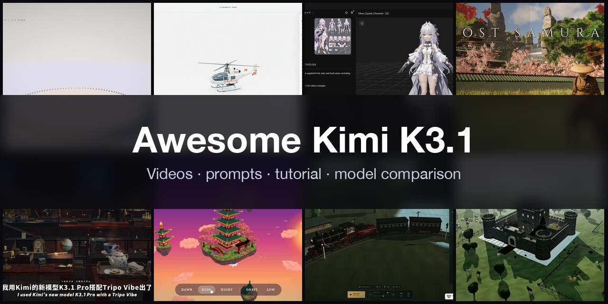](https://www.sandbase.ai/lab/ai-videos/kimi-k3-1?lang=zh-CN&utm_source=github&utm_medium=readme&utm_campaign=awesome-kimi-k3-1&utm_content=banner)

精选 **Kimi K3.1 案例**合集：用 Kimi K3.1 和 Kimi K3.1 Pro（Moonshot AI 月之暗面的旗舰开放权重多模态推理模型，发布前曾以代号 Kibitz 出现在竞技场）做出的视频、提示词和演示。包括可交互 Three.js 场景、体素世界、浏览器游戏、动效，以及大量与 Claude Opus 5.5 等前沿模型的同题对比，大多是模型根据提示词写成的单文件网页，均注明作者并链接原帖。

共 **269 条视频**，来自 **181 位创作者** · **55 条**附作者提示词 · 每天从 [SandBase Lab](https://www.sandbase.ai/lab/ai-videos/kimi-k3-1?lang=zh-CN&utm_source=github&utm_medium=readme&utm_campaign=awesome-kimi-k3-1&utm_content=stats) 同步

## 从这里开始

| 我想… | 去这里 |
|---|---|
| 看视频 | 在下方 [按分类浏览](#contents)，或 [在 SandBase Lab 大屏播放](https://www.sandbase.ai/lab/ai-videos/kimi-k3-1?lang=zh-CN&utm_source=github&utm_medium=readme&utm_campaign=awesome-kimi-k3-1&utm_content=quickstart) |
| 复制提示词 | [提示词索引](docs/zh-CN/prompts.md)：所有附带提示词的视频 |
| 自己写提示词 | [提示词写法](docs/zh-CN/prompt-guide.md)：7 条写法和一个填空模板 |
| 做一个视频 | [教程](docs/zh-CN/tutorial.md)：提示词 → HTML → MP4，含 API、CLI 调用和录屏脚本 |
| 选模型 | [Kimi K3.1 对比 Claude Opus 5.5、GPT-6 Astra 和 DeepSeek V4.1 Flash](docs/zh-CN/model-comparison.md) |
| 马上试试 | [在 Lab 竞技场运行 Kimi K3.1 Pro](https://www.sandbase.ai/lab/x/llm-arena?models=moonshotai%2Fkimi-k3.1-pro&lang=zh-CN&utm_source=github&utm_medium=readme&utm_campaign=awesome-kimi-k3-1&utm_content=quickstart)，和其他模型并排对比 |

<a id="contents"></a>

## 目录

- [精选](#featured) (8)
- [3D 场景](#3d-scene) (80)
- [动效](#motion-graphics) (19)
- [游戏](#game) (21)
- [产品界面](#ui-demo) (5)
- [讲解](#explainer) (5)
- [发布片](#launch-film) (7)
- [测试对比](#comparison) (132)
- [用 Kimi K3.1 复刻视频](#recreate)
- [常见问题](#faq)
- [推荐作品](#contribute)

点击预览图播放视频；点击标题前往 SandBase Lab 查看原帖、提示词，并一键 **复刻**；**@作者** 链接到 X 原帖。

<a id="featured"></a>

## 精选

<table>
<tr><td width="33%" valign="top"><a href="https://www.sandbase.ai/lab/media/x/kimi-k3-1/2113611006039761281/video.mp4">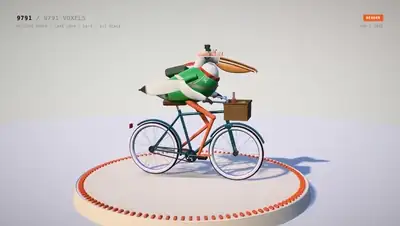</a><br><a href="https://www.sandbase.ai/lab/ai-videos/kimi-k3-1/2113611006039761281?lang=zh-CN&utm_source=github&utm_medium=readme&utm_campaign=awesome-kimi-k3-1&utm_content=card"><b>骑自行车的鹈鹕</b></a><br><sub><a href="https://x.com/chetaslua/status/2113611006039761281">@chetaslua</a> · 0:24</sub></td><td width="33%" valign="top"><a href="https://www.sandbase.ai/lab/media/x/kimi-k3-1/2113186973363929470/video.mp4">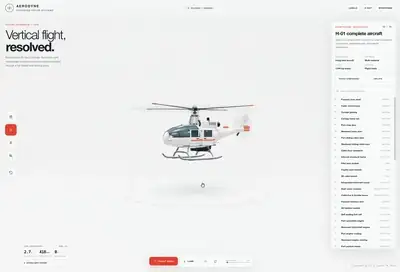</a><br><a href="https://www.sandbase.ai/lab/ai-videos/kimi-k3-1/2113186973363929470?lang=zh-CN&utm_source=github&utm_medium=readme&utm_campaign=awesome-kimi-k3-1&utm_content=card"><b>包含爆炸视图的精细3D直升机</b></a><br><sub><a href="https://x.com/LuminaBench/status/2113186973363929470">@LuminaBench</a> · 1:10</sub></td><td width="33%" valign="top"><a href="https://www.sandbase.ai/lab/media/x/kimi-k3-1/2114028190050254878/video.mp4"></a><br><a href="https://www.sandbase.ai/lab/ai-videos/kimi-k3-1/2114028190050254878?lang=zh-CN&utm_source=github&utm_medium=readme&utm_campaign=awesome-kimi-k3-1&utm_content=card"><b>Claude生成的AI发布会宣传片</b></a><br><sub><a href="https://x.com/whydeso/status/2114028190050254878">@whydeso</a> · 0:55</sub></td></tr>
<tr><td width="33%" valign="top"><a href="https://www.sandbase.ai/lab/media/x/kimi-k3-1/2113749533410955458/video.mp4">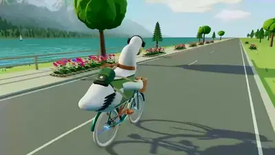</a><br><a href="https://www.sandbase.ai/lab/ai-videos/kimi-k3-1/2113749533410955458?lang=zh-CN&utm_source=github&utm_medium=readme&utm_campaign=awesome-kimi-k3-1&utm_content=card"><b>鹈鹕骑自行车的生成测试</b></a><br><sub><a href="https://x.com/ChrisGPT/status/2113749533410955458">@ChrisGPT</a> · 0:15</sub></td><td width="33%" valign="top"><a href="https://www.sandbase.ai/lab/media/x/kimi-k3-1/2113919155149943093/video.mp4">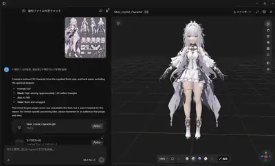</a><br><a href="https://www.sandbase.ai/lab/ai-videos/kimi-k3-1/2113919155149943093?lang=zh-CN&utm_source=github&utm_medium=readme&utm_campaign=awesome-kimi-k3-1&utm_content=card"><b>由设定图生成的二次元角色3D模型</b></a><br><sub><a href="https://x.com/lucianlamp/status/2113919155149943093">@lucianlamp</a> · 0:22</sub></td><td width="33%" valign="top"><a href="https://www.sandbase.ai/lab/media/x/kimi-k3-1/2113694356939112498/video.mp4">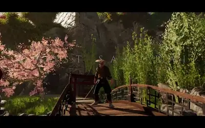</a><br><a href="https://www.sandbase.ai/lab/ai-videos/kimi-k3-1/2113694356939112498?lang=zh-CN&utm_source=github&utm_medium=readme&utm_campaign=awesome-kimi-k3-1&utm_content=card"><b>对马岛之魂风格的网页端游戏</b></a><br><sub><a href="https://x.com/thebuggeddev/status/2113694356939112498">@thebuggeddev</a> · 1:23</sub></td></tr>
<tr><td width="33%" valign="top"><a href="https://www.sandbase.ai/lab/media/x/kimi-k3-1/2113683399680700591/video.mp4">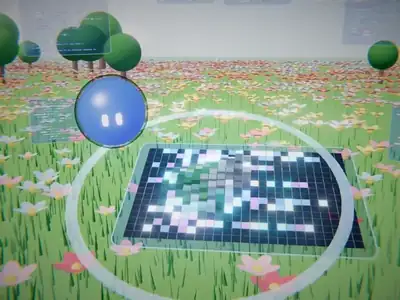</a><br><a href="https://www.sandbase.ai/lab/ai-videos/kimi-k3-1/2113683399680700591?lang=zh-CN&utm_source=github&utm_medium=readme&utm_campaign=awesome-kimi-k3-1&utm_content=card"><b>使用 Three.js 生成的产品发布宣传视频</b></a><br><sub><a href="https://x.com/Bhavani_00007/status/2113683399680700591">@Bhavani_00007</a> · 0:30</sub></td><td width="33%" valign="top"><a href="https://www.sandbase.ai/lab/media/x/kimi-k3-1/2114958387846971570/video.mp4">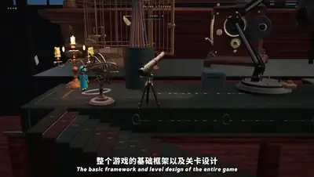</a><br><a href="https://www.sandbase.ai/lab/ai-videos/kimi-k3-1/2114958387846971570?lang=zh-CN&utm_source=github&utm_medium=readme&utm_campaign=awesome-kimi-k3-1&utm_content=card"><b>基于 Three.js 开发的 3D 游戏《书桌之上》</b></a><br><sub><a href="https://x.com/xingbugengming/status/2114958387846971570">@xingbugengming</a> · 1:42</sub></td></tr>
</table>

<a id="3d-scene"></a>

## 3D 场景

<table>
<tr><td width="33%" valign="top"><a href="https://www.sandbase.ai/lab/media/x/kimi-k3-1/2113185478178447455/video.mp4">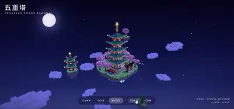</a><br><a href="https://www.sandbase.ai/lab/ai-videos/kimi-k3-1/2113185478178447455?lang=zh-CN&utm_source=github&utm_medium=readme&utm_campaign=awesome-kimi-k3-1&utm_content=card"><b>使用Kimi K3.1渲染的体素宝塔</b></a><br><sub><a href="https://x.com/Mr_Salio/status/2113185478178447455">@Mr_Salio</a> · 0:28</sub></td><td width="33%" valign="top"><a href="https://www.sandbase.ai/lab/media/x/kimi-k3-1/2113186973363929470/video.mp4"></a><br><a href="https://www.sandbase.ai/lab/ai-videos/kimi-k3-1/2113186973363929470?lang=zh-CN&utm_source=github&utm_medium=readme&utm_campaign=awesome-kimi-k3-1&utm_content=card"><b>包含爆炸视图的精细3D直升机</b></a><br><sub><a href="https://x.com/LuminaBench/status/2113186973363929470">@LuminaBench</a> · 1:10</sub></td><td width="33%" valign="top"><a href="https://www.sandbase.ai/lab/media/x/kimi-k3-1/2113218159603859914/video.mp4">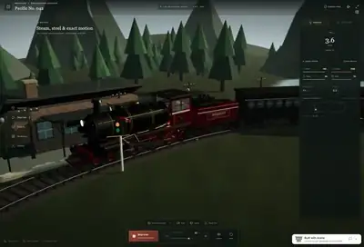</a><br><a href="https://www.sandbase.ai/lab/ai-videos/kimi-k3-1/2113218159603859914?lang=zh-CN&utm_source=github&utm_medium=readme&utm_campaign=awesome-kimi-k3-1&utm_content=card"><b>带爆炸视图的交互式3D火车</b></a><br><sub><a href="https://x.com/LuminaBench/status/2113218159603859914">@LuminaBench</a> · 0:59</sub></td></tr>
<tr><td width="33%" valign="top"><a href="https://www.sandbase.ai/lab/media/x/kimi-k3-1/2113223010274697726/video.mp4">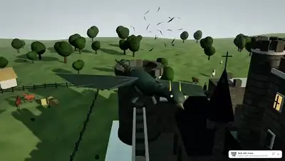</a><br><a href="https://www.sandbase.ai/lab/ai-videos/kimi-k3-1/2113223010274697726?lang=zh-CN&utm_source=github&utm_medium=readme&utm_campaign=awesome-kimi-k3-1&utm_content=card"><b>包含飞龙与护城河的中世纪城堡场景</b></a><br><sub><a href="https://x.com/karanC_12/status/2113223010274697726">@karanC_12</a> · 0:31</sub></td><td width="33%" valign="top"><a href="https://www.sandbase.ai/lab/media/x/kimi-k3-1/2113253316092448818/video.mp4">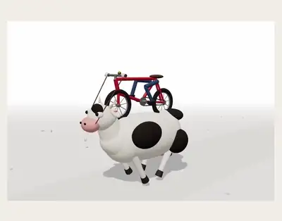</a><br><a href="https://www.sandbase.ai/lab/ai-videos/kimi-k3-1/2113253316092448818?lang=zh-CN&utm_source=github&utm_medium=readme&utm_campaign=awesome-kimi-k3-1&utm_content=card"><b>Three.js生成的骑自行车奶牛3D场景</b></a><br><sub><a href="https://x.com/TimJayas/status/2113253316092448818">@TimJayas</a> · 0:50 · <a href="https://www.sandbase.ai/lab/ai-videos/kimi-k3-1/2113253316092448818?lang=zh-CN&utm_source=github&utm_medium=readme&utm_campaign=awesome-kimi-k3-1&utm_content=card">提示词</a></sub></td><td width="33%" valign="top"><a href="https://www.sandbase.ai/lab/media/x/kimi-k3-1/2113258688756470183/video.mp4">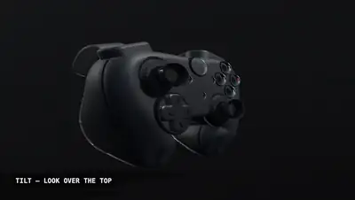</a><br><a href="https://www.sandbase.ai/lab/ai-videos/kimi-k3-1/2113258688756470183?lang=zh-CN&utm_source=github&utm_medium=readme&utm_campaign=awesome-kimi-k3-1&utm_content=card"><b>纯HTML程序化生成的3D手柄</b></a><br><sub><a href="https://x.com/CodeByNZ/status/2113258688756470183">@CodeByNZ</a> · 0:33</sub></td></tr>
</table>

<details>
<summary><b>展开全部 80 条</b></summary>

<table>
<tr><td width="33%" valign="top"><a href="https://www.sandbase.ai/lab/media/x/kimi-k3-1/2113262900328710564/video.mp4">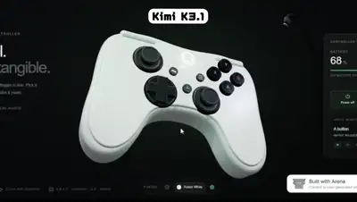</a><br><a href="https://www.sandbase.ai/lab/ai-videos/kimi-k3-1/2113262900328710564?lang=zh-CN&utm_source=github&utm_medium=readme&utm_campaign=awesome-kimi-k3-1&utm_content=card"><b>交互式3D Xbox手柄</b></a><br><sub><a href="https://x.com/karanC_12/status/2113262900328710564">@karanC_12</a> · 0:22</sub></td><td width="33%" valign="top"><a href="https://www.sandbase.ai/lab/media/x/kimi-k3-1/2113271273568792689/video.mp4">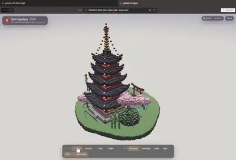</a><br><a href="https://www.sandbase.ai/lab/ai-videos/kimi-k3-1/2113271273568792689?lang=zh-CN&utm_source=github&utm_medium=readme&utm_campaign=awesome-kimi-k3-1&utm_content=card"><b>Kimi-K3.1 生成的体素宝塔架构</b></a><br><sub><a href="https://x.com/ashawv5i/status/2113271273568792689">@ashawv5i</a> · 0:22</sub></td><td width="33%" valign="top"><a href="https://www.sandbase.ai/lab/media/x/kimi-k3-1/2113283390548164986/video.mp4">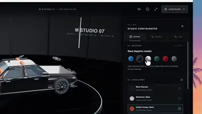</a><br><a href="https://www.sandbase.ai/lab/ai-videos/kimi-k3-1/2113283390548164986?lang=zh-CN&utm_source=github&utm_medium=readme&utm_campaign=awesome-kimi-k3-1&utm_content=card"><b>Three.js打造的3D宝马M5定制器</b></a><br><sub><a href="https://x.com/k2sbhai/status/2113283390548164986">@k2sbhai</a> · 0:50 · <a href="https://www.sandbase.ai/lab/ai-videos/kimi-k3-1/2113283390548164986?lang=zh-CN&utm_source=github&utm_medium=readme&utm_campaign=awesome-kimi-k3-1&utm_content=card">提示词</a></sub></td></tr>
<tr><td width="33%" valign="top"><a href="https://www.sandbase.ai/lab/media/x/kimi-k3-1/2113283549319274888/video.mp4">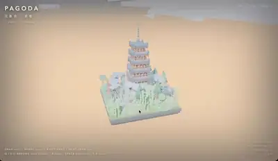</a><br><a href="https://www.sandbase.ai/lab/ai-videos/kimi-k3-1/2113283549319274888?lang=zh-CN&utm_source=github&utm_medium=readme&utm_campaign=awesome-kimi-k3-1&utm_content=card"><b>Kimi K3.1生成的体素宝塔</b></a><br><sub><a href="https://x.com/CodeByNZ/status/2113283549319274888">@CodeByNZ</a> · 0:13</sub></td><td width="33%" valign="top"><a href="https://www.sandbase.ai/lab/media/x/kimi-k3-1/2113285555165581763/video.mp4"></a><br><a href="https://www.sandbase.ai/lab/ai-videos/kimi-k3-1/2113285555165581763?lang=zh-CN&utm_source=github&utm_medium=readme&utm_campaign=awesome-kimi-k3-1&utm_content=card"><b>Kimi K3.1生成的体素宝塔建筑</b></a><br><sub><a href="https://x.com/ashawv5i/status/2113285555165581763">@ashawv5i</a> · 0:37</sub></td><td width="33%" valign="top"><a href="https://www.sandbase.ai/lab/media/x/kimi-k3-1/2113287408699728207/video.mp4">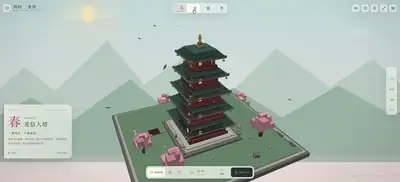</a><br><a href="https://www.sandbase.ai/lab/ai-videos/kimi-k3-1/2113287408699728207?lang=zh-CN&utm_source=github&utm_medium=readme&utm_campaign=awesome-kimi-k3-1&utm_content=card"><b>Kimi K3.1生成的四季3D像素宝塔</b></a><br><sub><a href="https://x.com/leo114119/status/2113287408699728207">@leo114119</a> · 0:34</sub></td></tr>
<tr><td width="33%" valign="top"><a href="https://www.sandbase.ai/lab/media/x/kimi-k3-1/2113291375697682940/video.mp4">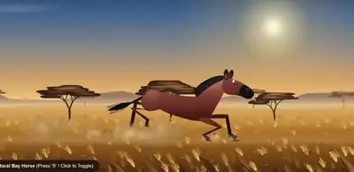</a><br><a href="https://www.sandbase.ai/lab/ai-videos/kimi-k3-1/2113291375697682940?lang=zh-CN&utm_source=github&utm_medium=readme&utm_campaign=awesome-kimi-k3-1&utm_content=card"><b>Three.js生成的奔跑骏马3D场景</b></a><br><sub><a href="https://x.com/AI_Screening/status/2113291375697682940">@AI_Screening</a> · 0:14</sub></td><td width="33%" valign="top"><a href="https://www.sandbase.ai/lab/media/x/kimi-k3-1/2113297716667371646/video.mp4">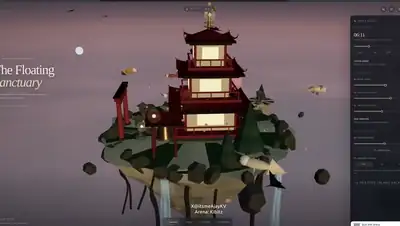</a><br><a href="https://www.sandbase.ai/lab/ai-videos/kimi-k3-1/2113297716667371646?lang=zh-CN&utm_source=github&utm_medium=readme&utm_campaign=awesome-kimi-k3-1&utm_content=card"><b>Kibitz生成的浮空宝塔岛交互场景</b></a><br><sub><a href="https://x.com/ItsmeAjayKV/status/2113297716667371646">@ItsmeAjayKV</a> · 0:32 · <a href="https://www.sandbase.ai/lab/ai-videos/kimi-k3-1/2113297716667371646?lang=zh-CN&utm_source=github&utm_medium=readme&utm_campaign=awesome-kimi-k3-1&utm_content=card">提示词</a></sub></td><td width="33%" valign="top"><a href="https://www.sandbase.ai/lab/media/x/kimi-k3-1/2113302979046744220/video.mp4">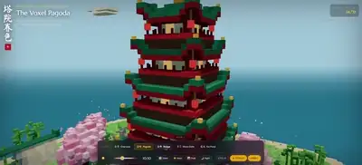</a><br><a href="https://www.sandbase.ai/lab/ai-videos/kimi-k3-1/2113302979046744220?lang=zh-CN&utm_source=github&utm_medium=readme&utm_campaign=awesome-kimi-k3-1&utm_content=card"><b>Qwen4生成的3D像素宝塔效果</b></a><br><sub><a href="https://x.com/leo114119/status/2113302979046744220">@leo114119</a> · 0:36</sub></td></tr>
<tr><td width="33%" valign="top"><a href="https://www.sandbase.ai/lab/media/x/kimi-k3-1/2113323680940130668/video.mp4">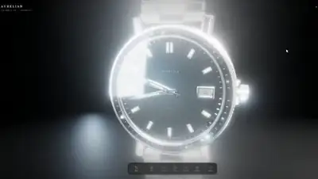</a><br><a href="https://www.sandbase.ai/lab/ai-videos/kimi-k3-1/2113323680940130668?lang=zh-CN&utm_source=github&utm_medium=readme&utm_campaign=awesome-kimi-k3-1&utm_content=card"><b>Three.js打造逼真3D模型</b></a><br><sub><a href="https://x.com/ash_twtz/status/2113323680940130668">@ash_twtz</a> · 0:11</sub></td><td width="33%" valign="top"><a href="https://www.sandbase.ai/lab/media/x/kimi-k3-1/2113341964297064753/video.mp4">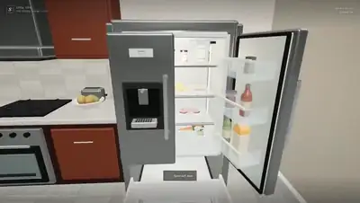</a><br><a href="https://www.sandbase.ai/lab/ai-videos/kimi-k3-1/2113341964297064753?lang=zh-CN&utm_source=github&utm_medium=readme&utm_campaign=awesome-kimi-k3-1&utm_content=card"><b>带可交互冰箱的3D餐厅场景</b></a><br><sub><a href="https://x.com/notjazii/status/2113341964297064753">@notjazii</a> · 0:58 · <a href="https://www.sandbase.ai/lab/ai-videos/kimi-k3-1/2113341964297064753?lang=zh-CN&utm_source=github&utm_medium=readme&utm_campaign=awesome-kimi-k3-1&utm_content=card">提示词</a></sub></td><td width="33%" valign="top"><a href="https://www.sandbase.ai/lab/media/x/kimi-k3-1/2113349968295788751/video.mp4">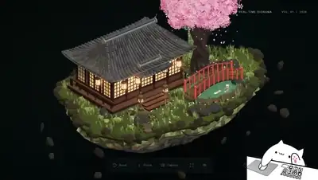</a><br><a href="https://www.sandbase.ai/lab/ai-videos/kimi-k3-1/2113349968295788751?lang=zh-CN&utm_source=github&utm_medium=readme&utm_campaign=awesome-kimi-k3-1&utm_content=card"><b>竞技场中生成的3D游戏资产</b></a><br><sub><a href="https://x.com/notjazii/status/2113349968295788751">@notjazii</a> · 0:28</sub></td></tr>
<tr><td width="33%" valign="top"><a href="https://www.sandbase.ai/lab/media/x/kimi-k3-1/2113400747631296635/video.mp4">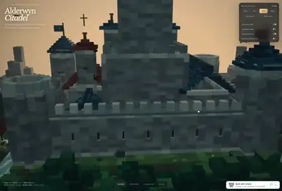</a><br><a href="https://www.sandbase.ai/lab/ai-videos/kimi-k3-1/2113400747631296635?lang=zh-CN&utm_source=github&utm_medium=readme&utm_campaign=awesome-kimi-k3-1&utm_content=card"><b>Kimi K3.1生成的体素中世纪城堡</b></a><br><sub><a href="https://x.com/FabianoFirmo/status/2113400747631296635">@FabianoFirmo</a> · 0:42</sub></td><td width="33%" valign="top"><a href="https://www.sandbase.ai/lab/media/x/kimi-k3-1/2113458401309020202/video.mp4">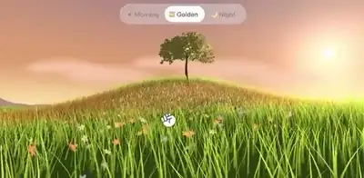</a><br><a href="https://www.sandbase.ai/lab/ai-videos/kimi-k3-1/2113458401309020202?lang=zh-CN&utm_source=github&utm_medium=readme&utm_campaign=awesome-kimi-k3-1&utm_content=card"><b>Three.js逆向工程演示</b></a><br><sub><a href="https://x.com/ChrisGPT/status/2113458401309020202">@ChrisGPT</a> · 0:14</sub></td><td width="33%" valign="top"><a href="https://www.sandbase.ai/lab/media/x/kimi-k3-1/2113636782311145846/video.mp4">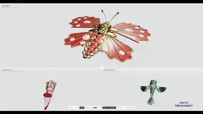</a><br><a href="https://www.sandbase.ai/lab/ai-videos/kimi-k3-1/2113636782311145846?lang=zh-CN&utm_source=github&utm_medium=readme&utm_campaign=awesome-kimi-k3-1&utm_content=card"><b>使用Three.js构建3D模型演示</b></a><br><sub><a href="https://x.com/ItsmeAjayKV/status/2113636782311145846">@ItsmeAjayKV</a> · 1:29</sub></td></tr>
<tr><td width="33%" valign="top"><a href="https://www.sandbase.ai/lab/media/x/kimi-k3-1/2113671138291376391/video.mp4">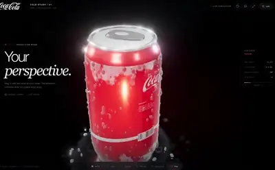</a><br><a href="https://www.sandbase.ai/lab/ai-videos/kimi-k3-1/2113671138291376391?lang=zh-CN&utm_source=github&utm_medium=readme&utm_campaign=awesome-kimi-k3-1&utm_content=card"><b>带3D水滴与光影质感的可口可乐渲染</b></a><br><sub><a href="https://x.com/laopai1990/status/2113671138291376391">@laopai1990</a> · 0:27</sub></td><td width="33%" valign="top"><a href="https://www.sandbase.ai/lab/media/x/kimi-k3-1/2113671744011763942/video.mp4">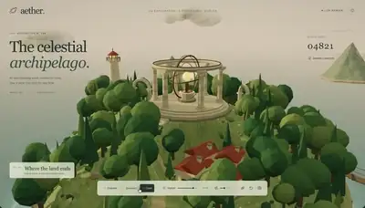</a><br><a href="https://www.sandbase.ai/lab/ai-videos/kimi-k3-1/2113671744011763942?lang=zh-CN&utm_source=github&utm_medium=readme&utm_campaign=awesome-kimi-k3-1&utm_content=card"><b>Three.js程序化3D场景与布料模拟测试</b></a><br><sub><a href="https://x.com/Kmno4Z62942/status/2113671744011763942">@Kmno4Z62942</a> · 0:37 · <a href="https://www.sandbase.ai/lab/ai-videos/kimi-k3-1/2113671744011763942?lang=zh-CN&utm_source=github&utm_medium=readme&utm_campaign=awesome-kimi-k3-1&utm_content=card">提示词</a></sub></td><td width="33%" valign="top"><a href="https://www.sandbase.ai/lab/media/x/kimi-k3-1/2113677973232681425/video.mp4">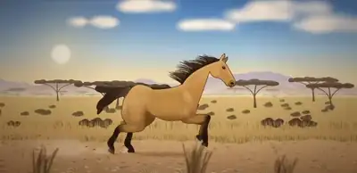</a><br><a href="https://www.sandbase.ai/lab/ai-videos/kimi-k3-1/2113677973232681425?lang=zh-CN&utm_source=github&utm_medium=readme&utm_campaign=awesome-kimi-k3-1&utm_content=card"><b>Three.js中奔跑的骏马</b></a><br><sub><a href="https://x.com/AI_Screening/status/2113677973232681425">@AI_Screening</a> · 0:16</sub></td></tr>
<tr><td width="33%" valign="top"><a href="https://www.sandbase.ai/lab/media/x/kimi-k3-1/2113684128734625948/video.mp4">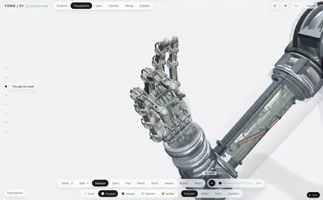</a><br><a href="https://www.sandbase.ai/lab/ai-videos/kimi-k3-1/2113684128734625948?lang=zh-CN&utm_source=github&utm_medium=readme&utm_campaign=awesome-kimi-k3-1&utm_content=card"><b>拆解为数千零件的交互式 3D 机械手</b></a><br><sub><a href="https://x.com/crystalsssup/status/2113684128734625948">@crystalsssup</a> · 0:09</sub></td><td width="33%" valign="top"><a href="https://www.sandbase.ai/lab/media/x/kimi-k3-1/2113691197189525853/video.mp4">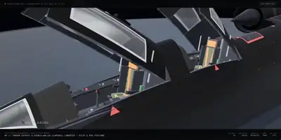</a><br><a href="https://www.sandbase.ai/lab/ai-videos/kimi-k3-1/2113691197189525853?lang=zh-CN&utm_source=github&utm_medium=readme&utm_campaign=awesome-kimi-k3-1&utm_content=card"><b>Three.js中的SR-71黑鸟侦察机</b></a><br><sub><a href="https://x.com/ai_for_success/status/2113691197189525853">@ai_for_success</a> · 1:03</sub></td><td width="33%" valign="top"><a href="https://www.sandbase.ai/lab/media/x/kimi-k3-1/2113695890468962495/video.mp4"></a><br><a href="https://www.sandbase.ai/lab/ai-videos/kimi-k3-1/2113695890468962495?lang=zh-CN&utm_source=github&utm_medium=readme&utm_campaign=awesome-kimi-k3-1&utm_content=card"><b>虚幻引擎中云层之上的宫殿</b></a><br><sub><a href="https://x.com/karankendre/status/2113695890468962495">@karankendre</a> · 0:41</sub></td></tr>
<tr><td width="33%" valign="top"><a href="https://www.sandbase.ai/lab/media/x/kimi-k3-1/2113695913617305805/video.mp4">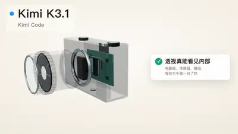</a><br><a href="https://www.sandbase.ai/lab/ai-videos/kimi-k3-1/2113695913617305805?lang=zh-CN&utm_source=github&utm_medium=readme&utm_campaign=awesome-kimi-k3-1&utm_content=card"><b>Kimi K3.1 Pro的3D生成能力表现</b></a><br><sub><a href="https://x.com/bourneliu66/status/2113695913617305805">@bourneliu66</a> · 1:44</sub></td><td width="33%" valign="top"><a href="https://www.sandbase.ai/lab/media/x/kimi-k3-1/2113697560103952826/video.mp4"></a><br><a href="https://www.sandbase.ai/lab/ai-videos/kimi-k3-1/2113697560103952826?lang=zh-CN&utm_source=github&utm_medium=readme&utm_campaign=awesome-kimi-k3-1&utm_content=card"><b>一次性生成的 3D 轮船模型测试</b></a><br><sub><a href="https://x.com/notjazii/status/2113697560103952826">@notjazii</a> · 0:24</sub></td><td width="33%" valign="top"><a href="https://www.sandbase.ai/lab/media/x/kimi-k3-1/2113698280991580577/video.mp4">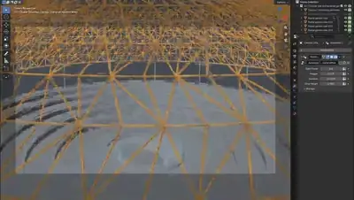</a><br><a href="https://www.sandbase.ai/lab/ai-videos/kimi-k3-1/2113698280991580577?lang=zh-CN&utm_source=github&utm_medium=readme&utm_campaign=awesome-kimi-k3-1&utm_content=card"><b>在 Blender 中建模的新加坡樟宜机场 3D 场景</b></a><br><sub><a href="https://x.com/crystalsssup/status/2113698280991580577">@crystalsssup</a> · 0:20</sub></td></tr>
<tr><td width="33%" valign="top"><a href="https://www.sandbase.ai/lab/media/x/kimi-k3-1/2113707002249552134/video.mp4">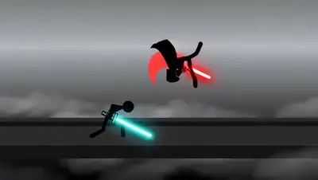</a><br><a href="https://www.sandbase.ai/lab/ai-videos/kimi-k3-1/2113707002249552134?lang=zh-CN&utm_source=github&utm_medium=readme&utm_campaign=awesome-kimi-k3-1&utm_content=card"><b>火柴人格斗视频与低模林克 3D 测试</b></a><br><sub><a href="https://x.com/DanielZambrini/status/2113707002249552134">@DanielZambrini</a> · 0:15</sub></td><td width="33%" valign="top"><a href="https://www.sandbase.ai/lab/media/x/kimi-k3-1/2113710105871139120/video.mp4">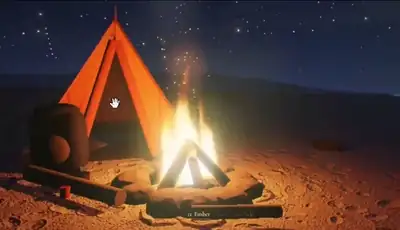</a><br><a href="https://www.sandbase.ai/lab/ai-videos/kimi-k3-1/2113710105871139120?lang=zh-CN&utm_source=github&utm_medium=readme&utm_campaign=awesome-kimi-k3-1&utm_content=card"><b>带有火光与阴影的 3D 露营场景</b></a><br><sub><a href="https://x.com/ashawv5i/status/2113710105871139120">@ashawv5i</a> · 0:47</sub></td><td width="33%" valign="top"><a href="https://www.sandbase.ai/lab/media/x/kimi-k3-1/2113715077795008531/video.mp4">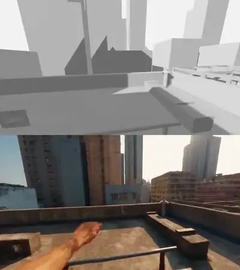</a><br><a href="https://www.sandbase.ai/lab/ai-videos/kimi-k3-1/2113715077795008531?lang=zh-CN&utm_source=github&utm_medium=readme&utm_campaign=awesome-kimi-k3-1&utm_content=card"><b>Blender中生成与渲染的3D场景</b></a><br><sub><a href="https://x.com/mattknowsai/status/2113715077795008531">@mattknowsai</a> · 0:22</sub></td></tr>
<tr><td width="33%" valign="top"><a href="https://www.sandbase.ai/lab/media/x/kimi-k3-1/2113721825309945895/video.mp4">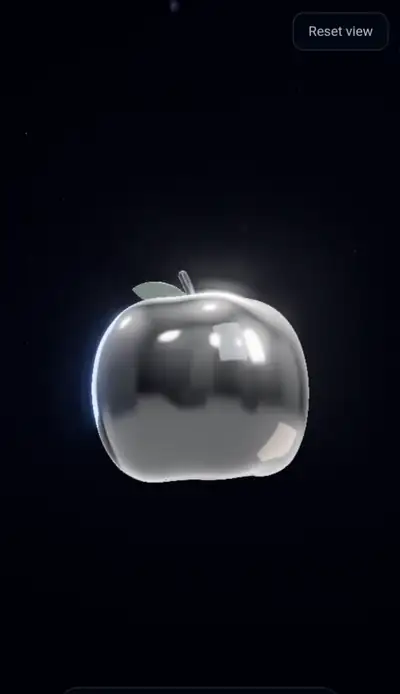</a><br><a href="https://www.sandbase.ai/lab/ai-videos/kimi-k3-1/2113721825309945895?lang=zh-CN&utm_source=github&utm_medium=readme&utm_campaign=awesome-kimi-k3-1&utm_content=card"><b>太空中漂浮的 3D 玻璃苹果</b></a><br><sub><a href="https://x.com/Lyelac_/status/2113721825309945895">@Lyelac_</a> · 0:30</sub></td><td width="33%" valign="top"><a href="https://www.sandbase.ai/lab/media/x/kimi-k3-1/2113724051332194589/video.mp4">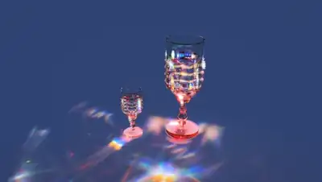</a><br><a href="https://www.sandbase.ai/lab/ai-videos/kimi-k3-1/2113724051332194589?lang=zh-CN&utm_source=github&utm_medium=readme&utm_campaign=awesome-kimi-k3-1&utm_content=card"><b>纯着色器代码构建的Three.js 3D场景</b></a><br><sub><a href="https://x.com/liambraus/status/2113724051332194589">@liambraus</a> · 0:22</sub></td><td width="33%" valign="top"><a href="https://www.sandbase.ai/lab/media/x/kimi-k3-1/2113725753489756521/video.mp4">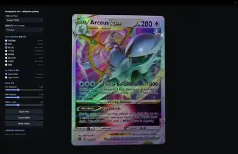</a><br><a href="https://www.sandbase.ai/lab/ai-videos/kimi-k3-1/2113725753489756521?lang=zh-CN&utm_source=github&utm_medium=readme&utm_campaign=awesome-kimi-k3-1&utm_content=card"><b>Three.js宝可梦全息卡牌着色器</b></a><br><sub><a href="https://x.com/slash1sol/status/2113725753489756521">@slash1sol</a> · 0:25</sub></td></tr>
<tr><td width="33%" valign="top"><a href="https://www.sandbase.ai/lab/media/x/kimi-k3-1/2113727019771179401/video.mp4">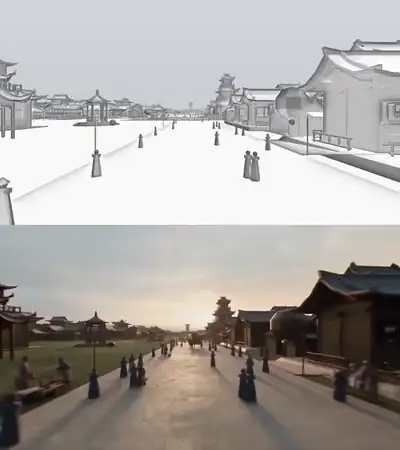</a><br><a href="https://www.sandbase.ai/lab/ai-videos/kimi-k3-1/2113727019771179401?lang=zh-CN&utm_source=github&utm_medium=readme&utm_campaign=awesome-kimi-k3-1&utm_content=card"><b>Blender中制作的粘土材质渲染</b></a><br><sub><a href="https://x.com/ChrisGPT/status/2113727019771179401">@ChrisGPT</a> · 1:05</sub></td><td width="33%" valign="top"><a href="https://www.sandbase.ai/lab/media/x/kimi-k3-1/2113729972754116779/video.mp4">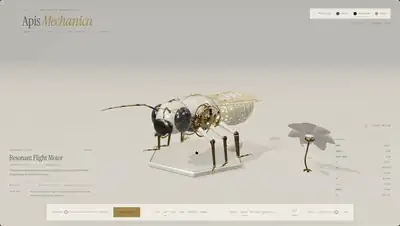</a><br><a href="https://www.sandbase.ai/lab/ai-videos/kimi-k3-1/2113729972754116779?lang=zh-CN&utm_source=github&utm_medium=readme&utm_campaign=awesome-kimi-k3-1&utm_content=card"><b>Kimi K3.1 Pro制作的3D机械蜜蜂</b></a><br><sub><a href="https://x.com/thtbee_/status/2113729972754116779">@thtbee_</a> · 0:29</sub></td><td width="33%" valign="top"><a href="https://www.sandbase.ai/lab/media/x/kimi-k3-1/2113746017023602833/video.mp4">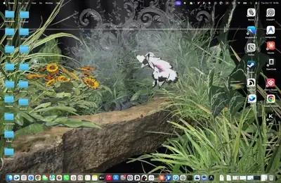</a><br><a href="https://www.sandbase.ai/lab/ai-videos/kimi-k3-1/2113746017023602833?lang=zh-CN&utm_source=github&utm_medium=readme&utm_campaign=awesome-kimi-k3-1&utm_content=card"><b>Kimi K3.1搭建的Houdini场景</b></a><br><sub><a href="https://x.com/bernirov/status/2113746017023602833">@bernirov</a> · 0:15</sub></td></tr>
<tr><td width="33%" valign="top"><a href="https://www.sandbase.ai/lab/media/x/kimi-k3-1/2113754577258352699/video.mp4">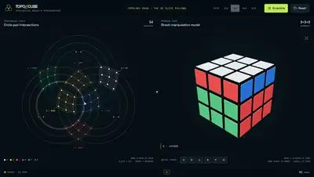</a><br><a href="https://www.sandbase.ai/lab/ai-videos/kimi-k3-1/2113754577258352699?lang=zh-CN&utm_source=github&utm_medium=readme&utm_campaign=awesome-kimi-k3-1&utm_content=card"><b>支持同步视图的 3D 交互式魔方</b></a><br><sub><a href="https://x.com/eandualem/status/2113754577258352699">@eandualem</a> · 0:20</sub></td><td width="33%" valign="top"><a href="https://www.sandbase.ai/lab/media/x/kimi-k3-1/2113785039158669347/video.mp4">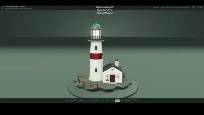</a><br><a href="https://www.sandbase.ai/lab/ai-videos/kimi-k3-1/2113785039158669347?lang=zh-CN&utm_source=github&utm_medium=readme&utm_campaign=awesome-kimi-k3-1&utm_content=card"><b>Three.js程序化3D灯塔场景</b></a><br><sub><a href="https://x.com/ItsmeAjayKV/status/2113785039158669347">@ItsmeAjayKV</a> · 1:23</sub></td><td width="33%" valign="top"><a href="https://www.sandbase.ai/lab/media/x/kimi-k3-1/2113808946884657487/video.mp4"></a><br><a href="https://www.sandbase.ai/lab/ai-videos/kimi-k3-1/2113808946884657487?lang=zh-CN&utm_source=github&utm_medium=readme&utm_campaign=awesome-kimi-k3-1&utm_content=card"><b>可自动解构的3D机械手</b></a><br><sub><a href="https://x.com/RoundtableSpace/status/2113808946884657487">@RoundtableSpace</a> · 0:09</sub></td></tr>
<tr><td width="33%" valign="top"><a href="https://www.sandbase.ai/lab/media/x/kimi-k3-1/2113882041444094366/video.mp4">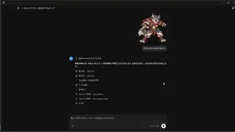</a><br><a href="https://www.sandbase.ai/lab/ai-videos/kimi-k3-1/2113882041444094366?lang=zh-CN&utm_source=github&utm_medium=readme&utm_campaign=awesome-kimi-k3-1&utm_content=card"><b>从单张图片生成的3D角色模型</b></a><br><sub><a href="https://x.com/lucianlamp/status/2113882041444094366">@lucianlamp</a> · 1:02</sub></td><td width="33%" valign="top"><a href="https://www.sandbase.ai/lab/media/x/kimi-k3-1/2113919155149943093/video.mp4"></a><br><a href="https://www.sandbase.ai/lab/ai-videos/kimi-k3-1/2113919155149943093?lang=zh-CN&utm_source=github&utm_medium=readme&utm_campaign=awesome-kimi-k3-1&utm_content=card"><b>由设定图生成的二次元角色3D模型</b></a><br><sub><a href="https://x.com/lucianlamp/status/2113919155149943093">@lucianlamp</a> · 0:22</sub></td><td width="33%" valign="top"><a href="https://www.sandbase.ai/lab/media/x/kimi-k3-1/2113920708325622178/video.mp4">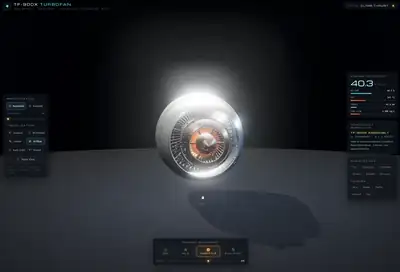</a><br><a href="https://www.sandbase.ai/lab/ai-videos/kimi-k3-1/2113920708325622178?lang=zh-CN&utm_source=github&utm_medium=readme&utm_campaign=awesome-kimi-k3-1&utm_content=card"><b>3D喷气发动机物理模拟</b></a><br><sub><a href="https://x.com/LuminaBench/status/2113920708325622178">@LuminaBench</a> · 0:55</sub></td></tr>
<tr><td width="33%" valign="top"><a href="https://www.sandbase.ai/lab/media/x/kimi-k3-1/2113933579747209626/video.mp4">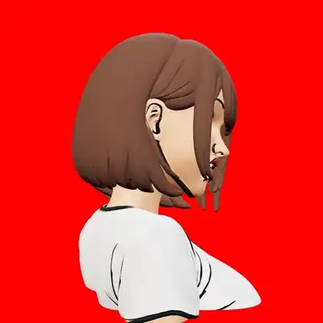</a><br><a href="https://www.sandbase.ai/lab/ai-videos/kimi-k3-1/2113933579747209626?lang=zh-CN&utm_source=github&utm_medium=readme&utm_campaign=awesome-kimi-k3-1&utm_content=card"><b>单张图片转360度旋转3D模型</b></a><br><sub><a href="https://x.com/ojigineko_tips/status/2113933579747209626">@ojigineko_tips</a> · 0:08 · <a href="https://www.sandbase.ai/lab/ai-videos/kimi-k3-1/2113933579747209626?lang=zh-CN&utm_source=github&utm_medium=readme&utm_campaign=awesome-kimi-k3-1&utm_content=card">提示词</a></sub></td><td width="33%" valign="top"><a href="https://www.sandbase.ai/lab/media/x/kimi-k3-1/2113944680631275903/video.mp4">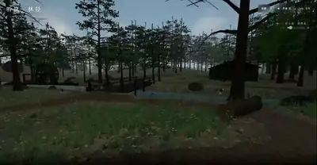</a><br><a href="https://www.sandbase.ai/lab/ai-videos/kimi-k3-1/2113944680631275903?lang=zh-CN&utm_source=github&utm_medium=readme&utm_campaign=awesome-kimi-k3-1&utm_content=card"><b>Three.js森林漫游3D场景</b></a><br><sub><a href="https://x.com/leo114119/status/2113944680631275903">@leo114119</a> · 0:33</sub></td><td width="33%" valign="top"><a href="https://www.sandbase.ai/lab/media/x/kimi-k3-1/2113983948208451941/video.mp4">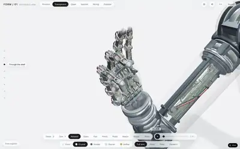</a><br><a href="https://www.sandbase.ai/lab/ai-videos/kimi-k3-1/2113983948208451941?lang=zh-CN&utm_source=github&utm_medium=readme&utm_campaign=awesome-kimi-k3-1&utm_content=card"><b>机械手交互式拆解视图</b></a><br><sub><a href="https://x.com/Jomolos/status/2113983948208451941">@Jomolos</a> · 0:09</sub></td></tr>
<tr><td width="33%" valign="top"><a href="https://www.sandbase.ai/lab/media/x/kimi-k3-1/2113991534693773817/video.mp4"></a><br><a href="https://www.sandbase.ai/lab/ai-videos/kimi-k3-1/2113991534693773817?lang=zh-CN&utm_source=github&utm_medium=readme&utm_campaign=awesome-kimi-k3-1&utm_content=card"><b>Blender设计的3D打印指尖陀螺</b></a><br><sub><a href="https://x.com/_MaxBlade/status/2113991534693773817">@_MaxBlade</a> · 0:58</sub></td><td width="33%" valign="top"><a href="https://www.sandbase.ai/lab/media/x/kimi-k3-1/2114000732697555300/video.mp4"></a><br><a href="https://www.sandbase.ai/lab/ai-videos/kimi-k3-1/2114000732697555300?lang=zh-CN&utm_source=github&utm_medium=readme&utm_campaign=awesome-kimi-k3-1&utm_content=card"><b>Three.js程序化自行车骑手动画</b></a><br><sub><a href="https://x.com/AI_Screening/status/2114000732697555300">@AI_Screening</a> · 0:13</sub></td><td width="33%" valign="top"><a href="https://www.sandbase.ai/lab/media/x/kimi-k3-1/2114000772145074321/video.mp4"></a><br><a href="https://www.sandbase.ai/lab/ai-videos/kimi-k3-1/2114000772145074321?lang=zh-CN&utm_source=github&utm_medium=readme&utm_campaign=awesome-kimi-k3-1&utm_content=card"><b>后室 Level Fun 伪纪录片风格视频</b></a><br><sub><a href="https://x.com/K1sqttPHfC41982/status/2114000772145074321">@K1sqttPHfC41982</a> · 3:20</sub></td></tr>
<tr><td width="33%" valign="top"><a href="https://www.sandbase.ai/lab/media/x/kimi-k3-1/2114003834393723033/video.mp4"></a><br><a href="https://www.sandbase.ai/lab/ai-videos/kimi-k3-1/2114003834393723033?lang=zh-CN&utm_source=github&utm_medium=readme&utm_campaign=awesome-kimi-k3-1&utm_content=card"><b>包含水冰和光照的3D场景</b></a><br><sub><a href="https://x.com/samiirr_0/status/2114003834393723033">@samiirr_0</a> · 0:11</sub></td><td width="33%" valign="top"><a href="https://www.sandbase.ai/lab/media/x/kimi-k3-1/2114014134480372210/video.mp4"></a><br><a href="https://www.sandbase.ai/lab/ai-videos/kimi-k3-1/2114014134480372210?lang=zh-CN&utm_source=github&utm_medium=readme&utm_campaign=awesome-kimi-k3-1&utm_content=card"><b>使用bpy程序化生成的3D模型</b></a><br><sub><a href="https://x.com/thebuggeddev/status/2114014134480372210">@thebuggeddev</a> · 0:33</sub></td><td width="33%" valign="top"><a href="https://www.sandbase.ai/lab/media/x/kimi-k3-1/2114021863605322191/video.mp4"></a><br><a href="https://www.sandbase.ai/lab/ai-videos/kimi-k3-1/2114021863605322191?lang=zh-CN&utm_source=github&utm_medium=readme&utm_campaign=awesome-kimi-k3-1&utm_content=card"><b>金缮花瓶碎裂并重组3D动画</b></a><br><sub><a href="https://x.com/pankajkumar_dev/status/2114021863605322191">@pankajkumar_dev</a> · 0:59</sub></td></tr>
<tr><td width="33%" valign="top"><a href="https://www.sandbase.ai/lab/media/x/kimi-k3-1/2114064765731721480/video.mp4"></a><br><a href="https://www.sandbase.ai/lab/ai-videos/kimi-k3-1/2114064765731721480?lang=zh-CN&utm_source=github&utm_medium=readme&utm_campaign=awesome-kimi-k3-1&utm_content=card"><b>虚拟风洞中的F1赛车</b></a><br><sub><a href="https://x.com/ka1manov/status/2114064765731721480">@ka1manov</a> · 0:15</sub></td><td width="33%" valign="top"><a href="https://www.sandbase.ai/lab/media/x/kimi-k3-1/2114136102399607204/video.mp4"></a><br><a href="https://www.sandbase.ai/lab/ai-videos/kimi-k3-1/2114136102399607204?lang=zh-CN&utm_source=github&utm_medium=readme&utm_campaign=awesome-kimi-k3-1&utm_content=card"><b>Three.js雪花球与飘落雪花</b></a><br><sub><a href="https://x.com/wikiwayne/status/2114136102399607204">@wikiwayne</a> · 0:29</sub></td><td width="33%" valign="top"><a href="https://www.sandbase.ai/lab/media/x/kimi-k3-1/2114165913578778832/video.mp4"></a><br><a href="https://www.sandbase.ai/lab/ai-videos/kimi-k3-1/2114165913578778832?lang=zh-CN&utm_source=github&utm_medium=readme&utm_campaign=awesome-kimi-k3-1&utm_content=card"><b>武器绑定与挥动动画测试</b></a><br><sub><a href="https://x.com/atomtanstudio/status/2114165913578778832">@atomtanstudio</a> · 1:01</sub></td></tr>
<tr><td width="33%" valign="top"><a href="https://www.sandbase.ai/lab/media/x/kimi-k3-1/2114200775060799504/video.mp4"></a><br><a href="https://www.sandbase.ai/lab/ai-videos/kimi-k3-1/2114200775060799504?lang=zh-CN&utm_source=github&utm_medium=readme&utm_campaign=awesome-kimi-k3-1&utm_content=card"><b>Kimi K3.1 Pro三维场景生成测试</b></a><br><sub><a href="https://x.com/FiniYang/status/2114200775060799504">@FiniYang</a> · 0:32</sub></td><td width="33%" valign="top"><a href="https://www.sandbase.ai/lab/media/x/kimi-k3-1/2114225941371384239/video.mp4"></a><br><a href="https://www.sandbase.ai/lab/ai-videos/kimi-k3-1/2114225941371384239?lang=zh-CN&utm_source=github&utm_medium=readme&utm_campaign=awesome-kimi-k3-1&utm_content=card"><b>带爆炸图的交互式3D V8发动机</b></a><br><sub><a href="https://x.com/SahilExec/status/2114225941371384239">@SahilExec</a> · 0:40</sub></td><td width="33%" valign="top"><a href="https://www.sandbase.ai/lab/media/x/kimi-k3-1/2114238010527285500/video.mp4"></a><br><a href="https://www.sandbase.ai/lab/ai-videos/kimi-k3-1/2114238010527285500?lang=zh-CN&utm_source=github&utm_medium=readme&utm_campaign=awesome-kimi-k3-1&utm_content=card"><b>Kimi K3.1 Pro的3D生成测试</b></a><br><sub><a href="https://x.com/HelloVyom/status/2114238010527285500">@HelloVyom</a> · 0:11</sub></td></tr>
<tr><td width="33%" valign="top"><a href="https://www.sandbase.ai/lab/media/x/kimi-k3-1/2114295910138322988/video.mp4"></a><br><a href="https://www.sandbase.ai/lab/ai-videos/kimi-k3-1/2114295910138322988?lang=zh-CN&utm_source=github&utm_medium=readme&utm_campaign=awesome-kimi-k3-1&utm_content=card"><b>用 Hermes Agent 生成体素风圣米歇尔山</b></a><br><sub><a href="https://x.com/witcheer/status/2114295910138322988">@witcheer</a> · 0:31</sub></td><td width="33%" valign="top"><a href="https://www.sandbase.ai/lab/media/x/kimi-k3-1/2114311773637734432/video.mp4"></a><br><a href="https://www.sandbase.ai/lab/ai-videos/kimi-k3-1/2114311773637734432?lang=zh-CN&utm_source=github&utm_medium=readme&utm_campaign=awesome-kimi-k3-1&utm_content=card"><b>基于双图在Three.js中复原房间场景</b></a><br><sub><a href="https://x.com/Kmno4Z62942/status/2114311773637734432">@Kmno4Z62942</a> · 0:40</sub></td><td width="33%" valign="top"><a href="https://www.sandbase.ai/lab/media/x/kimi-k3-1/2114350929319182656/video.mp4"></a><br><a href="https://www.sandbase.ai/lab/ai-videos/kimi-k3-1/2114350929319182656?lang=zh-CN&utm_source=github&utm_medium=readme&utm_campaign=awesome-kimi-k3-1&utm_content=card"><b>劳力士潜航者3D剖切与下潜动画</b></a><br><sub><a href="https://x.com/0xKitsui/status/2114350929319182656">@0xKitsui</a> · 0:34</sub></td></tr>
<tr><td width="33%" valign="top"><a href="https://www.sandbase.ai/lab/media/x/kimi-k3-1/2114351357561864673/video.mp4"></a><br><a href="https://www.sandbase.ai/lab/ai-videos/kimi-k3-1/2114351357561864673?lang=zh-CN&utm_source=github&utm_medium=readme&utm_campaign=awesome-kimi-k3-1&utm_content=card"><b>Qwen 4生成的庞大中世纪体素世界</b></a><br><sub><a href="https://x.com/marcthecreatorr/status/2114351357561864673">@marcthecreatorr</a> · 0:43</sub></td><td width="33%" valign="top"><a href="https://www.sandbase.ai/lab/media/x/kimi-k3-1/2114357069449253198/video.mp4"></a><br><a href="https://www.sandbase.ai/lab/ai-videos/kimi-k3-1/2114357069449253198?lang=zh-CN&utm_source=github&utm_medium=readme&utm_campaign=awesome-kimi-k3-1&utm_content=card"><b>Three.js一乐拉面鸣人场景</b></a><br><sub><a href="https://x.com/vipinxtwt/status/2114357069449253198">@vipinxtwt</a> · 1:28</sub></td><td width="33%" valign="top"><a href="https://www.sandbase.ai/lab/media/x/kimi-k3-1/2114646562018398492/video.mp4"></a><br><a href="https://www.sandbase.ai/lab/ai-videos/kimi-k3-1/2114646562018398492?lang=zh-CN&utm_source=github&utm_medium=readme&utm_campaign=awesome-kimi-k3-1&utm_content=card"><b>涡轮发动机三维可视化展示</b></a><br><sub><a href="https://x.com/ITangieff/status/2114646562018398492">@ITangieff</a> · 0:27</sub></td></tr>
<tr><td width="33%" valign="top"><a href="https://www.sandbase.ai/lab/media/x/kimi-k3-1/2114705736903307703/video.mp4"></a><br><a href="https://www.sandbase.ai/lab/ai-videos/kimi-k3-1/2114705736903307703?lang=zh-CN&utm_source=github&utm_medium=readme&utm_campaign=awesome-kimi-k3-1&utm_content=card"><b>交互式3D人脑解剖浏览器</b></a><br><sub><a href="https://x.com/sakatayasha/status/2114705736903307703">@sakatayasha</a> · 0:25 · <a href="https://www.sandbase.ai/lab/ai-videos/kimi-k3-1/2114705736903307703?lang=zh-CN&utm_source=github&utm_medium=readme&utm_campaign=awesome-kimi-k3-1&utm_content=card">提示词</a></sub></td><td width="33%" valign="top"><a href="https://www.sandbase.ai/lab/media/x/kimi-k3-1/2114718771566784541/video.mp4"></a><br><a href="https://www.sandbase.ai/lab/ai-videos/kimi-k3-1/2114718771566784541?lang=zh-CN&utm_source=github&utm_medium=readme&utm_campaign=awesome-kimi-k3-1&utm_content=card"><b>3D 变色龙对决概念对比</b></a><br><sub><a href="https://x.com/Acoramaa/status/2114718771566784541">@Acoramaa</a> · 0:18</sub></td><td width="33%" valign="top"><a href="https://www.sandbase.ai/lab/media/x/kimi-k3-1/2114750666736644321/video.mp4"></a><br><a href="https://www.sandbase.ai/lab/ai-videos/kimi-k3-1/2114750666736644321?lang=zh-CN&utm_source=github&utm_medium=readme&utm_campaign=awesome-kimi-k3-1&utm_content=card"><b>Three.js制作的像素风格火山喷发</b></a><br><sub><a href="https://x.com/xueyu1125/status/2114750666736644321">@xueyu1125</a> · 0:24 · <a href="https://www.sandbase.ai/lab/ai-videos/kimi-k3-1/2114750666736644321?lang=zh-CN&utm_source=github&utm_medium=readme&utm_campaign=awesome-kimi-k3-1&utm_content=card">提示词</a></sub></td></tr>
<tr><td width="33%" valign="top"><a href="https://www.sandbase.ai/lab/media/x/kimi-k3-1/2114911755147293117/video.mp4"></a><br><a href="https://www.sandbase.ai/lab/ai-videos/kimi-k3-1/2114911755147293117?lang=zh-CN&utm_source=github&utm_medium=readme&utm_campaign=awesome-kimi-k3-1&utm_content=card"><b>摩托车 3D 建模与动画效果测试</b></a><br><sub><a href="https://x.com/thebuggeddev/status/2114911755147293117">@thebuggeddev</a> · 0:37</sub></td><td width="33%" valign="top"><a href="https://www.sandbase.ai/lab/media/x/kimi-k3-1/2115025044346696034/video.mp4"></a><br><a href="https://www.sandbase.ai/lab/ai-videos/kimi-k3-1/2115025044346696034?lang=zh-CN&utm_source=github&utm_medium=readme&utm_campaign=awesome-kimi-k3-1&utm_content=card"><b>Spring Boot订单请求交互式3D可视化机器</b></a><br><sub><a href="https://x.com/your_javaguy/status/2115025044346696034">@your_javaguy</a> · 3:55</sub></td><td width="33%" valign="top"><a href="https://www.sandbase.ai/lab/media/x/kimi-k3-1/2115076399895826533/video.mp4"></a><br><a href="https://www.sandbase.ai/lab/ai-videos/kimi-k3-1/2115076399895826533?lang=zh-CN&utm_source=github&utm_medium=readme&utm_campaign=awesome-kimi-k3-1&utm_content=card"><b>Three.js程序化3D场景交互与讲解</b></a><br><sub><a href="https://x.com/shitunote/status/2115076399895826533">@shitunote</a> · 1:11 · <a href="https://www.sandbase.ai/lab/ai-videos/kimi-k3-1/2115076399895826533?lang=zh-CN&utm_source=github&utm_medium=readme&utm_campaign=awesome-kimi-k3-1&utm_content=card">提示词</a></sub></td></tr>
<tr><td width="33%" valign="top"><a href="https://www.sandbase.ai/lab/media/x/kimi-k3-1/2115100357965893649/video.mp4"></a><br><a href="https://www.sandbase.ai/lab/ai-videos/kimi-k3-1/2115100357965893649?lang=zh-CN&utm_source=github&utm_medium=readme&utm_campaign=awesome-kimi-k3-1&utm_content=card"><b>火星太空之旅模拟视频</b></a><br><sub><a href="https://x.com/ITangieff/status/2115100357965893649">@ITangieff</a> · 1:00 · <a href="https://www.sandbase.ai/lab/ai-videos/kimi-k3-1/2115100357965893649?lang=zh-CN&utm_source=github&utm_medium=readme&utm_campaign=awesome-kimi-k3-1&utm_content=card">提示词</a></sub></td><td width="33%" valign="top"><a href="https://www.sandbase.ai/lab/media/x/kimi-k3-1/2115398558623117349/video.mp4"></a><br><a href="https://www.sandbase.ai/lab/ai-videos/kimi-k3-1/2115398558623117349?lang=zh-CN&utm_source=github&utm_medium=readme&utm_campaign=awesome-kimi-k3-1&utm_content=card"><b>Three.js程序化汴京市井三维场景与讲解</b></a><br><sub><a href="https://x.com/shitunote/status/2115398558623117349">@shitunote</a> · 1:41 · <a href="https://www.sandbase.ai/lab/ai-videos/kimi-k3-1/2115398558623117349?lang=zh-CN&utm_source=github&utm_medium=readme&utm_campaign=awesome-kimi-k3-1&utm_content=card">提示词</a></sub></td><td width="33%" valign="top"><a href="https://www.sandbase.ai/lab/media/x/kimi-k3-1/2115427682746089475/video.mp4"></a><br><a href="https://www.sandbase.ai/lab/ai-videos/kimi-k3-1/2115427682746089475?lang=zh-CN&utm_source=github&utm_medium=readme&utm_campaign=awesome-kimi-k3-1&utm_content=card"><b>在Blender万圣节3D房间中跳舞</b></a><br><sub><a href="https://x.com/xc5_/status/2115427682746089475">@xc5_</a> · 1:30</sub></td></tr>
<tr><td width="33%" valign="top"><a href="https://www.sandbase.ai/lab/media/x/kimi-k3-1/2115727629861130735/video.mp4"></a><br><a href="https://www.sandbase.ai/lab/ai-videos/kimi-k3-1/2115727629861130735?lang=zh-CN&utm_source=github&utm_medium=readme&utm_campaign=awesome-kimi-k3-1&utm_content=card"><b>纸张弯曲与翻页受光的物理模拟</b></a><br><sub><a href="https://x.com/abhinavflac/status/2115727629861130735">@abhinavflac</a> · 0:29</sub></td><td width="33%" valign="top"><a href="https://www.sandbase.ai/lab/media/x/kimi-k3-1/2115778971442843889/video.mp4"></a><br><a href="https://www.sandbase.ai/lab/ai-videos/kimi-k3-1/2115778971442843889?lang=zh-CN&utm_source=github&utm_medium=readme&utm_campaign=awesome-kimi-k3-1&utm_content=card"><b>与音乐完全同步的3D角色动画</b></a><br><sub><a href="https://x.com/aratamadao/status/2115778971442843889">@aratamadao</a> · 0:16</sub></td><td width="33%" valign="top"><a href="https://www.sandbase.ai/lab/media/x/kimi-k3-1/2116061738357625190/video.mp4"></a><br><a href="https://www.sandbase.ai/lab/ai-videos/kimi-k3-1/2116061738357625190?lang=zh-CN&utm_source=github&utm_medium=readme&utm_campaign=awesome-kimi-k3-1&utm_content=card"><b>基于单张照片生成的交互式3D场景</b></a><br><sub><a href="https://x.com/lin_chenguo/status/2116061738357625190">@lin_chenguo</a> · 1:10</sub></td></tr>
<tr><td width="33%" valign="top"><a href="https://www.sandbase.ai/lab/media/x/kimi-k3-1/2116239385171771613/video.mp4"></a><br><a href="https://www.sandbase.ai/lab/ai-videos/kimi-k3-1/2116239385171771613?lang=zh-CN&utm_source=github&utm_medium=readme&utm_campaign=awesome-kimi-k3-1&utm_content=card"><b>浏览器中运行的可交互 3D 机械臂</b></a><br><sub><a href="https://x.com/grokkedd/status/2116239385171771613">@grokkedd</a> · 0:11</sub></td><td width="33%" valign="top"><a href="https://www.sandbase.ai/lab/media/x/kimi-k3-1/2116485953225400363/video.mp4"></a><br><a href="https://www.sandbase.ai/lab/ai-videos/kimi-k3-1/2116485953225400363?lang=zh-CN&utm_source=github&utm_medium=readme&utm_campaign=awesome-kimi-k3-1&utm_content=card"><b>基于单张图片生成的交互式3D空间</b></a><br><sub><a href="https://x.com/KimiAI_Studio/status/2116485953225400363">@KimiAI_Studio</a> · 0:35</sub></td></tr>
</table>

</details>

<a id="motion-graphics"></a>

## 动效

<table>
<tr><td width="33%" valign="top"><a href="https://www.sandbase.ai/lab/media/x/kimi-k3-1/2113297542372798938/video.mp4"></a><br><a href="https://www.sandbase.ai/lab/ai-videos/kimi-k3-1/2113297542372798938?lang=zh-CN&utm_source=github&utm_medium=readme&utm_campaign=awesome-kimi-k3-1&utm_content=card"><b>手柄骑自行车骑鹈鹕的循环动画</b></a><br><sub><a href="https://x.com/dummerspast39/status/2113297542372798938">@dummerspast39</a> · 0:12 · <a href="https://www.sandbase.ai/lab/ai-videos/kimi-k3-1/2113297542372798938?lang=zh-CN&utm_source=github&utm_medium=readme&utm_campaign=awesome-kimi-k3-1&utm_content=card">提示词</a></sub></td><td width="33%" valign="top"><a href="https://www.sandbase.ai/lab/media/x/kimi-k3-1/2113299432485843308/video.mp4"></a><br><a href="https://www.sandbase.ai/lab/ai-videos/kimi-k3-1/2113299432485843308?lang=zh-CN&utm_source=github&utm_medium=readme&utm_campaign=awesome-kimi-k3-1&utm_content=card"><b>SVG代码绘制的骑自行车鹈鹕</b></a><br><sub><a href="https://x.com/AndyL5cc/status/2113299432485843308">@AndyL5cc</a> · 0:13 · <a href="https://www.sandbase.ai/lab/ai-videos/kimi-k3-1/2113299432485843308?lang=zh-CN&utm_source=github&utm_medium=readme&utm_campaign=awesome-kimi-k3-1&utm_content=card">提示词</a></sub></td><td width="33%" valign="top"><a href="https://www.sandbase.ai/lab/media/x/kimi-k3-1/2113490614402924843/video.mp4"></a><br><a href="https://www.sandbase.ai/lab/ai-videos/kimi-k3-1/2113490614402924843?lang=zh-CN&utm_source=github&utm_medium=readme&utm_campaign=awesome-kimi-k3-1&utm_content=card"><b>荒诞风格鹈鹕自行车与灯塔场景</b></a><br><sub><a href="https://x.com/NFT_Chen/status/2113490614402924843">@NFT_Chen</a> · 0:12</sub></td></tr>
<tr><td width="33%" valign="top"><a href="https://www.sandbase.ai/lab/media/x/kimi-k3-1/2113572702673887407/video.mp4"></a><br><a href="https://www.sandbase.ai/lab/ai-videos/kimi-k3-1/2113572702673887407?lang=zh-CN&utm_source=github&utm_medium=readme&utm_campaign=awesome-kimi-k3-1&utm_content=card"><b>Kimi K3.1生成的SVG矢量图形</b></a><br><sub><a href="https://x.com/Mr_Salio/status/2113572702673887407">@Mr_Salio</a> · 0:18</sub></td><td width="33%" valign="top"><a href="https://www.sandbase.ai/lab/media/x/kimi-k3-1/2113611006039761281/video.mp4"></a><br><a href="https://www.sandbase.ai/lab/ai-videos/kimi-k3-1/2113611006039761281?lang=zh-CN&utm_source=github&utm_medium=readme&utm_campaign=awesome-kimi-k3-1&utm_content=card"><b>骑自行车的鹈鹕</b></a><br><sub><a href="https://x.com/chetaslua/status/2113611006039761281">@chetaslua</a> · 0:24</sub></td><td width="33%" valign="top"><a href="https://www.sandbase.ai/lab/media/x/kimi-k3-1/2113617458259218508/video.mp4"></a><br><a href="https://www.sandbase.ai/lab/ai-videos/kimi-k3-1/2113617458259218508?lang=zh-CN&utm_source=github&utm_medium=readme&utm_campaign=awesome-kimi-k3-1&utm_content=card"><b>自带配乐的五条悟SVG绘制</b></a><br><sub><a href="https://x.com/notjazii/status/2113617458259218508">@notjazii</a> · 0:16 · <a href="https://www.sandbase.ai/lab/ai-videos/kimi-k3-1/2113617458259218508?lang=zh-CN&utm_source=github&utm_medium=readme&utm_campaign=awesome-kimi-k3-1&utm_content=card">提示词</a></sub></td></tr>
</table>

<details>
<summary><b>展开全部 19 条</b></summary>

<table>
<tr><td width="33%" valign="top"><a href="https://www.sandbase.ai/lab/media/x/kimi-k3-1/2113689744014209045/video.mp4"></a><br><a href="https://www.sandbase.ai/lab/ai-videos/kimi-k3-1/2113689744014209045?lang=zh-CN&utm_source=github&utm_medium=readme&utm_campaign=awesome-kimi-k3-1&utm_content=card"><b>15秒动态图形展示短片</b></a><br><sub><a href="https://x.com/renoiseai/status/2113689744014209045">@renoiseai</a> · 0:15 · <a href="https://www.sandbase.ai/lab/ai-videos/kimi-k3-1/2113689744014209045?lang=zh-CN&utm_source=github&utm_medium=readme&utm_campaign=awesome-kimi-k3-1&utm_content=card">提示词</a></sub></td><td width="33%" valign="top"><a href="https://www.sandbase.ai/lab/media/x/kimi-k3-1/2113702615263359305/video.mp4"></a><br><a href="https://www.sandbase.ai/lab/ai-videos/kimi-k3-1/2113702615263359305?lang=zh-CN&utm_source=github&utm_medium=readme&utm_campaign=awesome-kimi-k3-1&utm_content=card"><b>Three.js代码绘制的莫扎特风格动画</b></a><br><sub><a href="https://x.com/marcthecreatorr/status/2113702615263359305">@marcthecreatorr</a> · 0:31</sub></td><td width="33%" valign="top"><a href="https://www.sandbase.ai/lab/media/x/kimi-k3-1/2113710465797009464/video.mp4"></a><br><a href="https://www.sandbase.ai/lab/ai-videos/kimi-k3-1/2113710465797009464?lang=zh-CN&utm_source=github&utm_medium=readme&utm_campaign=awesome-kimi-k3-1&utm_content=card"><b>使用Python脚本生成的网飞品牌动态视频</b></a><br><sub><a href="https://x.com/zentalksai/status/2113710465797009464">@zentalksai</a> · 0:15</sub></td></tr>
<tr><td width="33%" valign="top"><a href="https://www.sandbase.ai/lab/media/x/kimi-k3-1/2113712443507556696/video.mp4"></a><br><a href="https://www.sandbase.ai/lab/ai-videos/kimi-k3-1/2113712443507556696?lang=zh-CN&utm_source=github&utm_medium=readme&utm_campaign=awesome-kimi-k3-1&utm_content=card"><b>多主体连续变形转换动画</b></a><br><sub><a href="https://x.com/0xcalybur/status/2113712443507556696">@0xcalybur</a> · 0:12 · <a href="https://www.sandbase.ai/lab/ai-videos/kimi-k3-1/2113712443507556696?lang=zh-CN&utm_source=github&utm_medium=readme&utm_campaign=awesome-kimi-k3-1&utm_content=card">提示词</a></sub></td><td width="33%" valign="top"><a href="https://www.sandbase.ai/lab/media/x/kimi-k3-1/2113749533410955458/video.mp4"></a><br><a href="https://www.sandbase.ai/lab/ai-videos/kimi-k3-1/2113749533410955458?lang=zh-CN&utm_source=github&utm_medium=readme&utm_campaign=awesome-kimi-k3-1&utm_content=card"><b>鹈鹕骑自行车的生成测试</b></a><br><sub><a href="https://x.com/ChrisGPT/status/2113749533410955458">@ChrisGPT</a> · 0:15</sub></td><td width="33%" valign="top"><a href="https://www.sandbase.ai/lab/media/x/kimi-k3-1/2113930055806230636/video.mp4"></a><br><a href="https://www.sandbase.ai/lab/ai-videos/kimi-k3-1/2113930055806230636?lang=zh-CN&utm_source=github&utm_medium=readme&utm_campaign=awesome-kimi-k3-1&utm_content=card"><b>Kimi K3.1生成的动画作品合集</b></a><br><sub><a href="https://x.com/yihui_indie/status/2113930055806230636">@yihui_indie</a> · 1:17 · <a href="https://www.sandbase.ai/lab/ai-videos/kimi-k3-1/2113930055806230636?lang=zh-CN&utm_source=github&utm_medium=readme&utm_campaign=awesome-kimi-k3-1&utm_content=card">提示词</a></sub></td></tr>
<tr><td width="33%" valign="top"><a href="https://www.sandbase.ai/lab/media/x/kimi-k3-1/2113991469858226259/video.mp4"></a><br><a href="https://www.sandbase.ai/lab/ai-videos/kimi-k3-1/2113991469858226259?lang=zh-CN&utm_source=github&utm_medium=readme&utm_campaign=awesome-kimi-k3-1&utm_content=card"><b>同一提示词的六组生成结果展示</b></a><br><sub><a href="https://x.com/VulKan42069/status/2113991469858226259">@VulKan42069</a> · 1:22</sub></td><td width="33%" valign="top"><a href="https://www.sandbase.ai/lab/media/x/kimi-k3-1/2114000799156277357/video.mp4"></a><br><a href="https://www.sandbase.ai/lab/ai-videos/kimi-k3-1/2114000799156277357?lang=zh-CN&utm_source=github&utm_medium=readme&utm_campaign=awesome-kimi-k3-1&utm_content=card"><b>纯等距SVG直驱电子管唱机分解图</b></a><br><sub><a href="https://x.com/Adidotdev/status/2114000799156277357">@Adidotdev</a> · 0:10</sub></td><td width="33%" valign="top"><a href="https://www.sandbase.ai/lab/media/x/kimi-k3-1/2114020631507550557/video.mp4"></a><br><a href="https://www.sandbase.ai/lab/ai-videos/kimi-k3-1/2114020631507550557?lang=zh-CN&utm_source=github&utm_medium=readme&utm_campaign=awesome-kimi-k3-1&utm_content=card"><b>使用Claude Opus 5.5制作的动态设计</b></a><br><sub><a href="https://x.com/flxrnc/status/2114020631507550557">@flxrnc</a> · 0:21</sub></td></tr>
<tr><td width="33%" valign="top"><a href="https://www.sandbase.ai/lab/media/x/kimi-k3-1/2114387549921685606/video.mp4"></a><br><a href="https://www.sandbase.ai/lab/ai-videos/kimi-k3-1/2114387549921685606?lang=zh-CN&utm_source=github&utm_medium=readme&utm_campaign=awesome-kimi-k3-1&utm_content=card"><b>青少年AI工作坊宣传短片</b></a><br><sub><a href="https://x.com/CodeWithTamara/status/2114387549921685606">@CodeWithTamara</a> · 0:12</sub></td><td width="33%" valign="top"><a href="https://www.sandbase.ai/lab/media/x/kimi-k3-1/2114578134574207195/video.mp4"></a><br><a href="https://www.sandbase.ai/lab/ai-videos/kimi-k3-1/2114578134574207195?lang=zh-CN&utm_source=github&utm_medium=readme&utm_campaign=awesome-kimi-k3-1&utm_content=card"><b>使用Kimi K3.1 Pro与Remotion制作的视频</b></a><br><sub><a href="https://x.com/direkturcrypto/status/2114578134574207195">@direkturcrypto</a> · 0:15</sub></td><td width="33%" valign="top"><a href="https://www.sandbase.ai/lab/media/x/kimi-k3-1/2116045123746517474/video.mp4"></a><br><a href="https://www.sandbase.ai/lab/ai-videos/kimi-k3-1/2116045123746517474?lang=zh-CN&utm_source=github&utm_medium=readme&utm_campaign=awesome-kimi-k3-1&utm_content=card"><b>对比Muse与Hermes的动态视频</b></a><br><sub><a href="https://x.com/direkturcrypto/status/2116045123746517474">@direkturcrypto</a> · 1:17</sub></td></tr>
<tr><td width="33%" valign="top"><a href="https://www.sandbase.ai/lab/media/x/kimi-k3-1/2116429103645806643/video.mp4"></a><br><a href="https://www.sandbase.ai/lab/ai-videos/kimi-k3-1/2116429103645806643?lang=zh-CN&utm_source=github&utm_medium=readme&utm_campaign=awesome-kimi-k3-1&utm_content=card"><b>使用 Remotion 制作二维动画短片</b></a><br><sub><a href="https://x.com/direkturcrypto/status/2116429103645806643">@direkturcrypto</a> · 3:00</sub></td></tr>
</table>

</details>

<a id="game"></a>

## 游戏

<table>
<tr><td width="33%" valign="top"><a href="https://www.sandbase.ai/lab/media/x/kimi-k3-1/2113274970881044853/video.mp4"></a><br><a href="https://www.sandbase.ai/lab/ai-videos/kimi-k3-1/2113274970881044853?lang=zh-CN&utm_source=github&utm_medium=readme&utm_campaign=awesome-kimi-k3-1&utm_content=card"><b>Kimi生成的3D可玩飞机游戏</b></a><br><sub><a href="https://x.com/Mr_Salio/status/2113274970881044853">@Mr_Salio</a> · 0:49</sub></td><td width="33%" valign="top"><a href="https://www.sandbase.ai/lab/media/x/kimi-k3-1/2113306271629640019/video.mp4"></a><br><a href="https://www.sandbase.ai/lab/ai-videos/kimi-k3-1/2113306271629640019?lang=zh-CN&utm_source=github&utm_medium=readme&utm_campaign=awesome-kimi-k3-1&utm_content=card"><b>Three.js制作的2D转3D赛车游戏</b></a><br><sub><a href="https://x.com/leo114119/status/2113306271629640019">@leo114119</a> · 0:55</sub></td><td width="33%" valign="top"><a href="https://www.sandbase.ai/lab/media/x/kimi-k3-1/2113342706303004771/video.mp4"></a><br><a href="https://www.sandbase.ai/lab/ai-videos/kimi-k3-1/2113342706303004771?lang=zh-CN&utm_source=github&utm_medium=readme&utm_campaign=awesome-kimi-k3-1&utm_content=card"><b>AI单提示词生成的3D飞机游戏</b></a><br><sub><a href="https://x.com/ashawv5i/status/2113342706303004771">@ashawv5i</a> · 0:49</sub></td></tr>
<tr><td width="33%" valign="top"><a href="https://www.sandbase.ai/lab/media/x/kimi-k3-1/2113694356939112498/video.mp4"></a><br><a href="https://www.sandbase.ai/lab/ai-videos/kimi-k3-1/2113694356939112498?lang=zh-CN&utm_source=github&utm_medium=readme&utm_campaign=awesome-kimi-k3-1&utm_content=card"><b>对马岛之魂风格的网页端游戏</b></a><br><sub><a href="https://x.com/thebuggeddev/status/2113694356939112498">@thebuggeddev</a> · 1:23</sub></td><td width="33%" valign="top"><a href="https://www.sandbase.ai/lab/media/x/kimi-k3-1/2113698617353527664/video.mp4"></a><br><a href="https://www.sandbase.ai/lab/ai-videos/kimi-k3-1/2113698617353527664?lang=zh-CN&utm_source=github&utm_medium=readme&utm_campaign=awesome-kimi-k3-1&utm_content=card"><b>HTML单文件现代版青蛙过河街机游戏</b></a><br><sub><a href="https://x.com/ivanfioravanti/status/2113698617353527664">@ivanfioravanti</a> · 0:38 · <a href="https://www.sandbase.ai/lab/ai-videos/kimi-k3-1/2113698617353527664?lang=zh-CN&utm_source=github&utm_medium=readme&utm_campaign=awesome-kimi-k3-1&utm_content=card">提示词</a></sub></td><td width="33%" valign="top"><a href="https://www.sandbase.ai/lab/media/x/kimi-k3-1/2113701194187059221/video.mp4"></a><br><a href="https://www.sandbase.ai/lab/ai-videos/kimi-k3-1/2113701194187059221?lang=zh-CN&utm_source=github&utm_medium=readme&utm_campaign=awesome-kimi-k3-1&utm_content=card"><b>蜘蛛侠在曼哈顿蛛丝荡跃三维场景</b></a><br><sub><a href="https://x.com/bubbubbdex/status/2113701194187059221">@bubbubbdex</a> · 0:37</sub></td></tr>
</table>

<details>
<summary><b>展开全部 21 条</b></summary>

<table>
<tr><td width="33%" valign="top"><a href="https://www.sandbase.ai/lab/media/x/kimi-k3-1/2113710554225504495/video.mp4"></a><br><a href="https://www.sandbase.ai/lab/ai-videos/kimi-k3-1/2113710554225504495?lang=zh-CN&utm_source=github&utm_medium=readme&utm_campaign=awesome-kimi-k3-1&utm_content=card"><b>使用虚幻引擎构建的开放世界游戏</b></a><br><sub><a href="https://x.com/nattcornelis/status/2113710554225504495">@nattcornelis</a> · 0:13</sub></td><td width="33%" valign="top"><a href="https://www.sandbase.ai/lab/media/x/kimi-k3-1/2113716426708291882/video.mp4"></a><br><a href="https://www.sandbase.ai/lab/ai-videos/kimi-k3-1/2113716426708291882?lang=zh-CN&utm_source=github&utm_medium=readme&utm_campaign=awesome-kimi-k3-1&utm_content=card"><b>浏览器端多人在线可玩游戏演示</b></a><br><sub><a href="https://x.com/noisyb0y1/status/2113716426708291882">@noisyb0y1</a> · 0:04</sub></td><td width="33%" valign="top"><a href="https://www.sandbase.ai/lab/media/x/kimi-k3-1/2113740437609398680/video.mp4"></a><br><a href="https://www.sandbase.ai/lab/ai-videos/kimi-k3-1/2113740437609398680?lang=zh-CN&utm_source=github&utm_medium=readme&utm_campaign=awesome-kimi-k3-1&utm_content=card"><b>日落天际线屋顶跑酷游戏</b></a><br><sub><a href="https://x.com/ka1r0seve/status/2113740437609398680">@ka1r0seve</a> · 0:13</sub></td></tr>
<tr><td width="33%" valign="top"><a href="https://www.sandbase.ai/lab/media/x/kimi-k3-1/2113755557182267586/video.mp4"></a><br><a href="https://www.sandbase.ai/lab/ai-videos/kimi-k3-1/2113755557182267586?lang=zh-CN&utm_source=github&utm_medium=readme&utm_campaign=awesome-kimi-k3-1&utm_content=card"><b>第三人称科幻射击游戏演示</b></a><br><sub><a href="https://x.com/ItsmeAjayKV/status/2113755557182267586">@ItsmeAjayKV</a> · 3:31</sub></td><td width="33%" valign="top"><a href="https://www.sandbase.ai/lab/media/x/kimi-k3-1/2113770240769442012/video.mp4"></a><br><a href="https://www.sandbase.ai/lab/ai-videos/kimi-k3-1/2113770240769442012?lang=zh-CN&utm_source=github&utm_medium=readme&utm_campaign=awesome-kimi-k3-1&utm_content=card"><b>交互式3D山地自行车速降场景</b></a><br><sub><a href="https://x.com/ArtificialAnlys/status/2113770240769442012">@ArtificialAnlys</a> · 0:22</sub></td><td width="33%" valign="top"><a href="https://www.sandbase.ai/lab/media/x/kimi-k3-1/2114237695526679033/video.mp4"></a><br><a href="https://www.sandbase.ai/lab/ai-videos/kimi-k3-1/2114237695526679033?lang=zh-CN&utm_source=github&utm_medium=readme&utm_campaign=awesome-kimi-k3-1&utm_content=card"><b>Three.js完整3D国际象棋游戏</b></a><br><sub><a href="https://x.com/TechyAizen/status/2114237695526679033">@TechyAizen</a> · 0:22</sub></td></tr>
<tr><td width="33%" valign="top"><a href="https://www.sandbase.ai/lab/media/x/kimi-k3-1/2114561416695009580/video.mp4"></a><br><a href="https://www.sandbase.ai/lab/ai-videos/kimi-k3-1/2114561416695009580?lang=zh-CN&utm_source=github&utm_medium=readme&utm_campaign=awesome-kimi-k3-1&utm_content=card"><b>3D仙侠RPG游戏万剑归宗战斗演示</b></a><br><sub><a href="https://x.com/FiniYang/status/2114561416695009580">@FiniYang</a> · 0:18</sub></td><td width="33%" valign="top"><a href="https://www.sandbase.ai/lab/media/x/kimi-k3-1/2114628327638188408/video.mp4"></a><br><a href="https://www.sandbase.ai/lab/ai-videos/kimi-k3-1/2114628327638188408?lang=zh-CN&utm_source=github&utm_medium=readme&utm_campaign=awesome-kimi-k3-1&utm_content=card"><b>基于Three.js的书桌探索小游戏</b></a><br><sub><a href="https://x.com/xingbugengming/status/2114628327638188408">@xingbugengming</a> · 0:41</sub></td><td width="33%" valign="top"><a href="https://www.sandbase.ai/lab/media/x/kimi-k3-1/2114958387846971570/video.mp4"></a><br><a href="https://www.sandbase.ai/lab/ai-videos/kimi-k3-1/2114958387846971570?lang=zh-CN&utm_source=github&utm_medium=readme&utm_campaign=awesome-kimi-k3-1&utm_content=card"><b>基于 Three.js 开发的 3D 游戏《书桌之上》</b></a><br><sub><a href="https://x.com/xingbugengming/status/2114958387846971570">@xingbugengming</a> · 1:42</sub></td></tr>
<tr><td width="33%" valign="top"><a href="https://www.sandbase.ai/lab/media/x/kimi-k3-1/2115083605743644785/video.mp4"></a><br><a href="https://www.sandbase.ai/lab/ai-videos/kimi-k3-1/2115083605743644785?lang=zh-CN&utm_source=github&utm_medium=readme&utm_campaign=awesome-kimi-k3-1&utm_content=card"><b>带有3D角色的蒸汽朋克横版射击游戏</b></a><br><sub><a href="https://x.com/kis/status/2115083605743644785">@kis</a> · 0:48</sub></td><td width="33%" valign="top"><a href="https://www.sandbase.ai/lab/media/x/kimi-k3-1/2115100479835529522/video.mp4"></a><br><a href="https://www.sandbase.ai/lab/ai-videos/kimi-k3-1/2115100479835529522?lang=zh-CN&utm_source=github&utm_medium=readme&utm_campaign=awesome-kimi-k3-1&utm_content=card"><b>手绘风 3D 游戏《纸海邮航》</b></a><br><sub><a href="https://x.com/NFT_Chen/status/2115100479835529522">@NFT_Chen</a> · 1:50</sub></td><td width="33%" valign="top"><a href="https://www.sandbase.ai/lab/media/x/kimi-k3-1/2115107408246890499/video.mp4"></a><br><a href="https://www.sandbase.ai/lab/ai-videos/kimi-k3-1/2115107408246890499?lang=zh-CN&utm_source=github&utm_medium=readme&utm_campaign=awesome-kimi-k3-1&utm_content=card"><b>可交互3D手绘风游戏《纸海邮航》演示</b></a><br><sub><a href="https://x.com/xiax0603/status/2115107408246890499">@xiax0603</a> · 1:50</sub></td></tr>
<tr><td width="33%" valign="top"><a href="https://www.sandbase.ai/lab/media/x/kimi-k3-1/2115430328538181787/video.mp4"></a><br><a href="https://www.sandbase.ai/lab/ai-videos/kimi-k3-1/2115430328538181787?lang=zh-CN&utm_source=github&utm_medium=readme&utm_campaign=awesome-kimi-k3-1&utm_content=card"><b>多重氛围的滑雪回转赛道演示</b></a><br><sub><a href="https://x.com/davidliyangbing/status/2115430328538181787">@davidliyangbing</a> · 1:00</sub></td><td width="33%" valign="top"><a href="https://www.sandbase.ai/lab/media/x/kimi-k3-1/2115805865731039572/video.mp4"></a><br><a href="https://www.sandbase.ai/lab/ai-videos/kimi-k3-1/2115805865731039572?lang=zh-CN&utm_source=github&utm_medium=readme&utm_campaign=awesome-kimi-k3-1&utm_content=card"><b>体素风武侠动作游戏演示</b></a><br><sub><a href="https://x.com/CanopyWave_CW/status/2115805865731039572">@CanopyWave_CW</a> · 0:33</sub></td><td width="33%" valign="top"><a href="https://www.sandbase.ai/lab/media/x/kimi-k3-1/2116558404487446869/video.mp4"></a><br><a href="https://www.sandbase.ai/lab/ai-videos/kimi-k3-1/2116558404487446869?lang=zh-CN&utm_source=github&utm_medium=readme&utm_campaign=awesome-kimi-k3-1&utm_content=card"><b>像素风排球交互式3D场景</b></a><br><sub><a href="https://x.com/EvoLinkAi/status/2116558404487446869">@EvoLinkAi</a> · 0:30 · <a href="https://www.sandbase.ai/lab/ai-videos/kimi-k3-1/2116558404487446869?lang=zh-CN&utm_source=github&utm_medium=readme&utm_campaign=awesome-kimi-k3-1&utm_content=card">提示词</a></sub></td></tr>
</table>

</details>

<a id="ui-demo"></a>

## 产品界面

<table>
<tr><td width="33%" valign="top"><a href="https://www.sandbase.ai/lab/media/x/kimi-k3-1/2113552063636578445/video.mp4"></a><br><a href="https://www.sandbase.ai/lab/ai-videos/kimi-k3-1/2113552063636578445?lang=zh-CN&utm_source=github&utm_medium=readme&utm_campaign=awesome-kimi-k3-1&utm_content=card"><b>单次生成的演示网站</b></a><br><sub><a href="https://x.com/chetaslua/status/2113552063636578445">@chetaslua</a> · 0:30</sub></td><td width="33%" valign="top"><a href="https://www.sandbase.ai/lab/media/x/kimi-k3-1/2113694080014356760/video.mp4"></a><br><a href="https://www.sandbase.ai/lab/ai-videos/kimi-k3-1/2113694080014356760?lang=zh-CN&utm_source=github&utm_medium=readme&utm_campaign=awesome-kimi-k3-1&utm_content=card"><b>基于 Blender 打造的可交互折叠屏手机网页</b></a><br><sub><a href="https://x.com/chetaslua/status/2113694080014356760">@chetaslua</a> · 0:46</sub></td><td width="33%" valign="top"><a href="https://www.sandbase.ai/lab/media/x/kimi-k3-1/2113698732537704574/video.mp4"></a><br><a href="https://www.sandbase.ai/lab/ai-videos/kimi-k3-1/2113698732537704574?lang=zh-CN&utm_source=github&utm_medium=readme&utm_campaign=awesome-kimi-k3-1&utm_content=card"><b>Kimi K3.1 Pro 电脑操作演示</b></a><br><sub><a href="https://x.com/chetaslua/status/2113698732537704574">@chetaslua</a> · 0:34</sub></td></tr>
<tr><td width="33%" valign="top"><a href="https://www.sandbase.ai/lab/media/x/kimi-k3-1/2113850263576449125/video.mp4"></a><br><a href="https://www.sandbase.ai/lab/ai-videos/kimi-k3-1/2113850263576449125?lang=zh-CN&utm_source=github&utm_medium=readme&utm_campaign=awesome-kimi-k3-1&utm_content=card"><b>Three.js构建的交互式3D地球仪看板</b></a><br><sub><a href="https://x.com/hqmank/status/2113850263576449125">@hqmank</a> · 0:39</sub></td><td width="33%" valign="top"><a href="https://www.sandbase.ai/lab/media/x/kimi-k3-1/2114670012086513901/video.mp4"></a><br><a href="https://www.sandbase.ai/lab/ai-videos/kimi-k3-1/2114670012086513901?lang=zh-CN&utm_source=github&utm_medium=readme&utm_campaign=awesome-kimi-k3-1&utm_content=card"><b>由PDF手册生成的交互式3D装配指南</b></a><br><sub><a href="https://x.com/hqmank/status/2114670012086513901">@hqmank</a> · 0:34</sub></td></tr>
</table>

<a id="explainer"></a>

## 讲解

<table>
<tr><td width="33%" valign="top"><a href="https://www.sandbase.ai/lab/media/x/kimi-k3-1/2113990648646750546/video.mp4"></a><br><a href="https://www.sandbase.ai/lab/ai-videos/kimi-k3-1/2113990648646750546?lang=zh-CN&utm_source=github&utm_medium=readme&utm_campaign=awesome-kimi-k3-1&utm_content=card"><b>可拆解的交互式3D无人机模型</b></a><br><sub><a href="https://x.com/elvar_official/status/2113990648646750546">@elvar_official</a> · 0:35 · <a href="https://www.sandbase.ai/lab/ai-videos/kimi-k3-1/2113990648646750546?lang=zh-CN&utm_source=github&utm_medium=readme&utm_campaign=awesome-kimi-k3-1&utm_content=card">提示词</a></sub></td><td width="33%" valign="top"><a href="https://www.sandbase.ai/lab/media/x/kimi-k3-1/2115036428673626218/video.mp4"></a><br><a href="https://www.sandbase.ai/lab/ai-videos/kimi-k3-1/2115036428673626218?lang=zh-CN&utm_source=github&utm_medium=readme&utm_campaign=awesome-kimi-k3-1&utm_content=card"><b>关于骑自行车的鹈鹕测试的解释视频</b></a><br><sub><a href="https://x.com/OpenDesignHQ/status/2115036428673626218">@OpenDesignHQ</a> · 0:34</sub></td><td width="33%" valign="top"><a href="https://www.sandbase.ai/lab/media/x/kimi-k3-1/2115082090190684247/video.mp4"></a><br><a href="https://www.sandbase.ai/lab/ai-videos/kimi-k3-1/2115082090190684247?lang=zh-CN&utm_source=github&utm_medium=readme&utm_campaign=awesome-kimi-k3-1&utm_content=card"><b>大语言模型工作原理解释视频</b></a><br><sub><a href="https://x.com/iamfakhrealam/status/2115082090190684247">@iamfakhrealam</a> · 1:00 · <a href="https://www.sandbase.ai/lab/ai-videos/kimi-k3-1/2115082090190684247?lang=zh-CN&utm_source=github&utm_medium=readme&utm_campaign=awesome-kimi-k3-1&utm_content=card">提示词</a></sub></td></tr>
<tr><td width="33%" valign="top"><a href="https://www.sandbase.ai/lab/media/x/kimi-k3-1/2115391381237858707/video.mp4"></a><br><a href="https://www.sandbase.ai/lab/ai-videos/kimi-k3-1/2115391381237858707?lang=zh-CN&utm_source=github&utm_medium=readme&utm_campaign=awesome-kimi-k3-1&utm_content=card"><b>含动态对比与数据可视化的科普讲解</b></a><br><sub><a href="https://x.com/OpenDesignHQ/status/2115391381237858707">@OpenDesignHQ</a> · 0:34</sub></td><td width="33%" valign="top"><a href="https://www.sandbase.ai/lab/media/x/kimi-k3-1/2115468854751346856/video.mp4"></a><br><a href="https://www.sandbase.ai/lab/ai-videos/kimi-k3-1/2115468854751346856?lang=zh-CN&utm_source=github&utm_medium=readme&utm_campaign=awesome-kimi-k3-1&utm_content=card"><b>Kimi-K3.1-Pro制作的STEM科普视频</b></a><br><sub><a href="https://x.com/Schneizellll/status/2115468854751346856">@Schneizellll</a> · 0:36</sub></td></tr>
</table>

<a id="launch-film"></a>

## 发布片

<table>
<tr><td width="33%" valign="top"><a href="https://www.sandbase.ai/lab/media/x/kimi-k3-1/2113580809609498873/video.mp4"></a><br><a href="https://www.sandbase.ai/lab/ai-videos/kimi-k3-1/2113580809609498873?lang=zh-CN&utm_source=github&utm_medium=readme&utm_campaign=awesome-kimi-k3-1&utm_content=card"><b>用纯代码复刻Kimi K3.1发布视频</b></a><br><sub><a href="https://x.com/fanofaliens/status/2113580809609498873">@fanofaliens</a> · 0:24</sub></td><td width="33%" valign="top"><a href="https://www.sandbase.ai/lab/media/x/kimi-k3-1/2113683399680700591/video.mp4"></a><br><a href="https://www.sandbase.ai/lab/ai-videos/kimi-k3-1/2113683399680700591?lang=zh-CN&utm_source=github&utm_medium=readme&utm_campaign=awesome-kimi-k3-1&utm_content=card"><b>使用 Three.js 生成的产品发布宣传视频</b></a><br><sub><a href="https://x.com/Bhavani_00007/status/2113683399680700591">@Bhavani_00007</a> · 0:30</sub></td><td width="33%" valign="top"><a href="https://www.sandbase.ai/lab/media/x/kimi-k3-1/2113693742163218695/video.mp4"></a><br><a href="https://www.sandbase.ai/lab/ai-videos/kimi-k3-1/2113693742163218695?lang=zh-CN&utm_source=github&utm_medium=readme&utm_campaign=awesome-kimi-k3-1&utm_content=card"><b>由单句提示词生成的完整宣传视频</b></a><br><sub><a href="https://x.com/renoiseai/status/2113693742163218695">@renoiseai</a> · 0:30</sub></td></tr>
<tr><td width="33%" valign="top"><a href="https://www.sandbase.ai/lab/media/x/kimi-k3-1/2113717837168566696/video.mp4"></a><br><a href="https://www.sandbase.ai/lab/ai-videos/kimi-k3-1/2113717837168566696?lang=zh-CN&utm_source=github&utm_medium=readme&utm_campaign=awesome-kimi-k3-1&utm_content=card"><b>Three.js制作的Antseed发布视频</b></a><br><sub><a href="https://x.com/AntSeed/status/2113717837168566696">@AntSeed</a> · 0:40</sub></td><td width="33%" valign="top"><a href="https://www.sandbase.ai/lab/media/x/kimi-k3-1/2113751620014002629/video.mp4"></a><br><a href="https://www.sandbase.ai/lab/ai-videos/kimi-k3-1/2113751620014002629?lang=zh-CN&utm_source=github&utm_medium=readme&utm_campaign=awesome-kimi-k3-1&utm_content=card"><b>Three.js生成的动态AI发布影片</b></a><br><sub><a href="https://x.com/superalesha/status/2113751620014002629">@superalesha</a> · 0:45</sub></td><td width="33%" valign="top"><a href="https://www.sandbase.ai/lab/media/x/kimi-k3-1/2114028190050254878/video.mp4"></a><br><a href="https://www.sandbase.ai/lab/ai-videos/kimi-k3-1/2114028190050254878?lang=zh-CN&utm_source=github&utm_medium=readme&utm_campaign=awesome-kimi-k3-1&utm_content=card"><b>Claude生成的AI发布会宣传片</b></a><br><sub><a href="https://x.com/whydeso/status/2114028190050254878">@whydeso</a> · 0:55</sub></td></tr>
</table>

<details>
<summary><b>展开全部 7 条</b></summary>

<table>
<tr><td width="33%" valign="top"><a href="https://www.sandbase.ai/lab/media/x/kimi-k3-1/2114543806464823449/video.mp4"></a><br><a href="https://www.sandbase.ai/lab/ai-videos/kimi-k3-1/2114543806464823449?lang=zh-CN&utm_source=github&utm_medium=readme&utm_campaign=awesome-kimi-k3-1&utm_content=card"><b>利用Claude工作流生成的发布视频</b></a><br><sub><a href="https://x.com/RealMarvelX/status/2114543806464823449">@RealMarvelX</a> · 0:55</sub></td></tr>
</table>

</details>

<a id="comparison"></a>

## 测试对比

<table>
<tr><td width="33%" valign="top"><a href="https://www.sandbase.ai/lab/media/x/kimi-k3-1/2113136432936083808/video.mp4"></a><br><a href="https://www.sandbase.ai/lab/ai-videos/kimi-k3-1/2113136432936083808?lang=zh-CN&utm_source=github&utm_medium=readme&utm_campaign=awesome-kimi-k3-1&utm_content=card"><b>Kibitz与Fable 5.1在Arena的3D对比测试</b></a><br><sub><a href="https://x.com/SPAC89/status/2113136432936083808">@SPAC89</a> · 0:29</sub></td><td width="33%" valign="top"><a href="https://www.sandbase.ai/lab/media/x/kimi-k3-1/2113217029675085963/video.mp4"></a><br><a href="https://www.sandbase.ai/lab/ai-videos/kimi-k3-1/2113217029675085963?lang=zh-CN&utm_source=github&utm_medium=readme&utm_campaign=awesome-kimi-k3-1&utm_content=card"><b>3D直升机模型对比测试</b></a><br><sub><a href="https://x.com/LuminaBench/status/2113217029675085963">@LuminaBench</a> · 0:56</sub></td><td width="33%" valign="top"><a href="https://www.sandbase.ai/lab/media/x/kimi-k3-1/2113218148837257546/video.mp4"></a><br><a href="https://www.sandbase.ai/lab/ai-videos/kimi-k3-1/2113218148837257546?lang=zh-CN&utm_source=github&utm_medium=readme&utm_campaign=awesome-kimi-k3-1&utm_content=card"><b>鹈鹕骑自行车的模型对比</b></a><br><sub><a href="https://x.com/abhinavflac/status/2113218148837257546">@abhinavflac</a> · 0:08 · <a href="https://www.sandbase.ai/lab/ai-videos/kimi-k3-1/2113218148837257546?lang=zh-CN&utm_source=github&utm_medium=readme&utm_campaign=awesome-kimi-k3-1&utm_content=card">提示词</a></sub></td></tr>
<tr><td width="33%" valign="top"><a href="https://www.sandbase.ai/lab/media/x/kimi-k3-1/2113229529208525057/video.mp4"></a><br><a href="https://www.sandbase.ai/lab/ai-videos/kimi-k3-1/2113229529208525057?lang=zh-CN&utm_source=github&utm_medium=readme&utm_campaign=awesome-kimi-k3-1&utm_content=card"><b>Kimi K3.1与Opus 5.5同提示词效果对比</b></a><br><sub><a href="https://x.com/Mr_Salio/status/2113229529208525057">@Mr_Salio</a> · 0:49</sub></td><td width="33%" valign="top"><a href="https://www.sandbase.ai/lab/media/x/kimi-k3-1/2113237033737216492/video.mp4"></a><br><a href="https://www.sandbase.ai/lab/ai-videos/kimi-k3-1/2113237033737216492?lang=zh-CN&utm_source=github&utm_medium=readme&utm_campaign=awesome-kimi-k3-1&utm_content=card"><b>网页设计提示词侧重对比展示</b></a><br><sub><a href="https://x.com/Adidotdev/status/2113237033737216492">@Adidotdev</a> · 1:07</sub></td><td width="33%" valign="top"><a href="https://www.sandbase.ai/lab/media/x/kimi-k3-1/2113276208716866019/video.mp4"></a><br><a href="https://www.sandbase.ai/lab/ai-videos/kimi-k3-1/2113276208716866019?lang=zh-CN&utm_source=github&utm_medium=readme&utm_campaign=awesome-kimi-k3-1&utm_content=card"><b>科纳克太阳神庙日晷轮的3D重建对比</b></a><br><sub><a href="https://x.com/srikanthvaluri/status/2113276208716866019">@srikanthvaluri</a> · 0:19</sub></td></tr>
</table>

<details>
<summary><b>展开全部 132 条</b></summary>

<table>
<tr><td width="33%" valign="top"><a href="https://www.sandbase.ai/lab/media/x/kimi-k3-1/2113277551980482975/video.mp4"></a><br><a href="https://www.sandbase.ai/lab/ai-videos/kimi-k3-1/2113277551980482975?lang=zh-CN&utm_source=github&utm_medium=readme&utm_campaign=awesome-kimi-k3-1&utm_content=card"><b>Three.js骑自行车的奶牛对比</b></a><br><sub><a href="https://x.com/TimJayas/status/2113277551980482975">@TimJayas</a> · 0:50 · <a href="https://www.sandbase.ai/lab/ai-videos/kimi-k3-1/2113277551980482975?lang=zh-CN&utm_source=github&utm_medium=readme&utm_campaign=awesome-kimi-k3-1&utm_content=card">提示词</a></sub></td><td width="33%" valign="top"><a href="https://www.sandbase.ai/lab/media/x/kimi-k3-1/2113285539998872040/video.mp4"></a><br><a href="https://www.sandbase.ai/lab/ai-videos/kimi-k3-1/2113285539998872040?lang=zh-CN&utm_source=github&utm_medium=readme&utm_campaign=awesome-kimi-k3-1&utm_content=card"><b>3D体素樱花谷模型对比</b></a><br><sub><a href="https://x.com/abhinavflac/status/2113285539998872040">@abhinavflac</a> · 0:38 · <a href="https://www.sandbase.ai/lab/ai-videos/kimi-k3-1/2113285539998872040?lang=zh-CN&utm_source=github&utm_medium=readme&utm_campaign=awesome-kimi-k3-1&utm_content=card">提示词</a></sub></td><td width="33%" valign="top"><a href="https://www.sandbase.ai/lab/media/x/kimi-k3-1/2113296124576764239/video.mp4"></a><br><a href="https://www.sandbase.ai/lab/ai-videos/kimi-k3-1/2113296124576764239?lang=zh-CN&utm_source=github&utm_medium=readme&utm_campaign=awesome-kimi-k3-1&utm_content=card"><b>后室恐怖游戏开发对比</b></a><br><sub><a href="https://x.com/kepochnik/status/2113296124576764239">@kepochnik</a> · 2:55</sub></td></tr>
<tr><td width="33%" valign="top"><a href="https://www.sandbase.ai/lab/media/x/kimi-k3-1/2113408447777522140/video.mp4"></a><br><a href="https://www.sandbase.ai/lab/ai-videos/kimi-k3-1/2113408447777522140?lang=zh-CN&utm_source=github&utm_medium=readme&utm_campaign=awesome-kimi-k3-1&utm_content=card"><b>Gemini 4 Carbon与Kimi K3.1的3D对比测试</b></a><br><sub><a href="https://x.com/SPAC89/status/2113408447777522140">@SPAC89</a> · 0:15</sub></td><td width="33%" valign="top"><a href="https://www.sandbase.ai/lab/media/x/kimi-k3-1/2113581118339662139/video.mp4"></a><br><a href="https://www.sandbase.ai/lab/ai-videos/kimi-k3-1/2113581118339662139?lang=zh-CN&utm_source=github&utm_medium=readme&utm_campaign=awesome-kimi-k3-1&utm_content=card"><b>云端漂浮城堡的三维场景对比</b></a><br><sub><a href="https://x.com/sakatayasha/status/2113581118339662139">@sakatayasha</a> · 0:29 · <a href="https://www.sandbase.ai/lab/ai-videos/kimi-k3-1/2113581118339662139?lang=zh-CN&utm_source=github&utm_medium=readme&utm_campaign=awesome-kimi-k3-1&utm_content=card">提示词</a></sub></td><td width="33%" valign="top"><a href="https://www.sandbase.ai/lab/media/x/kimi-k3-1/2113586533836173561/video.mp4"></a><br><a href="https://www.sandbase.ai/lab/ai-videos/kimi-k3-1/2113586533836173561?lang=zh-CN&utm_source=github&utm_medium=readme&utm_campaign=awesome-kimi-k3-1&utm_content=card"><b>Kimi K3.1对比K3的3D输出表现</b></a><br><sub><a href="https://x.com/Haleeeemahh/status/2113586533836173561">@Haleeeemahh</a> · 0:12</sub></td></tr>
<tr><td width="33%" valign="top"><a href="https://www.sandbase.ai/lab/media/x/kimi-k3-1/2113619577578070324/video.mp4"></a><br><a href="https://www.sandbase.ai/lab/ai-videos/kimi-k3-1/2113619577578070324?lang=zh-CN&utm_source=github&utm_medium=readme&utm_campaign=awesome-kimi-k3-1&utm_content=card"><b>鹈鹕叠骑自行车的模型对比</b></a><br><sub><a href="https://x.com/Pexoai_offical/status/2113619577578070324">@Pexoai_offical</a> · 0:10</sub></td><td width="33%" valign="top"><a href="https://www.sandbase.ai/lab/media/x/kimi-k3-1/2113621605624500590/video.mp4"></a><br><a href="https://www.sandbase.ai/lab/ai-videos/kimi-k3-1/2113621605624500590?lang=zh-CN&utm_source=github&utm_medium=readme&utm_campaign=awesome-kimi-k3-1&utm_content=card"><b>多模型运行相同提示词的效果对比</b></a><br><sub><a href="https://x.com/vikktorrrre/status/2113621605624500590">@vikktorrrre</a> · 0:32</sub></td><td width="33%" valign="top"><a href="https://www.sandbase.ai/lab/media/x/kimi-k3-1/2113623079330980114/video.mp4"></a><br><a href="https://www.sandbase.ai/lab/ai-videos/kimi-k3-1/2113623079330980114?lang=zh-CN&utm_source=github&utm_medium=readme&utm_campaign=awesome-kimi-k3-1&utm_content=card"><b>海滩鹈鹕场景SVG矢量渲染对比</b></a><br><sub><a href="https://x.com/0ai_zoyberg/status/2113623079330980114">@0ai_zoyberg</a> · 0:13</sub></td></tr>
<tr><td width="33%" valign="top"><a href="https://www.sandbase.ai/lab/media/x/kimi-k3-1/2113657922404466862/video.mp4"></a><br><a href="https://www.sandbase.ai/lab/ai-videos/kimi-k3-1/2113657922404466862?lang=zh-CN&utm_source=github&utm_medium=readme&utm_campaign=awesome-kimi-k3-1&utm_content=card"><b>体素锦鲤山谷生成效果横向对比</b></a><br><sub><a href="https://x.com/abhinavflac/status/2113657922404466862">@abhinavflac</a> · 0:41 · <a href="https://www.sandbase.ai/lab/ai-videos/kimi-k3-1/2113657922404466862?lang=zh-CN&utm_source=github&utm_medium=readme&utm_campaign=awesome-kimi-k3-1&utm_content=card">提示词</a></sub></td><td width="33%" valign="top"><a href="https://www.sandbase.ai/lab/media/x/kimi-k3-1/2113683116820746556/video.mp4"></a><br><a href="https://www.sandbase.ai/lab/ai-videos/kimi-k3-1/2113683116820746556?lang=zh-CN&utm_source=github&utm_medium=readme&utm_campaign=awesome-kimi-k3-1&utm_content=card"><b>3D罗马废墟场景生成效果对比</b></a><br><sub><a href="https://x.com/NinaLumeh_ia/status/2113683116820746556">@NinaLumeh_ia</a> · 0:05</sub></td><td width="33%" valign="top"><a href="https://www.sandbase.ai/lab/media/x/kimi-k3-1/2113687234448875770/video.mp4"></a><br><a href="https://www.sandbase.ai/lab/ai-videos/kimi-k3-1/2113687234448875770?lang=zh-CN&utm_source=github&utm_medium=readme&utm_campaign=awesome-kimi-k3-1&utm_content=card"><b>AI 模型体素宝塔浮岛生成对比</b></a><br><sub><a href="https://x.com/adxtyahq/status/2113687234448875770">@adxtyahq</a> · 0:30</sub></td></tr>
<tr><td width="33%" valign="top"><a href="https://www.sandbase.ai/lab/media/x/kimi-k3-1/2113688082474221830/video.mp4"></a><br><a href="https://www.sandbase.ai/lab/ai-videos/kimi-k3-1/2113688082474221830?lang=zh-CN&utm_source=github&utm_medium=readme&utm_campaign=awesome-kimi-k3-1&utm_content=card"><b>前沿模型 Three.js 代码生成对比测试</b></a><br><sub><a href="https://x.com/AI_Screening/status/2113688082474221830">@AI_Screening</a> · 0:14</sub></td><td width="33%" valign="top"><a href="https://www.sandbase.ai/lab/media/x/kimi-k3-1/2113694807587512558/video.mp4"></a><br><a href="https://www.sandbase.ai/lab/ai-videos/kimi-k3-1/2113694807587512558?lang=zh-CN&utm_source=github&utm_medium=readme&utm_campaign=awesome-kimi-k3-1&utm_content=card"><b>浮空城堡场景与后室游戏开发对比</b></a><br><sub><a href="https://x.com/0ai_zoyberg/status/2113694807587512558">@0ai_zoyberg</a> · 0:46</sub></td><td width="33%" valign="top"><a href="https://www.sandbase.ai/lab/media/x/kimi-k3-1/2113699800847929483/video.mp4"></a><br><a href="https://www.sandbase.ai/lab/ai-videos/kimi-k3-1/2113699800847929483?lang=zh-CN&utm_source=github&utm_medium=readme&utm_campaign=awesome-kimi-k3-1&utm_content=card"><b>AI 模型火箭场景生成基准测试对比</b></a><br><sub><a href="https://x.com/Bhavani_00007/status/2113699800847929483">@Bhavani_00007</a> · 0:25</sub></td></tr>
<tr><td width="33%" valign="top"><a href="https://www.sandbase.ai/lab/media/x/kimi-k3-1/2113699831248220177/video.mp4"></a><br><a href="https://www.sandbase.ai/lab/ai-videos/kimi-k3-1/2113699831248220177?lang=zh-CN&utm_source=github&utm_medium=readme&utm_campaign=awesome-kimi-k3-1&utm_content=card"><b>三维桌面微缩铁路模型生成对比</b></a><br><sub><a href="https://x.com/Amank1412/status/2113699831248220177">@Amank1412</a> · 0:30</sub></td><td width="33%" valign="top"><a href="https://www.sandbase.ai/lab/media/x/kimi-k3-1/2113700709506113948/video.mp4"></a><br><a href="https://www.sandbase.ai/lab/ai-videos/kimi-k3-1/2113700709506113948?lang=zh-CN&utm_source=github&utm_medium=readme&utm_campaign=awesome-kimi-k3-1&utm_content=card"><b>海绵宝宝任务多智能体团队性能对比</b></a><br><sub><a href="https://x.com/atomic_chat_hq/status/2113700709506113948">@atomic_chat_hq</a> · 0:40</sub></td><td width="33%" valign="top"><a href="https://www.sandbase.ai/lab/media/x/kimi-k3-1/2113702744800571769/video.mp4"></a><br><a href="https://www.sandbase.ai/lab/ai-videos/kimi-k3-1/2113702744800571769?lang=zh-CN&utm_source=github&utm_medium=readme&utm_campaign=awesome-kimi-k3-1&utm_content=card"><b>纯代码生成的单文件HTML阿凡达场景</b></a><br><sub><a href="https://x.com/atomicagent_io/status/2113702744800571769">@atomicagent_io</a> · 0:28</sub></td></tr>
<tr><td width="33%" valign="top"><a href="https://www.sandbase.ai/lab/media/x/kimi-k3-1/2113705327615184952/video.mp4"></a><br><a href="https://www.sandbase.ai/lab/ai-videos/kimi-k3-1/2113705327615184952?lang=zh-CN&utm_source=github&utm_medium=readme&utm_campaign=awesome-kimi-k3-1&utm_content=card"><b>多款AI模型3D生成能力对比实测</b></a><br><sub><a href="https://x.com/Super_Nius/status/2113705327615184952">@Super_Nius</a> · 0:12</sub></td><td width="33%" valign="top"><a href="https://www.sandbase.ai/lab/media/x/kimi-k3-1/2113707413006143727/video.mp4"></a><br><a href="https://www.sandbase.ai/lab/ai-videos/kimi-k3-1/2113707413006143727?lang=zh-CN&utm_source=github&utm_medium=readme&utm_campaign=awesome-kimi-k3-1&utm_content=card"><b>火箭联盟3D建模基准测试对比</b></a><br><sub><a href="https://x.com/LLMJunky/status/2113707413006143727">@LLMJunky</a> · 1:58</sub></td><td width="33%" valign="top"><a href="https://www.sandbase.ai/lab/media/x/kimi-k3-1/2113708170132459697/video.mp4"></a><br><a href="https://www.sandbase.ai/lab/ai-videos/kimi-k3-1/2113708170132459697?lang=zh-CN&utm_source=github&utm_medium=readme&utm_campaign=awesome-kimi-k3-1&utm_content=card"><b>AI模型生成太空场景效果对比</b></a><br><sub><a href="https://x.com/hug0_plat/status/2113708170132459697">@hug0_plat</a> · 0:28</sub></td></tr>
<tr><td width="33%" valign="top"><a href="https://www.sandbase.ai/lab/media/x/kimi-k3-1/2113708763719012400/video.mp4"></a><br><a href="https://www.sandbase.ai/lab/ai-videos/kimi-k3-1/2113708763719012400?lang=zh-CN&utm_source=github&utm_medium=readme&utm_campaign=awesome-kimi-k3-1&utm_content=card"><b>火箭发射3D场景多模型对比</b></a><br><sub><a href="https://x.com/marcusyul/status/2113708763719012400">@marcusyul</a> · 0:20</sub></td><td width="33%" valign="top"><a href="https://www.sandbase.ai/lab/media/x/kimi-k3-1/2113710005509877842/video.mp4"></a><br><a href="https://www.sandbase.ai/lab/ai-videos/kimi-k3-1/2113710005509877842?lang=zh-CN&utm_source=github&utm_medium=readme&utm_campaign=awesome-kimi-k3-1&utm_content=card"><b>Kimi K3.1 Pro 与 Fable 5.1 推理能力对比</b></a><br><sub><a href="https://x.com/AiHubMix/status/2113710005509877842">@AiHubMix</a> · 0:37</sub></td><td width="33%" valign="top"><a href="https://www.sandbase.ai/lab/media/x/kimi-k3-1/2113711071668142142/video.mp4"></a><br><a href="https://www.sandbase.ai/lab/ai-videos/kimi-k3-1/2113711071668142142?lang=zh-CN&utm_source=github&utm_medium=readme&utm_campaign=awesome-kimi-k3-1&utm_content=card"><b>Opus 5.5 与 Kimi K3.1 Pro Canvas 编程对比</b></a><br><sub><a href="https://x.com/adolandev/status/2113711071668142142">@adolandev</a> · 1:02 · <a href="https://www.sandbase.ai/lab/ai-videos/kimi-k3-1/2113711071668142142?lang=zh-CN&utm_source=github&utm_medium=readme&utm_campaign=awesome-kimi-k3-1&utm_content=card">提示词</a></sub></td></tr>
<tr><td width="33%" valign="top"><a href="https://www.sandbase.ai/lab/media/x/kimi-k3-1/2113716424887661034/video.mp4"></a><br><a href="https://www.sandbase.ai/lab/ai-videos/kimi-k3-1/2113716424887661034?lang=zh-CN&utm_source=github&utm_medium=readme&utm_campaign=awesome-kimi-k3-1&utm_content=card"><b>跑车三维动画模型生成效果对比</b></a><br><sub><a href="https://x.com/k1rallik/status/2113716424887661034">@k1rallik</a> · 0:16 · <a href="https://www.sandbase.ai/lab/ai-videos/kimi-k3-1/2113716424887661034?lang=zh-CN&utm_source=github&utm_medium=readme&utm_campaign=awesome-kimi-k3-1&utm_content=card">提示词</a></sub></td><td width="33%" valign="top"><a href="https://www.sandbase.ai/lab/media/x/kimi-k3-1/2113716730057150479/video.mp4"></a><br><a href="https://www.sandbase.ai/lab/ai-videos/kimi-k3-1/2113716730057150479?lang=zh-CN&utm_source=github&utm_medium=readme&utm_campaign=awesome-kimi-k3-1&utm_content=card"><b>交互式体素风瓶中船对比</b></a><br><sub><a href="https://x.com/vib3coded/status/2113716730057150479">@vib3coded</a> · 0:18</sub></td><td width="33%" valign="top"><a href="https://www.sandbase.ai/lab/media/x/kimi-k3-1/2113717949811032357/video.mp4"></a><br><a href="https://www.sandbase.ai/lab/ai-videos/kimi-k3-1/2113717949811032357?lang=zh-CN&utm_source=github&utm_medium=readme&utm_campaign=awesome-kimi-k3-1&utm_content=card"><b>Three.js中央公园秋景多模型对比</b></a><br><sub><a href="https://x.com/yuhasbeentaken/status/2113717949811032357">@yuhasbeentaken</a> · 0:30 · <a href="https://www.sandbase.ai/lab/ai-videos/kimi-k3-1/2113717949811032357?lang=zh-CN&utm_source=github&utm_medium=readme&utm_campaign=awesome-kimi-k3-1&utm_content=card">提示词</a></sub></td></tr>
<tr><td width="33%" valign="top"><a href="https://www.sandbase.ai/lab/media/x/kimi-k3-1/2113722581610033330/video.mp4"></a><br><a href="https://www.sandbase.ai/lab/ai-videos/kimi-k3-1/2113722581610033330?lang=zh-CN&utm_source=github&utm_medium=readme&utm_campaign=awesome-kimi-k3-1&utm_content=card"><b>网页版我的世界游戏生成对比</b></a><br><sub><a href="https://x.com/starmexxx/status/2113722581610033330">@starmexxx</a> · 0:46 · <a href="https://www.sandbase.ai/lab/ai-videos/kimi-k3-1/2113722581610033330?lang=zh-CN&utm_source=github&utm_medium=readme&utm_campaign=awesome-kimi-k3-1&utm_content=card">提示词</a></sub></td><td width="33%" valign="top"><a href="https://www.sandbase.ai/lab/media/x/kimi-k3-1/2113726374359834722/video.mp4"></a><br><a href="https://www.sandbase.ai/lab/ai-videos/kimi-k3-1/2113726374359834722?lang=zh-CN&utm_source=github&utm_medium=readme&utm_campaign=awesome-kimi-k3-1&utm_content=card"><b>Opus 与 Kimi 制作 ELISA 科学动画对比</b></a><br><sub><a href="https://x.com/animiotics/status/2113726374359834722">@animiotics</a> · 0:40</sub></td><td width="33%" valign="top"><a href="https://www.sandbase.ai/lab/media/x/kimi-k3-1/2113727385904280034/video.mp4"></a><br><a href="https://www.sandbase.ai/lab/ai-videos/kimi-k3-1/2113727385904280034?lang=zh-CN&utm_source=github&utm_medium=readme&utm_campaign=awesome-kimi-k3-1&utm_content=card"><b>多模型生成3D自行车展厅对比</b></a><br><sub><a href="https://x.com/reMugi3/status/2113727385904280034">@reMugi3</a> · 0:13 · <a href="https://www.sandbase.ai/lab/ai-videos/kimi-k3-1/2113727385904280034?lang=zh-CN&utm_source=github&utm_medium=readme&utm_campaign=awesome-kimi-k3-1&utm_content=card">提示词</a></sub></td></tr>
<tr><td width="33%" valign="top"><a href="https://www.sandbase.ai/lab/media/x/kimi-k3-1/2113727486580449755/video.mp4"></a><br><a href="https://www.sandbase.ai/lab/ai-videos/kimi-k3-1/2113727486580449755?lang=zh-CN&utm_source=github&utm_medium=readme&utm_campaign=awesome-kimi-k3-1&utm_content=card"><b>巨鲸跃出水面场景多模型生成对比</b></a><br><sub><a href="https://x.com/Bhavani_00007/status/2113727486580449755">@Bhavani_00007</a> · 0:20</sub></td><td width="33%" valign="top"><a href="https://www.sandbase.ai/lab/media/x/kimi-k3-1/2113736911978418315/video.mp4"></a><br><a href="https://www.sandbase.ai/lab/ai-videos/kimi-k3-1/2113736911978418315?lang=zh-CN&utm_source=github&utm_medium=readme&utm_campaign=awesome-kimi-k3-1&utm_content=card"><b>Three.js飞龙飞行场景对比</b></a><br><sub><a href="https://x.com/kartikktwt/status/2113736911978418315">@kartikktwt</a> · 0:28 · <a href="https://www.sandbase.ai/lab/ai-videos/kimi-k3-1/2113736911978418315?lang=zh-CN&utm_source=github&utm_medium=readme&utm_campaign=awesome-kimi-k3-1&utm_content=card">提示词</a></sub></td><td width="33%" valign="top"><a href="https://www.sandbase.ai/lab/media/x/kimi-k3-1/2113737965704990914/video.mp4"></a><br><a href="https://www.sandbase.ai/lab/ai-videos/kimi-k3-1/2113737965704990914?lang=zh-CN&utm_source=github&utm_medium=readme&utm_campaign=awesome-kimi-k3-1&utm_content=card"><b>Kimi K3.1 Pro与多款前沿模型同提示词对比</b></a><br><sub><a href="https://x.com/heliocosta/status/2113737965704990914">@heliocosta</a> · 0:15</sub></td></tr>
<tr><td width="33%" valign="top"><a href="https://www.sandbase.ai/lab/media/x/kimi-k3-1/2113750412507406751/video.mp4"></a><br><a href="https://www.sandbase.ai/lab/ai-videos/kimi-k3-1/2113750412507406751?lang=zh-CN&utm_source=github&utm_medium=readme&utm_campaign=awesome-kimi-k3-1&utm_content=card"><b>Kimi与Opus生成质量效果对比</b></a><br><sub><a href="https://x.com/_MaxBlade/status/2113750412507406751">@_MaxBlade</a> · 0:42</sub></td><td width="33%" valign="top"><a href="https://www.sandbase.ai/lab/media/x/kimi-k3-1/2113758485758328945/video.mp4"></a><br><a href="https://www.sandbase.ai/lab/ai-videos/kimi-k3-1/2113758485758328945?lang=zh-CN&utm_source=github&utm_medium=readme&utm_campaign=awesome-kimi-k3-1&utm_content=card"><b>Three.js日落下的凯旋门场景对比</b></a><br><sub><a href="https://x.com/thehypedotnews/status/2113758485758328945">@thehypedotnews</a> · 0:35 · <a href="https://www.sandbase.ai/lab/ai-videos/kimi-k3-1/2113758485758328945?lang=zh-CN&utm_source=github&utm_medium=readme&utm_campaign=awesome-kimi-k3-1&utm_content=card">提示词</a></sub></td><td width="33%" valign="top"><a href="https://www.sandbase.ai/lab/media/x/kimi-k3-1/2113759398187417835/video.mp4"></a><br><a href="https://www.sandbase.ai/lab/ai-videos/kimi-k3-1/2113759398187417835?lang=zh-CN&utm_source=github&utm_medium=readme&utm_campaign=awesome-kimi-k3-1&utm_content=card"><b>滑雪胜地3D场景生成效果对比</b></a><br><sub><a href="https://x.com/N1njaCodex/status/2113759398187417835">@N1njaCodex</a> · 0:17</sub></td></tr>
<tr><td width="33%" valign="top"><a href="https://www.sandbase.ai/lab/media/x/kimi-k3-1/2113775873786794218/video.mp4"></a><br><a href="https://www.sandbase.ai/lab/ai-videos/kimi-k3-1/2113775873786794218?lang=zh-CN&utm_source=github&utm_medium=readme&utm_campaign=awesome-kimi-k3-1&utm_content=card"><b>交互式3D彩绘玻璃蝴蝶模型对比</b></a><br><sub><a href="https://x.com/ivanainai/status/2113775873786794218">@ivanainai</a> · 1:07</sub></td><td width="33%" valign="top"><a href="https://www.sandbase.ai/lab/media/x/kimi-k3-1/2113784835659722860/video.mp4"></a><br><a href="https://www.sandbase.ai/lab/ai-videos/kimi-k3-1/2113784835659722860?lang=zh-CN&utm_source=github&utm_medium=readme&utm_campaign=awesome-kimi-k3-1&utm_content=card"><b>通过JSON提示词生成的电影感场景</b></a><br><sub><a href="https://x.com/eng_khairallah1/status/2113784835659722860">@eng_khairallah1</a> · 0:15</sub></td><td width="33%" valign="top"><a href="https://www.sandbase.ai/lab/media/x/kimi-k3-1/2113846772770779388/video.mp4"></a><br><a href="https://www.sandbase.ai/lab/ai-videos/kimi-k3-1/2113846772770779388?lang=zh-CN&utm_source=github&utm_medium=readme&utm_campaign=awesome-kimi-k3-1&utm_content=card"><b>Kimi 与 Astra 生成 3D 弹球机对比</b></a><br><sub><a href="https://x.com/leppppp1/status/2113846772770779388">@leppppp1</a> · 0:33</sub></td></tr>
<tr><td width="33%" valign="top"><a href="https://www.sandbase.ai/lab/media/x/kimi-k3-1/2113849897438834851/video.mp4"></a><br><a href="https://www.sandbase.ai/lab/ai-videos/kimi-k3-1/2113849897438834851?lang=zh-CN&utm_source=github&utm_medium=readme&utm_campaign=awesome-kimi-k3-1&utm_content=card"><b>像素风格机场3D场景模型对比</b></a><br><sub><a href="https://x.com/vib3coded/status/2113849897438834851">@vib3coded</a> · 0:18</sub></td><td width="33%" valign="top"><a href="https://www.sandbase.ai/lab/media/x/kimi-k3-1/2113861932251758723/video.mp4"></a><br><a href="https://www.sandbase.ai/lab/ai-videos/kimi-k3-1/2113861932251758723?lang=zh-CN&utm_source=github&utm_medium=readme&utm_campaign=awesome-kimi-k3-1&utm_content=card"><b>两款模型生成月光幽灵船的同题对比</b></a><br><sub><a href="https://x.com/N1njaCodex/status/2113861932251758723">@N1njaCodex</a> · 0:15</sub></td><td width="33%" valign="top"><a href="https://www.sandbase.ai/lab/media/x/kimi-k3-1/2113869535338000625/video.mp4"></a><br><a href="https://www.sandbase.ai/lab/ai-videos/kimi-k3-1/2113869535338000625?lang=zh-CN&utm_source=github&utm_medium=readme&utm_campaign=awesome-kimi-k3-1&utm_content=card"><b>HTML鲁棒机效果对比</b></a><br><sub><a href="https://x.com/adolandev/status/2113869535338000625">@adolandev</a> · 1:15 · <a href="https://www.sandbase.ai/lab/ai-videos/kimi-k3-1/2113869535338000625?lang=zh-CN&utm_source=github&utm_medium=readme&utm_campaign=awesome-kimi-k3-1&utm_content=card">提示词</a></sub></td></tr>
<tr><td width="33%" valign="top"><a href="https://www.sandbase.ai/lab/media/x/kimi-k3-1/2113875636016042418/video.mp4"></a><br><a href="https://www.sandbase.ai/lab/ai-videos/kimi-k3-1/2113875636016042418?lang=zh-CN&utm_source=github&utm_medium=readme&utm_campaign=awesome-kimi-k3-1&utm_content=card"><b>DeepSeek Flash与Kimi K3.1视觉效果对比</b></a><br><sub><a href="https://x.com/loktar00/status/2113875636016042418">@loktar00</a> · 0:50</sub></td><td width="33%" valign="top"><a href="https://www.sandbase.ai/lab/media/x/kimi-k3-1/2113889721185444329/video.mp4"></a><br><a href="https://www.sandbase.ai/lab/ai-videos/kimi-k3-1/2113889721185444329?lang=zh-CN&utm_source=github&utm_medium=readme&utm_campaign=awesome-kimi-k3-1&utm_content=card"><b>浏览器中运行的3D雪地峡湾环境</b></a><br><sub><a href="https://x.com/thebuggeddev/status/2113889721185444329">@thebuggeddev</a> · 0:19</sub></td><td width="33%" valign="top"><a href="https://www.sandbase.ai/lab/media/x/kimi-k3-1/2113895768998531583/video.mp4"></a><br><a href="https://www.sandbase.ai/lab/ai-videos/kimi-k3-1/2113895768998531583?lang=zh-CN&utm_source=github&utm_medium=readme&utm_campaign=awesome-kimi-k3-1&utm_content=card"><b>3D鹈鹕骑自行车模型对比</b></a><br><sub><a href="https://x.com/jurlycat/status/2113895768998531583">@jurlycat</a> · 0:16 · <a href="https://www.sandbase.ai/lab/ai-videos/kimi-k3-1/2113895768998531583?lang=zh-CN&utm_source=github&utm_medium=readme&utm_campaign=awesome-kimi-k3-1&utm_content=card">提示词</a></sub></td></tr>
<tr><td width="33%" valign="top"><a href="https://www.sandbase.ai/lab/media/x/kimi-k3-1/2113897852107681981/video.mp4"></a><br><a href="https://www.sandbase.ai/lab/ai-videos/kimi-k3-1/2113897852107681981?lang=zh-CN&utm_source=github&utm_medium=readme&utm_campaign=awesome-kimi-k3-1&utm_content=card"><b>Three.js生成的阿凡达风格巨龙飞行场景</b></a><br><sub><a href="https://x.com/KimiDYOR/status/2113897852107681981">@KimiDYOR</a> · 0:28</sub></td><td width="33%" valign="top"><a href="https://www.sandbase.ai/lab/media/x/kimi-k3-1/2113918746939076683/video.mp4"></a><br><a href="https://www.sandbase.ai/lab/ai-videos/kimi-k3-1/2113918746939076683?lang=zh-CN&utm_source=github&utm_medium=readme&utm_campaign=awesome-kimi-k3-1&utm_content=card"><b>火箭发射3D场景生成对比</b></a><br><sub><a href="https://x.com/0xKiyoro/status/2113918746939076683">@0xKiyoro</a> · 0:15</sub></td><td width="33%" valign="top"><a href="https://www.sandbase.ai/lab/media/x/kimi-k3-1/2113924752679321607/video.mp4"></a><br><a href="https://www.sandbase.ai/lab/ai-videos/kimi-k3-1/2113924752679321607?lang=zh-CN&utm_source=github&utm_medium=readme&utm_campaign=awesome-kimi-k3-1&utm_content=card"><b>Kimi K3.1 Pro 与 Opus 5.5 基准数据对比</b></a><br><sub><a href="https://x.com/camperaigg/status/2113924752679321607">@camperaigg</a> · 0:24</sub></td></tr>
<tr><td width="33%" valign="top"><a href="https://www.sandbase.ai/lab/media/x/kimi-k3-1/2113932268271960096/video.mp4"></a><br><a href="https://www.sandbase.ai/lab/ai-videos/kimi-k3-1/2113932268271960096?lang=zh-CN&utm_source=github&utm_medium=readme&utm_campaign=awesome-kimi-k3-1&utm_content=card"><b>代码构建日落屋顶玻璃泳池效果对比</b></a><br><sub><a href="https://x.com/daveeyyy_/status/2113932268271960096">@daveeyyy_</a> · 0:34</sub></td><td width="33%" valign="top"><a href="https://www.sandbase.ai/lab/media/x/kimi-k3-1/2113941454963806558/video.mp4"></a><br><a href="https://www.sandbase.ai/lab/ai-videos/kimi-k3-1/2113941454963806558?lang=zh-CN&utm_source=github&utm_medium=readme&utm_campaign=awesome-kimi-k3-1&utm_content=card"><b>多模型CAD支架建模速度对比</b></a><br><sub><a href="https://x.com/leopardracer/status/2113941454963806558">@leopardracer</a> · 0:33</sub></td><td width="33%" valign="top"><a href="https://www.sandbase.ai/lab/media/x/kimi-k3-1/2113944297620017458/video.mp4"></a><br><a href="https://www.sandbase.ai/lab/ai-videos/kimi-k3-1/2113944297620017458?lang=zh-CN&utm_source=github&utm_medium=readme&utm_campaign=awesome-kimi-k3-1&utm_content=card"><b>交互式像素机场模拟效果对比</b></a><br><sub><a href="https://x.com/alannnfx/status/2113944297620017458">@alannnfx</a> · 0:18</sub></td></tr>
<tr><td width="33%" valign="top"><a href="https://www.sandbase.ai/lab/media/x/kimi-k3-1/2113974830215098859/video.mp4"></a><br><a href="https://www.sandbase.ai/lab/ai-videos/kimi-k3-1/2113974830215098859?lang=zh-CN&utm_source=github&utm_medium=readme&utm_campaign=awesome-kimi-k3-1&utm_content=card"><b>Kimi与Opus模拟泰坦尼克号沉没对比</b></a><br><sub><a href="https://x.com/noclipepe/status/2113974830215098859">@noclipepe</a> · 0:29 · <a href="https://www.sandbase.ai/lab/ai-videos/kimi-k3-1/2113974830215098859?lang=zh-CN&utm_source=github&utm_medium=readme&utm_campaign=awesome-kimi-k3-1&utm_content=card">提示词</a></sub></td><td width="33%" valign="top"><a href="https://www.sandbase.ai/lab/media/x/kimi-k3-1/2113981829984460925/video.mp4"></a><br><a href="https://www.sandbase.ai/lab/ai-videos/kimi-k3-1/2113981829984460925?lang=zh-CN&utm_source=github&utm_medium=readme&utm_campaign=awesome-kimi-k3-1&utm_content=card"><b>三款模型日落飞机降落生成对比</b></a><br><sub><a href="https://x.com/glitch_catAI/status/2113981829984460925">@glitch_catAI</a> · 0:10 · <a href="https://www.sandbase.ai/lab/ai-videos/kimi-k3-1/2113981829984460925?lang=zh-CN&utm_source=github&utm_medium=readme&utm_campaign=awesome-kimi-k3-1&utm_content=card">提示词</a></sub></td><td width="33%" valign="top"><a href="https://www.sandbase.ai/lab/media/x/kimi-k3-1/2113989179382350015/video.mp4"></a><br><a href="https://www.sandbase.ai/lab/ai-videos/kimi-k3-1/2113989179382350015?lang=zh-CN&utm_source=github&utm_medium=readme&utm_campaign=awesome-kimi-k3-1&utm_content=card"><b>拍立得3D相机模型对比</b></a><br><sub><a href="https://x.com/IFITALEX/status/2113989179382350015">@IFITALEX</a> · 0:22 · <a href="https://www.sandbase.ai/lab/ai-videos/kimi-k3-1/2113989179382350015?lang=zh-CN&utm_source=github&utm_medium=readme&utm_campaign=awesome-kimi-k3-1&utm_content=card">提示词</a></sub></td></tr>
<tr><td width="33%" valign="top"><a href="https://www.sandbase.ai/lab/media/x/kimi-k3-1/2113995388189286653/video.mp4"></a><br><a href="https://www.sandbase.ai/lab/ai-videos/kimi-k3-1/2113995388189286653?lang=zh-CN&utm_source=github&utm_medium=readme&utm_campaign=awesome-kimi-k3-1&utm_content=card"><b>星系射击网页游戏生成步骤及模型对比</b></a><br><sub><a href="https://x.com/slash1sol/status/2113995388189286653">@slash1sol</a> · 0:15 · <a href="https://www.sandbase.ai/lab/ai-videos/kimi-k3-1/2113995388189286653?lang=zh-CN&utm_source=github&utm_medium=readme&utm_campaign=awesome-kimi-k3-1&utm_content=card">提示词</a></sub></td><td width="33%" valign="top"><a href="https://www.sandbase.ai/lab/media/x/kimi-k3-1/2113996838818693507/video.mp4"></a><br><a href="https://www.sandbase.ai/lab/ai-videos/kimi-k3-1/2113996838818693507?lang=zh-CN&utm_source=github&utm_medium=readme&utm_campaign=awesome-kimi-k3-1&utm_content=card"><b>Three.js实现的特斯拉Roadster发射动画</b></a><br><sub><a href="https://x.com/the0xbt/status/2113996838818693507">@the0xbt</a> · 0:16</sub></td><td width="33%" valign="top"><a href="https://www.sandbase.ai/lab/media/x/kimi-k3-1/2114011532145344826/video.mp4"></a><br><a href="https://www.sandbase.ai/lab/ai-videos/kimi-k3-1/2114011532145344826?lang=zh-CN&utm_source=github&utm_medium=readme&utm_campaign=awesome-kimi-k3-1&utm_content=card"><b>四款模型生成 Three.js 橄榄球场对比</b></a><br><sub><a href="https://x.com/wikiwayne/status/2114011532145344826">@wikiwayne</a> · 2:03</sub></td></tr>
<tr><td width="33%" valign="top"><a href="https://www.sandbase.ai/lab/media/x/kimi-k3-1/2114014158102397168/video.mp4"></a><br><a href="https://www.sandbase.ai/lab/ai-videos/kimi-k3-1/2114014158102397168?lang=zh-CN&utm_source=github&utm_medium=readme&utm_campaign=awesome-kimi-k3-1&utm_content=card"><b>Three.js可交互软体眼球对比</b></a><br><sub><a href="https://x.com/daveeyyy_/status/2114014158102397168">@daveeyyy_</a> · 0:43 · <a href="https://www.sandbase.ai/lab/ai-videos/kimi-k3-1/2114014158102397168?lang=zh-CN&utm_source=github&utm_medium=readme&utm_campaign=awesome-kimi-k3-1&utm_content=card">提示词</a></sub></td><td width="33%" valign="top"><a href="https://www.sandbase.ai/lab/media/x/kimi-k3-1/2114027559214317621/video.mp4"></a><br><a href="https://www.sandbase.ai/lab/ai-videos/kimi-k3-1/2114027559214317621?lang=zh-CN&utm_source=github&utm_medium=readme&utm_campaign=awesome-kimi-k3-1&utm_content=card"><b>单HTML文件Three.js多模型生成测试对比</b></a><br><sub><a href="https://x.com/Tech_William6/status/2114027559214317621">@Tech_William6</a> · 0:14</sub></td><td width="33%" valign="top"><a href="https://www.sandbase.ai/lab/media/x/kimi-k3-1/2114057423023431922/video.mp4"></a><br><a href="https://www.sandbase.ai/lab/ai-videos/kimi-k3-1/2114057423023431922?lang=zh-CN&utm_source=github&utm_medium=readme&utm_campaign=awesome-kimi-k3-1&utm_content=card"><b>3D深潜器模型效果对比</b></a><br><sub><a href="https://x.com/kenonews/status/2114057423023431922">@kenonews</a> · 0:08</sub></td></tr>
<tr><td width="33%" valign="top"><a href="https://www.sandbase.ai/lab/media/x/kimi-k3-1/2114059647233495351/video.mp4"></a><br><a href="https://www.sandbase.ai/lab/ai-videos/kimi-k3-1/2114059647233495351?lang=zh-CN&utm_source=github&utm_medium=readme&utm_campaign=awesome-kimi-k3-1&utm_content=card"><b>Kimi与Opus彩虹果冻对比</b></a><br><sub><a href="https://x.com/0xRhinoX/status/2114059647233495351">@0xRhinoX</a> · 0:28 · <a href="https://www.sandbase.ai/lab/ai-videos/kimi-k3-1/2114059647233495351?lang=zh-CN&utm_source=github&utm_medium=readme&utm_campaign=awesome-kimi-k3-1&utm_content=card">提示词</a></sub></td><td width="33%" valign="top"><a href="https://www.sandbase.ai/lab/media/x/kimi-k3-1/2114074078340649183/video.mp4"></a><br><a href="https://www.sandbase.ai/lab/ai-videos/kimi-k3-1/2114074078340649183?lang=zh-CN&utm_source=github&utm_medium=readme&utm_campaign=awesome-kimi-k3-1&utm_content=card"><b>浮空王国单HTML文件生成对比</b></a><br><sub><a href="https://x.com/marcthecreatorr/status/2114074078340649183">@marcthecreatorr</a> · 1:07 · <a href="https://www.sandbase.ai/lab/ai-videos/kimi-k3-1/2114074078340649183?lang=zh-CN&utm_source=github&utm_medium=readme&utm_campaign=awesome-kimi-k3-1&utm_content=card">提示词</a></sub></td><td width="33%" valign="top"><a href="https://www.sandbase.ai/lab/media/x/kimi-k3-1/2114079543632003455/video.mp4"></a><br><a href="https://www.sandbase.ai/lab/ai-videos/kimi-k3-1/2114079543632003455?lang=zh-CN&utm_source=github&utm_medium=readme&utm_campaign=awesome-kimi-k3-1&utm_content=card"><b>鹈鹕独轮车基准测试对比</b></a><br><sub><a href="https://x.com/VulKan42069/status/2114079543632003455">@VulKan42069</a> · 0:10</sub></td></tr>
<tr><td width="33%" valign="top"><a href="https://www.sandbase.ai/lab/media/x/kimi-k3-1/2114085091261682016/video.mp4"></a><br><a href="https://www.sandbase.ai/lab/ai-videos/kimi-k3-1/2114085091261682016?lang=zh-CN&utm_source=github&utm_medium=readme&utm_campaign=awesome-kimi-k3-1&utm_content=card"><b>鹈鹕翘头基准测试模型对比</b></a><br><sub><a href="https://x.com/VulKan42069/status/2114085091261682016">@VulKan42069</a> · 0:14</sub></td><td width="33%" valign="top"><a href="https://www.sandbase.ai/lab/media/x/kimi-k3-1/2114092835729445213/video.mp4"></a><br><a href="https://www.sandbase.ai/lab/ai-videos/kimi-k3-1/2114092835729445213?lang=zh-CN&utm_source=github&utm_medium=readme&utm_campaign=awesome-kimi-k3-1&utm_content=card"><b>多模型同提示词生成效果对比</b></a><br><sub><a href="https://x.com/rubenssoto_ai/status/2114092835729445213">@rubenssoto_ai</a> · 0:30</sub></td><td width="33%" valign="top"><a href="https://www.sandbase.ai/lab/media/x/kimi-k3-1/2114149692523311578/video.mp4"></a><br><a href="https://www.sandbase.ai/lab/ai-videos/kimi-k3-1/2114149692523311578?lang=zh-CN&utm_source=github&utm_medium=readme&utm_campaign=awesome-kimi-k3-1&utm_content=card"><b>DeepSeek与Kimi西番莲渲染对比</b></a><br><sub><a href="https://x.com/loktar00/status/2114149692523311578">@loktar00</a> · 0:28</sub></td></tr>
<tr><td width="33%" valign="top"><a href="https://www.sandbase.ai/lab/media/x/kimi-k3-1/2114170540391096407/video.mp4"></a><br><a href="https://www.sandbase.ai/lab/ai-videos/kimi-k3-1/2114170540391096407?lang=zh-CN&utm_source=github&utm_medium=readme&utm_campaign=awesome-kimi-k3-1&utm_content=card"><b>Claude Opus 5.5 与 Kimi K3.1 Pro 效果对比</b></a><br><sub><a href="https://x.com/anxuanng/status/2114170540391096407">@anxuanng</a> · 0:16</sub></td><td width="33%" valign="top"><a href="https://www.sandbase.ai/lab/media/x/kimi-k3-1/2114228712623517738/video.mp4"></a><br><a href="https://www.sandbase.ai/lab/ai-videos/kimi-k3-1/2114228712623517738?lang=zh-CN&utm_source=github&utm_medium=readme&utm_campaign=awesome-kimi-k3-1&utm_content=card"><b>Three.js程序化3D场景生成对比</b></a><br><sub><a href="https://x.com/mylifcc/status/2114228712623517738">@mylifcc</a> · 0:15 · <a href="https://www.sandbase.ai/lab/ai-videos/kimi-k3-1/2114228712623517738?lang=zh-CN&utm_source=github&utm_medium=readme&utm_campaign=awesome-kimi-k3-1&utm_content=card">提示词</a></sub></td><td width="33%" valign="top"><a href="https://www.sandbase.ai/lab/media/x/kimi-k3-1/2114281588850831677/video.mp4"></a><br><a href="https://www.sandbase.ai/lab/ai-videos/kimi-k3-1/2114281588850831677?lang=zh-CN&utm_source=github&utm_medium=readme&utm_campaign=awesome-kimi-k3-1&utm_content=card"><b>两款模型生成竹林场景效果对比</b></a><br><sub><a href="https://x.com/keydol123/status/2114281588850831677">@keydol123</a> · 0:24</sub></td></tr>
<tr><td width="33%" valign="top"><a href="https://www.sandbase.ai/lab/media/x/kimi-k3-1/2114294888523026501/video.mp4"></a><br><a href="https://www.sandbase.ai/lab/ai-videos/kimi-k3-1/2114294888523026501?lang=zh-CN&utm_source=github&utm_medium=readme&utm_campaign=awesome-kimi-k3-1&utm_content=card"><b>地铁跑酷风格鹈鹕游戏模型对比</b></a><br><sub><a href="https://x.com/noclipepe/status/2114294888523026501">@noclipepe</a> · 0:48</sub></td><td width="33%" valign="top"><a href="https://www.sandbase.ai/lab/media/x/kimi-k3-1/2114313469029748874/video.mp4"></a><br><a href="https://www.sandbase.ai/lab/ai-videos/kimi-k3-1/2114313469029748874?lang=zh-CN&utm_source=github&utm_medium=readme&utm_campaign=awesome-kimi-k3-1&utm_content=card"><b>水下科考站场景模型效果对比</b></a><br><sub><a href="https://x.com/kenonews/status/2114313469029748874">@kenonews</a> · 0:08 · <a href="https://www.sandbase.ai/lab/ai-videos/kimi-k3-1/2114313469029748874?lang=zh-CN&utm_source=github&utm_medium=readme&utm_campaign=awesome-kimi-k3-1&utm_content=card">提示词</a></sub></td><td width="33%" valign="top"><a href="https://www.sandbase.ai/lab/media/x/kimi-k3-1/2114315304335474786/video.mp4"></a><br><a href="https://www.sandbase.ai/lab/ai-videos/kimi-k3-1/2114315304335474786?lang=zh-CN&utm_source=github&utm_medium=readme&utm_campaign=awesome-kimi-k3-1&utm_content=card"><b>AI模型生成的3D蜜蜂对比</b></a><br><sub><a href="https://x.com/Nyxera0x/status/2114315304335474786">@Nyxera0x</a> · 0:20</sub></td></tr>
<tr><td width="33%" valign="top"><a href="https://www.sandbase.ai/lab/media/x/kimi-k3-1/2114325660248281265/video.mp4"></a><br><a href="https://www.sandbase.ai/lab/ai-videos/kimi-k3-1/2114325660248281265?lang=zh-CN&utm_source=github&utm_medium=readme&utm_campaign=awesome-kimi-k3-1&utm_content=card"><b>AI模型生成的3D沙虫对比</b></a><br><sub><a href="https://x.com/elvar_official/status/2114325660248281265">@elvar_official</a> · 0:20</sub></td><td width="33%" valign="top"><a href="https://www.sandbase.ai/lab/media/x/kimi-k3-1/2114330266986799169/video.mp4"></a><br><a href="https://www.sandbase.ai/lab/ai-videos/kimi-k3-1/2114330266986799169?lang=zh-CN&utm_source=github&utm_medium=readme&utm_campaign=awesome-kimi-k3-1&utm_content=card"><b>Three.js交互式埃及神庙复现对比</b></a><br><sub><a href="https://x.com/sakatayasha/status/2114330266986799169">@sakatayasha</a> · 0:46 · <a href="https://www.sandbase.ai/lab/ai-videos/kimi-k3-1/2114330266986799169?lang=zh-CN&utm_source=github&utm_medium=readme&utm_campaign=awesome-kimi-k3-1&utm_content=card">提示词</a></sub></td><td width="33%" valign="top"><a href="https://www.sandbase.ai/lab/media/x/kimi-k3-1/2114333062506930187/video.mp4"></a><br><a href="https://www.sandbase.ai/lab/ai-videos/kimi-k3-1/2114333062506930187?lang=zh-CN&utm_source=github&utm_medium=readme&utm_campaign=awesome-kimi-k3-1&utm_content=card"><b>Three.js中的跑车发射动画渲染</b></a><br><sub><a href="https://x.com/slash1sol/status/2114333062506930187">@slash1sol</a> · 0:16</sub></td></tr>
<tr><td width="33%" valign="top"><a href="https://www.sandbase.ai/lab/media/x/kimi-k3-1/2114337407247982640/video.mp4"></a><br><a href="https://www.sandbase.ai/lab/ai-videos/kimi-k3-1/2114337407247982640?lang=zh-CN&utm_source=github&utm_medium=readme&utm_campaign=awesome-kimi-k3-1&utm_content=card"><b>六足机器人3D模型对比</b></a><br><sub><a href="https://x.com/0x_fokki/status/2114337407247982640">@0x_fokki</a> · 0:20</sub></td><td width="33%" valign="top"><a href="https://www.sandbase.ai/lab/media/x/kimi-k3-1/2114365812807250224/video.mp4"></a><br><a href="https://www.sandbase.ai/lab/ai-videos/kimi-k3-1/2114365812807250224?lang=zh-CN&utm_source=github&utm_medium=readme&utm_campaign=awesome-kimi-k3-1&utm_content=card"><b>Three.js交互式3D V8引擎实验室</b></a><br><sub><a href="https://x.com/sai0xgen/status/2114365812807250224">@sai0xgen</a> · 0:56</sub></td><td width="33%" valign="top"><a href="https://www.sandbase.ai/lab/media/x/kimi-k3-1/2114371152151781524/video.mp4"></a><br><a href="https://www.sandbase.ai/lab/ai-videos/kimi-k3-1/2114371152151781524?lang=zh-CN&utm_source=github&utm_medium=readme&utm_campaign=awesome-kimi-k3-1&utm_content=card"><b>Opus 5.5与Kimi基准测试对比</b></a><br><sub><a href="https://x.com/Kaggii_/status/2114371152151781524">@Kaggii_</a> · 0:40</sub></td></tr>
<tr><td width="33%" valign="top"><a href="https://www.sandbase.ai/lab/media/x/kimi-k3-1/2114402157872939277/video.mp4"></a><br><a href="https://www.sandbase.ai/lab/ai-videos/kimi-k3-1/2114402157872939277?lang=zh-CN&utm_source=github&utm_medium=readme&utm_campaign=awesome-kimi-k3-1&utm_content=card"><b>实时克尔黑洞观测台效果对比</b></a><br><sub><a href="https://x.com/filicroval/status/2114402157872939277">@filicroval</a> · 0:51 · <a href="https://www.sandbase.ai/lab/ai-videos/kimi-k3-1/2114402157872939277?lang=zh-CN&utm_source=github&utm_medium=readme&utm_campaign=awesome-kimi-k3-1&utm_content=card">提示词</a></sub></td><td width="33%" valign="top"><a href="https://www.sandbase.ai/lab/media/x/kimi-k3-1/2114416470365180179/video.mp4"></a><br><a href="https://www.sandbase.ai/lab/ai-videos/kimi-k3-1/2114416470365180179?lang=zh-CN&utm_source=github&utm_medium=readme&utm_campaign=awesome-kimi-k3-1&utm_content=card"><b>Three.js 短动画多模型基准对比</b></a><br><sub><a href="https://x.com/VulKan42069/status/2114416470365180179">@VulKan42069</a> · 0:21</sub></td><td width="33%" valign="top"><a href="https://www.sandbase.ai/lab/media/x/kimi-k3-1/2114417187838648773/video.mp4"></a><br><a href="https://www.sandbase.ai/lab/ai-videos/kimi-k3-1/2114417187838648773?lang=zh-CN&utm_source=github&utm_medium=readme&utm_campaign=awesome-kimi-k3-1&utm_content=card"><b>多模型高难度3D编程测试对比</b></a><br><sub><a href="https://x.com/Stefan_3D_AI/status/2114417187838648773">@Stefan_3D_AI</a> · 0:47</sub></td></tr>
<tr><td width="33%" valign="top"><a href="https://www.sandbase.ai/lab/media/x/kimi-k3-1/2114431926228467849/video.mp4"></a><br><a href="https://www.sandbase.ai/lab/ai-videos/kimi-k3-1/2114431926228467849?lang=zh-CN&utm_source=github&utm_medium=readme&utm_campaign=awesome-kimi-k3-1&utm_content=card"><b>云端悬浮3D城堡模型生成对比</b></a><br><sub><a href="https://x.com/msbr_dev/status/2114431926228467849">@msbr_dev</a> · 0:29 · <a href="https://www.sandbase.ai/lab/ai-videos/kimi-k3-1/2114431926228467849?lang=zh-CN&utm_source=github&utm_medium=readme&utm_campaign=awesome-kimi-k3-1&utm_content=card">提示词</a></sub></td><td width="33%" valign="top"><a href="https://www.sandbase.ai/lab/media/x/kimi-k3-1/2114434422984651157/video.mp4"></a><br><a href="https://www.sandbase.ai/lab/ai-videos/kimi-k3-1/2114434422984651157?lang=zh-CN&utm_source=github&utm_medium=readme&utm_campaign=awesome-kimi-k3-1&utm_content=card"><b>三款AI模型的同个3D提示词对比</b></a><br><sub><a href="https://x.com/LatentOperatorX/status/2114434422984651157">@LatentOperatorX</a> · 0:18</sub></td><td width="33%" valign="top"><a href="https://www.sandbase.ai/lab/media/x/kimi-k3-1/2114438106254299320/video.mp4"></a><br><a href="https://www.sandbase.ai/lab/ai-videos/kimi-k3-1/2114438106254299320?lang=zh-CN&utm_source=github&utm_medium=readme&utm_campaign=awesome-kimi-k3-1&utm_content=card"><b>布娃娃物理Chrome恐龙多模型对比</b></a><br><sub><a href="https://x.com/noclipepe/status/2114438106254299320">@noclipepe</a> · 0:30 · <a href="https://www.sandbase.ai/lab/ai-videos/kimi-k3-1/2114438106254299320?lang=zh-CN&utm_source=github&utm_medium=readme&utm_campaign=awesome-kimi-k3-1&utm_content=card">提示词</a></sub></td></tr>
<tr><td width="33%" valign="top"><a href="https://www.sandbase.ai/lab/media/x/kimi-k3-1/2114471220687286425/video.mp4"></a><br><a href="https://www.sandbase.ai/lab/ai-videos/kimi-k3-1/2114471220687286425?lang=zh-CN&utm_source=github&utm_medium=readme&utm_campaign=awesome-kimi-k3-1&utm_content=card"><b>果冻棱镜彩虹色散效果对比</b></a><br><sub><a href="https://x.com/0xRhinoX/status/2114471220687286425">@0xRhinoX</a> · 0:30</sub></td><td width="33%" valign="top"><a href="https://www.sandbase.ai/lab/media/x/kimi-k3-1/2114491459206262930/video.mp4"></a><br><a href="https://www.sandbase.ai/lab/ai-videos/kimi-k3-1/2114491459206262930?lang=zh-CN&utm_source=github&utm_medium=readme&utm_campaign=awesome-kimi-k3-1&utm_content=card"><b>Three.js复古旋转木马生成对比</b></a><br><sub><a href="https://x.com/HavisT83099/status/2114491459206262930">@HavisT83099</a> · 0:16 · <a href="https://www.sandbase.ai/lab/ai-videos/kimi-k3-1/2114491459206262930?lang=zh-CN&utm_source=github&utm_medium=readme&utm_campaign=awesome-kimi-k3-1&utm_content=card">提示词</a></sub></td><td width="33%" valign="top"><a href="https://www.sandbase.ai/lab/media/x/kimi-k3-1/2114529949809791256/video.mp4"></a><br><a href="https://www.sandbase.ai/lab/ai-videos/kimi-k3-1/2114529949809791256?lang=zh-CN&utm_source=github&utm_medium=readme&utm_campaign=awesome-kimi-k3-1&utm_content=card"><b>Three.js 交互式 3D V8 发动机对比</b></a><br><sub><a href="https://x.com/BlockInsight214/status/2114529949809791256">@BlockInsight214</a> · 0:20</sub></td></tr>
<tr><td width="33%" valign="top"><a href="https://www.sandbase.ai/lab/media/x/kimi-k3-1/2114553855824265423/video.mp4"></a><br><a href="https://www.sandbase.ai/lab/ai-videos/kimi-k3-1/2114553855824265423?lang=zh-CN&utm_source=github&utm_medium=readme&utm_campaign=awesome-kimi-k3-1&utm_content=card"><b>Kimi K3.1 Pro 与 Opus 5.5 盲测对比</b></a><br><sub><a href="https://x.com/luckeyfaraday/status/2114553855824265423">@luckeyfaraday</a> · 0:21</sub></td><td width="33%" valign="top"><a href="https://www.sandbase.ai/lab/media/x/kimi-k3-1/2114571732938080761/video.mp4"></a><br><a href="https://www.sandbase.ai/lab/ai-videos/kimi-k3-1/2114571732938080761?lang=zh-CN&utm_source=github&utm_medium=readme&utm_campaign=awesome-kimi-k3-1&utm_content=card"><b>Three.js飞龙场景生成对比测试</b></a><br><sub><a href="https://x.com/sai0xgen/status/2114571732938080761">@sai0xgen</a> · 0:28 · <a href="https://www.sandbase.ai/lab/ai-videos/kimi-k3-1/2114571732938080761?lang=zh-CN&utm_source=github&utm_medium=readme&utm_campaign=awesome-kimi-k3-1&utm_content=card">提示词</a></sub></td><td width="33%" valign="top"><a href="https://www.sandbase.ai/lab/media/x/kimi-k3-1/2114664139398537412/video.mp4"></a><br><a href="https://www.sandbase.ai/lab/ai-videos/kimi-k3-1/2114664139398537412?lang=zh-CN&utm_source=github&utm_medium=readme&utm_campaign=awesome-kimi-k3-1&utm_content=card"><b>Three.js 运行中的 V8 发动机模拟对比</b></a><br><sub><a href="https://x.com/BuildFastWithAI/status/2114664139398537412">@BuildFastWithAI</a> · 0:56</sub></td></tr>
<tr><td width="33%" valign="top"><a href="https://www.sandbase.ai/lab/media/x/kimi-k3-1/2114698947830960384/video.mp4"></a><br><a href="https://www.sandbase.ai/lab/ai-videos/kimi-k3-1/2114698947830960384?lang=zh-CN&utm_source=github&utm_medium=readme&utm_campaign=awesome-kimi-k3-1&utm_content=card"><b>三款模型生成放屁后空翻动作对比</b></a><br><sub><a href="https://x.com/LatentOperatorX/status/2114698947830960384">@LatentOperatorX</a> · 0:10</sub></td><td width="33%" valign="top"><a href="https://www.sandbase.ai/lab/media/x/kimi-k3-1/2114718986097098758/video.mp4"></a><br><a href="https://www.sandbase.ai/lab/ai-videos/kimi-k3-1/2114718986097098758?lang=zh-CN&utm_source=github&utm_medium=readme&utm_campaign=awesome-kimi-k3-1&utm_content=card"><b>陨石撞击模拟生成效果对比</b></a><br><sub><a href="https://x.com/semichenkko/status/2114718986097098758">@semichenkko</a> · 0:14</sub></td><td width="33%" valign="top"><a href="https://www.sandbase.ai/lab/media/x/kimi-k3-1/2114729415997637023/video.mp4"></a><br><a href="https://www.sandbase.ai/lab/ai-videos/kimi-k3-1/2114729415997637023?lang=zh-CN&utm_source=github&utm_medium=readme&utm_campaign=awesome-kimi-k3-1&utm_content=card"><b>三款AI智能体排查安全漏洞对比</b></a><br><sub><a href="https://x.com/agentsky_dev/status/2114729415997637023">@agentsky_dev</a> · 0:15</sub></td></tr>
<tr><td width="33%" valign="top"><a href="https://www.sandbase.ai/lab/media/x/kimi-k3-1/2114793433608995138/video.mp4"></a><br><a href="https://www.sandbase.ai/lab/ai-videos/kimi-k3-1/2114793433608995138?lang=zh-CN&utm_source=github&utm_medium=readme&utm_campaign=awesome-kimi-k3-1&utm_content=card"><b>Kimi K3.1 Pro 与 Opus 5.5 生成效果对比</b></a><br><sub><a href="https://x.com/luckeyfaraday/status/2114793433608995138">@luckeyfaraday</a> · 0:12</sub></td><td width="33%" valign="top"><a href="https://www.sandbase.ai/lab/media/x/kimi-k3-1/2114811718320996843/video.mp4"></a><br><a href="https://www.sandbase.ai/lab/ai-videos/kimi-k3-1/2114811718320996843?lang=zh-CN&utm_source=github&utm_medium=readme&utm_campaign=awesome-kimi-k3-1&utm_content=card"><b>四款模型生成埃菲尔铁塔效果对比</b></a><br><sub><a href="https://x.com/EnvolDev/status/2114811718320996843">@EnvolDev</a> · 0:20</sub></td><td width="33%" valign="top"><a href="https://www.sandbase.ai/lab/media/x/kimi-k3-1/2114821160235885004/video.mp4"></a><br><a href="https://www.sandbase.ai/lab/ai-videos/kimi-k3-1/2114821160235885004?lang=zh-CN&utm_source=github&utm_medium=readme&utm_campaign=awesome-kimi-k3-1&utm_content=card"><b>日落航行海盗船模型生成对比</b></a><br><sub><a href="https://x.com/SamgreyAi/status/2114821160235885004">@SamgreyAi</a> · 0:12 · <a href="https://www.sandbase.ai/lab/ai-videos/kimi-k3-1/2114821160235885004?lang=zh-CN&utm_source=github&utm_medium=readme&utm_campaign=awesome-kimi-k3-1&utm_content=card">提示词</a></sub></td></tr>
<tr><td width="33%" valign="top"><a href="https://www.sandbase.ai/lab/media/x/kimi-k3-1/2114826074614100315/video.mp4"></a><br><a href="https://www.sandbase.ai/lab/ai-videos/kimi-k3-1/2114826074614100315?lang=zh-CN&utm_source=github&utm_medium=readme&utm_campaign=awesome-kimi-k3-1&utm_content=card"><b>四款模型生成埃菲尔铁塔 3D 效果对比</b></a><br><sub><a href="https://x.com/Bhavani_00007/status/2114826074614100315">@Bhavani_00007</a> · 0:15</sub></td><td width="33%" valign="top"><a href="https://www.sandbase.ai/lab/media/x/kimi-k3-1/2114877816311541921/video.mp4"></a><br><a href="https://www.sandbase.ai/lab/ai-videos/kimi-k3-1/2114877816311541921?lang=zh-CN&utm_source=github&utm_medium=readme&utm_campaign=awesome-kimi-k3-1&utm_content=card"><b>日式像素风街角生成对比测试</b></a><br><sub><a href="https://x.com/gmi_cloud/status/2114877816311541921">@gmi_cloud</a> · 0:33</sub></td><td width="33%" valign="top"><a href="https://www.sandbase.ai/lab/media/x/kimi-k3-1/2115002105513619843/video.mp4"></a><br><a href="https://www.sandbase.ai/lab/ai-videos/kimi-k3-1/2115002105513619843?lang=zh-CN&utm_source=github&utm_medium=readme&utm_campaign=awesome-kimi-k3-1&utm_content=card"><b>同一图像参考生成的3D动画网站对比</b></a><br><sub><a href="https://x.com/exploraX_/status/2115002105513619843">@exploraX_</a> · 0:55</sub></td></tr>
<tr><td width="33%" valign="top"><a href="https://www.sandbase.ai/lab/media/x/kimi-k3-1/2115037400808472726/video.mp4"></a><br><a href="https://www.sandbase.ai/lab/ai-videos/kimi-k3-1/2115037400808472726?lang=zh-CN&utm_source=github&utm_medium=readme&utm_campaign=awesome-kimi-k3-1&utm_content=card"><b>四款AI视频模型同提示词效果对比</b></a><br><sub><a href="https://x.com/insanekrishnaa/status/2115037400808472726">@insanekrishnaa</a> · 0:18</sub></td><td width="33%" valign="top"><a href="https://www.sandbase.ai/lab/media/x/kimi-k3-1/2115081769162772696/video.mp4"></a><br><a href="https://www.sandbase.ai/lab/ai-videos/kimi-k3-1/2115081769162772696?lang=zh-CN&utm_source=github&utm_medium=readme&utm_campaign=awesome-kimi-k3-1&utm_content=card"><b>AI模型生成的乒乓球小游戏对比</b></a><br><sub><a href="https://x.com/yohakujpn/status/2115081769162772696">@yohakujpn</a> · 2:26</sub></td><td width="33%" valign="top"><a href="https://www.sandbase.ai/lab/media/x/kimi-k3-1/2115089132531904888/video.mp4"></a><br><a href="https://www.sandbase.ai/lab/ai-videos/kimi-k3-1/2115089132531904888?lang=zh-CN&utm_source=github&utm_medium=readme&utm_campaign=awesome-kimi-k3-1&utm_content=card"><b>两款模型 3D 电机挑战对比</b></a><br><sub><a href="https://x.com/CanopyWave_CW/status/2115089132531904888">@CanopyWave_CW</a> · 0:40</sub></td></tr>
<tr><td width="33%" valign="top"><a href="https://www.sandbase.ai/lab/media/x/kimi-k3-1/2115164427657904336/video.mp4"></a><br><a href="https://www.sandbase.ai/lab/ai-videos/kimi-k3-1/2115164427657904336?lang=zh-CN&utm_source=github&utm_medium=readme&utm_campaign=awesome-kimi-k3-1&utm_content=card"><b>电影级 3D 高山湖泊渲染效果对比</b></a><br><sub><a href="https://x.com/Lummox_eth/status/2115164427657904336">@Lummox_eth</a> · 0:25 · <a href="https://www.sandbase.ai/lab/ai-videos/kimi-k3-1/2115164427657904336?lang=zh-CN&utm_source=github&utm_medium=readme&utm_campaign=awesome-kimi-k3-1&utm_content=card">提示词</a></sub></td><td width="33%" valign="top"><a href="https://www.sandbase.ai/lab/media/x/kimi-k3-1/2115257358980919771/video.mp4"></a><br><a href="https://www.sandbase.ai/lab/ai-videos/kimi-k3-1/2115257358980919771?lang=zh-CN&utm_source=github&utm_medium=readme&utm_campaign=awesome-kimi-k3-1&utm_content=card"><b>代码生成的东京夜间街头赛车多模型对比</b></a><br><sub><a href="https://x.com/thehypedotnews/status/2115257358980919771">@thehypedotnews</a> · 0:29</sub></td><td width="33%" valign="top"><a href="https://www.sandbase.ai/lab/media/x/kimi-k3-1/2115264932308775115/video.mp4"></a><br><a href="https://www.sandbase.ai/lab/ai-videos/kimi-k3-1/2115264932308775115?lang=zh-CN&utm_source=github&utm_medium=readme&utm_campaign=awesome-kimi-k3-1&utm_content=card"><b>双模型程序化Three.js爆炸燃烧车辆对比</b></a><br><sub><a href="https://x.com/AskClash/status/2115264932308775115">@AskClash</a> · 0:10 · <a href="https://www.sandbase.ai/lab/ai-videos/kimi-k3-1/2115264932308775115?lang=zh-CN&utm_source=github&utm_medium=readme&utm_campaign=awesome-kimi-k3-1&utm_content=card">提示词</a></sub></td></tr>
<tr><td width="33%" valign="top"><a href="https://www.sandbase.ai/lab/media/x/kimi-k3-1/2115313771568648585/video.mp4"></a><br><a href="https://www.sandbase.ai/lab/ai-videos/kimi-k3-1/2115313771568648585?lang=zh-CN&utm_source=github&utm_medium=readme&utm_campaign=awesome-kimi-k3-1&utm_content=card"><b>鹈鹕骑自行车的无限缩放动画对比</b></a><br><sub><a href="https://x.com/techfren/status/2115313771568648585">@techfren</a> · 0:39 · <a href="https://www.sandbase.ai/lab/ai-videos/kimi-k3-1/2115313771568648585?lang=zh-CN&utm_source=github&utm_medium=readme&utm_campaign=awesome-kimi-k3-1&utm_content=card">提示词</a></sub></td><td width="33%" valign="top"><a href="https://www.sandbase.ai/lab/media/x/kimi-k3-1/2115385947806122053/video.mp4"></a><br><a href="https://www.sandbase.ai/lab/ai-videos/kimi-k3-1/2115385947806122053?lang=zh-CN&utm_source=github&utm_medium=readme&utm_campaign=awesome-kimi-k3-1&utm_content=card"><b>Chrome恐龙小游戏多模型生成评测对比</b></a><br><sub><a href="https://x.com/noclipepe/status/2115385947806122053">@noclipepe</a> · 0:26</sub></td><td width="33%" valign="top"><a href="https://www.sandbase.ai/lab/media/x/kimi-k3-1/2115392440081510567/video.mp4"></a><br><a href="https://www.sandbase.ai/lab/ai-videos/kimi-k3-1/2115392440081510567?lang=zh-CN&utm_source=github&utm_medium=readme&utm_campaign=awesome-kimi-k3-1&utm_content=card"><b>概念艺术生成的雪夜码头警局3D场景</b></a><br><sub><a href="https://x.com/Arcane_Aii/status/2115392440081510567">@Arcane_Aii</a> · 0:11</sub></td></tr>
<tr><td width="33%" valign="top"><a href="https://www.sandbase.ai/lab/media/x/kimi-k3-1/2115444940448702704/video.mp4"></a><br><a href="https://www.sandbase.ai/lab/ai-videos/kimi-k3-1/2115444940448702704?lang=zh-CN&utm_source=github&utm_medium=readme&utm_campaign=awesome-kimi-k3-1&utm_content=card"><b>前沿模型构建3D超跑能力对比</b></a><br><sub><a href="https://x.com/marcthecreatorr/status/2115444940448702704">@marcthecreatorr</a> · 0:24</sub></td><td width="33%" valign="top"><a href="https://www.sandbase.ai/lab/media/x/kimi-k3-1/2115460315131400414/video.mp4"></a><br><a href="https://www.sandbase.ai/lab/ai-videos/kimi-k3-1/2115460315131400414?lang=zh-CN&utm_source=github&utm_medium=readme&utm_campaign=awesome-kimi-k3-1&utm_content=card"><b>四款 AI 工具生成日式寺庙 3D 渲染对比</b></a><br><sub><a href="https://x.com/Lummox_eth/status/2115460315131400414">@Lummox_eth</a> · 0:25</sub></td><td width="33%" valign="top"><a href="https://www.sandbase.ai/lab/media/x/kimi-k3-1/2115547065006665992/video.mp4"></a><br><a href="https://www.sandbase.ai/lab/ai-videos/kimi-k3-1/2115547065006665992?lang=zh-CN&utm_source=github&utm_medium=readme&utm_campaign=awesome-kimi-k3-1&utm_content=card"><b>四款AI模型在动画生成上的对比测试</b></a><br><sub><a href="https://x.com/DanielZambrini/status/2115547065006665992">@DanielZambrini</a> · 3:02</sub></td></tr>
<tr><td width="33%" valign="top"><a href="https://www.sandbase.ai/lab/media/x/kimi-k3-1/2115628795080397078/video.mp4"></a><br><a href="https://www.sandbase.ai/lab/ai-videos/kimi-k3-1/2115628795080397078?lang=zh-CN&utm_source=github&utm_medium=readme&utm_campaign=awesome-kimi-k3-1&utm_content=card"><b>双模型复刻官网小章鱼网页动画对比</b></a><br><sub><a href="https://x.com/cryozerolabs/status/2115628795080397078">@cryozerolabs</a> · 0:24</sub></td><td width="33%" valign="top"><a href="https://www.sandbase.ai/lab/media/x/kimi-k3-1/2115651031262806393/video.mp4"></a><br><a href="https://www.sandbase.ai/lab/ai-videos/kimi-k3-1/2115651031262806393?lang=zh-CN&utm_source=github&utm_medium=readme&utm_campaign=awesome-kimi-k3-1&utm_content=card"><b>点亮南瓜移动幽灵模型生成对比</b></a><br><sub><a href="https://x.com/WizstarAI/status/2115651031262806393">@WizstarAI</a> · 0:14</sub></td><td width="33%" valign="top"><a href="https://www.sandbase.ai/lab/media/x/kimi-k3-1/2115698474893369591/video.mp4"></a><br><a href="https://www.sandbase.ai/lab/ai-videos/kimi-k3-1/2115698474893369591?lang=zh-CN&utm_source=github&utm_medium=readme&utm_campaign=awesome-kimi-k3-1&utm_content=card"><b>一只优雅的熊被赶出来的对比视频</b></a><br><sub><a href="https://x.com/WizstarAI/status/2115698474893369591">@WizstarAI</a> · 0:20</sub></td></tr>
<tr><td width="33%" valign="top"><a href="https://www.sandbase.ai/lab/media/x/kimi-k3-1/2115717669676548575/video.mp4"></a><br><a href="https://www.sandbase.ai/lab/ai-videos/kimi-k3-1/2115717669676548575?lang=zh-CN&utm_source=github&utm_medium=readme&utm_campaign=awesome-kimi-k3-1&utm_content=card"><b>绅士熊被请出门场景模型对比</b></a><br><sub><a href="https://x.com/Akram_786Ai/status/2115717669676548575">@Akram_786Ai</a> · 0:20</sub></td><td width="33%" valign="top"><a href="https://www.sandbase.ai/lab/media/x/kimi-k3-1/2115812773590454442/video.mp4"></a><br><a href="https://www.sandbase.ai/lab/ai-videos/kimi-k3-1/2115812773590454442?lang=zh-CN&utm_source=github&utm_medium=readme&utm_campaign=awesome-kimi-k3-1&utm_content=card"><b>多模型测试热气球沙漠场景生成</b></a><br><sub><a href="https://x.com/Lummox_eth/status/2115812773590454442">@Lummox_eth</a> · 0:25</sub></td><td width="33%" valign="top"><a href="https://www.sandbase.ai/lab/media/x/kimi-k3-1/2115815409114898468/video.mp4"></a><br><a href="https://www.sandbase.ai/lab/ai-videos/kimi-k3-1/2115815409114898468?lang=zh-CN&utm_source=github&utm_medium=readme&utm_campaign=awesome-kimi-k3-1&utm_content=card"><b>四款模型自主卫星网络韧性基准测试对比</b></a><br><sub><a href="https://x.com/AlicanKiraz0/status/2115815409114898468">@AlicanKiraz0</a> · 1:16</sub></td></tr>
<tr><td width="33%" valign="top"><a href="https://www.sandbase.ai/lab/media/x/kimi-k3-1/2115828001837359209/video.mp4"></a><br><a href="https://www.sandbase.ai/lab/ai-videos/kimi-k3-1/2115828001837359209?lang=zh-CN&utm_source=github&utm_medium=readme&utm_campaign=awesome-kimi-k3-1&utm_content=card"><b>三款模型 Alpine Gold 提示词生成测试对比</b></a><br><sub><a href="https://x.com/EnvolDev/status/2115828001837359209">@EnvolDev</a> · 0:25</sub></td><td width="33%" valign="top"><a href="https://www.sandbase.ai/lab/media/x/kimi-k3-1/2115900781970788627/video.mp4"></a><br><a href="https://www.sandbase.ai/lab/ai-videos/kimi-k3-1/2115900781970788627?lang=zh-CN&utm_source=github&utm_medium=readme&utm_campaign=awesome-kimi-k3-1&utm_content=card"><b>电子表格中的火星殖民地生存模拟器</b></a><br><sub><a href="https://x.com/coastyai/status/2115900781970788627">@coastyai</a> · 0:30</sub></td><td width="33%" valign="top"><a href="https://www.sandbase.ai/lab/media/x/kimi-k3-1/2115957714203332616/video.mp4"></a><br><a href="https://www.sandbase.ai/lab/ai-videos/kimi-k3-1/2115957714203332616?lang=zh-CN&utm_source=github&utm_medium=readme&utm_campaign=awesome-kimi-k3-1&utm_content=card"><b>飞行特斯拉 3D 游戏开发对比</b></a><br><sub><a href="https://x.com/AbdoKerdawy/status/2115957714203332616">@AbdoKerdawy</a> · 2:46</sub></td></tr>
<tr><td width="33%" valign="top"><a href="https://www.sandbase.ai/lab/media/x/kimi-k3-1/2116098067950862340/video.mp4"></a><br><a href="https://www.sandbase.ai/lab/ai-videos/kimi-k3-1/2116098067950862340?lang=zh-CN&utm_source=github&utm_medium=readme&utm_campaign=awesome-kimi-k3-1&utm_content=card"><b>跨模型生成斑马奔跑JS动画对比</b></a><br><sub><a href="https://x.com/bebuu_ai/status/2116098067950862340">@bebuu_ai</a> · 0:12</sub></td><td width="33%" valign="top"><a href="https://www.sandbase.ai/lab/media/x/kimi-k3-1/2116143918890758198/video.mp4"></a><br><a href="https://www.sandbase.ai/lab/ai-videos/kimi-k3-1/2116143918890758198?lang=zh-CN&utm_source=github&utm_medium=readme&utm_campaign=awesome-kimi-k3-1&utm_content=card"><b>带缆车的浮空雪山滑雪场对比</b></a><br><sub><a href="https://x.com/olezhavich/status/2116143918890758198">@olezhavich</a> · 0:19 · <a href="https://www.sandbase.ai/lab/ai-videos/kimi-k3-1/2116143918890758198?lang=zh-CN&utm_source=github&utm_medium=readme&utm_campaign=awesome-kimi-k3-1&utm_content=card">提示词</a></sub></td><td width="33%" valign="top"><a href="https://www.sandbase.ai/lab/media/x/kimi-k3-1/2116144052957540390/video.mp4"></a><br><a href="https://www.sandbase.ai/lab/ai-videos/kimi-k3-1/2116144052957540390?lang=zh-CN&utm_source=github&utm_medium=readme&utm_campaign=awesome-kimi-k3-1&utm_content=card"><b>多款AI模型构建成本与效果对比</b></a><br><sub><a href="https://x.com/misat0x/status/2116144052957540390">@misat0x</a> · 0:20</sub></td></tr>
<tr><td width="33%" valign="top"><a href="https://www.sandbase.ai/lab/media/x/kimi-k3-1/2116280067315618272/video.mp4"></a><br><a href="https://www.sandbase.ai/lab/ai-videos/kimi-k3-1/2116280067315618272?lang=zh-CN&utm_source=github&utm_medium=readme&utm_campaign=awesome-kimi-k3-1&utm_content=card"><b>巨型 3D 沙丘蠕虫建模效果对比</b></a><br><sub><a href="https://x.com/0x_Anni/status/2116280067315618272">@0x_Anni</a> · 0:20</sub></td><td width="33%" valign="top"><a href="https://www.sandbase.ai/lab/media/x/kimi-k3-1/2116375636994621816/video.mp4"></a><br><a href="https://www.sandbase.ai/lab/ai-videos/kimi-k3-1/2116375636994621816?lang=zh-CN&utm_source=github&utm_medium=readme&utm_campaign=awesome-kimi-k3-1&utm_content=card"><b>三大前沿模型的分镜故事板生成测试对比</b></a><br><sub><a href="https://x.com/laura_llin/status/2116375636994621816">@laura_llin</a> · 0:30</sub></td><td width="33%" valign="top"><a href="https://www.sandbase.ai/lab/media/x/kimi-k3-1/2116476226894270738/video.mp4"></a><br><a href="https://www.sandbase.ai/lab/ai-videos/kimi-k3-1/2116476226894270738?lang=zh-CN&utm_source=github&utm_medium=readme&utm_campaign=awesome-kimi-k3-1&utm_content=card"><b>多模型生成子弹头列车场景对比</b></a><br><sub><a href="https://x.com/Lummox_eth/status/2116476226894270738">@Lummox_eth</a> · 0:25</sub></td></tr>
</table>

</details>

**[在 SandBase Lab 查看全部 269 条 →](https://www.sandbase.ai/lab/ai-videos/kimi-k3-1?lang=zh-CN&utm_source=github&utm_medium=readme&utm_campaign=awesome-kimi-k3-1&utm_content=section)**

<a id="recreate"></a>

## 用 Kimi K3.1 复刻视频

[SandBase Lab](https://www.sandbase.ai/lab/ai-videos/kimi-k3-1?lang=zh-CN&utm_source=github&utm_medium=readme&utm_campaign=awesome-kimi-k3-1&utm_content=recreate) 的每个视频页都有 **复刻** 按钮：在 Lab 文本竞技场把帖子内容发给 K3.1，返回可在浏览器直接播放的代码。

用 API 的话，Kimi K3.1 在 SandBase 上的模型 ID 是 `moonshotai/kimi-k3.1-pro`（兼容 OpenAI）。把提示词写进 `prompt.txt`，在 [控制台](https://www.sandbase.ai/console/keys?utm_source=github&utm_medium=readme&utm_campaign=awesome-kimi-k3-1) 创建 Key，然后运行：

```bash
jq -n --rawfile prompt prompt.txt \
  '{model: "moonshotai/kimi-k3.1-pro", max_tokens: 131072, messages: [{role: "user", content: $prompt}]}' |
curl -sS --max-time 900 https://api.sandbase.ai/v1/chat/completions \
  -H "Authorization: Bearer $SANDBASE_API_KEY" \
  -H "Content-Type: application/json" \
  -d @- | jq -r '.choices[0].message.content' | sed '/^```/d' > kimi.html
```

用浏览器打开 `kimi.html`，或在 [SandBase Sandbox](https://www.sandbase.ai/landing/sandbox?utm_source=github&utm_medium=readme&utm_campaign=awesome-kimi-k3-1) 中运行，让生成的代码保持隔离。这个模型的思考始终开启，隐藏的推理 token 也占用 `max_tokens`，所以上面的示例给到 131072 的上限。完整步骤见 [教程](docs/zh-CN/tutorial.md)，价格见 [模型页](https://www.sandbase.ai/model/moonshotai/kimi-k3.1-pro?utm_source=github&utm_medium=readme&utm_campaign=awesome-kimi-k3-1)。

<a id="faq"></a>

## 常见问题

### Kimi K3.1 是什么？

Kimi K3.1 Pro 是 Moonshot AI（月之暗面）的旗舰开放权重多模态推理模型，是 Kimi K3 的后训练继任者，上下文窗口 1,048,576 token。它接受文本、图片和视频输入，面向长程编码、智能体工具调用和可视化软件工作。发布前它以代号 **Kibitz** 出现在竞技场，本合集最早的一批视频就是在那里做的。在 SandBase 上模型 ID 是 `moonshotai/kimi-k3.1-pro`（Pro 档；本合集把 K3.1 和 K3.1 Pro 合在一起）。来源：`sandbase inspect moonshotai/kimi-k3.1-pro`。

### 这些 Kimi K3.1 视频是怎么做出来的？

模型并不直接渲染视频。它写代码——一个网页（用 Three.js、Canvas 或 SVG 的 HTML）、一个 Blender 场景或一个可玩的游戏——作者再把结果录下来。很多作品出自 Kimi 网页版自带的 "3D Make" 流程或 Claude Code、OpenCode 这类 agent harness；也有作者把生成的页面再过一遍视频模型来配音。见 [教程](docs/zh-CN/tutorial.md)。

### 在哪里找到视频的提示词？

标有 **提示词** 的视频，其 Lab 页面上有作者的提示词。[提示词索引](docs/zh-CN/prompts.md) 列出了全部。

### 怎么写好 Kimi K3.1 提示词？

指定输出一个独立的 HTML 文件，并说明用哪个渲染方式（这里的 3D 默认是 Three.js）；描述场景、交互，以及录屏需要捕捉的状态；禁止外部素材并给它一条终点线——做游戏则一次只加一个系统。`max_tokens` 要给足：思考始终开启，也占用这个额度。详细写法和模板见 [提示词写法](docs/zh-CN/prompt-guide.md)。

### 怎么调用 Kimi K3.1 API？

在 SandBase 上模型 ID 是 `moonshotai/kimi-k3.1-pro`，使用兼容 OpenAI 的 `/v1/chat/completions` 接口，一个 Key 调用所有模型；`reasoning_effort` 可选 `low`、`high`、`max`（默认 `max`）。见 [复刻](#recreate) 和 [模型页](https://www.sandbase.ai/model/moonshotai/kimi-k3.1-pro?utm_source=github&utm_medium=readme&utm_campaign=awesome-kimi-k3-1)。

### Kimi K3.1 比 Claude Opus 5.5、GPT-6 Astra 或 DeepSeek V4.1 Flash 更强吗？

这个合集大半就是在回答这个问题：132 条视频是同题对比，Opus 5.5 是最常见的对手。实测数据上，Lab [Evals 榜单](https://www.sandbase.ai/lab/evals?lang=zh-CN&utm_source=github&utm_medium=readme&utm_campaign=awesome-kimi-k3-1)（Artificial Analysis，2026-10-29 快照）把 K3.1 Pro 排在智能指数 46.0、78 个模型中第 22 位——落后于 Opus 5.5 Max（58.4）和 GPT-6 Astra Max（56.9），领先 DeepSeek V4.1 Flash 1017（32.5）——单任务成本 $3.68，对 Opus 的 $10.04。创作者实测里它常以 5–10 分之一的价格在 Three.js 场景上追平 Opus，但也有不少作者认为 Opus 在细节和提示词遵循上更好。Lab [Pelican Test](https://www.sandbase.ai/lab/pelican-test?lang=zh-CN&utm_source=github&utm_medium=readme&utm_campaign=awesome-kimi-k3-1) 还没有 K3.1 的成绩。详见 [模型对比](docs/zh-CN/model-comparison.md)。

### 做一个视频要花多少钱？

创作者报告的花费从单个 Three.js 场景的 $0.20–$0.33（一艘体素瓶中信、一次火箭发射）到连素材一起搭的 harness 运行 $12.5–$19（折叠手机页面、子弹列车电影感场景）不等。SandBase 标价为每百万输入 token $2、每百万输出 token $10（缓存命中按 0.1 倍），推理 token 按输出计费。

### 可以转用这些视频吗？

默认不可以，视频归作者所有。见 [MEDIA-RIGHTS](MEDIA-RIGHTS.md)。

<a id="contribute"></a>

## 推荐作品

发现了应该收录的 Kimi K3.1 作品？附上 X 原帖 [提交给我们](https://github.com/sandbase-lab/awesome-kimi-k3-1/issues/new?template=submit-video.yml)。通过后会先加入 SandBase Lab，下一次每日同步时出现在这里。觉得有用的话，点个 ⭐ 能让更多人看到。

## 致谢与权利

所有视频、提示词和帖子归作者所有。每张卡片都注明作者并链接原帖。MIT 许可证只覆盖本仓库的脚本。更正署名或下架视频请见 [MEDIA-RIGHTS](MEDIA-RIGHTS.md)。

与 Moonshot AI（月之暗面）无隶属或背书关系。

---

由 [SandBase Lab](https://www.sandbase.ai/lab/?lang=zh-CN&utm_source=github&utm_medium=readme&utm_campaign=awesome-kimi-k3-1) 维护 · [全部 AI 视频合集](https://www.sandbase.ai/lab/ai-videos?lang=zh-CN&utm_source=github&utm_medium=readme&utm_campaign=awesome-kimi-k3-1)
